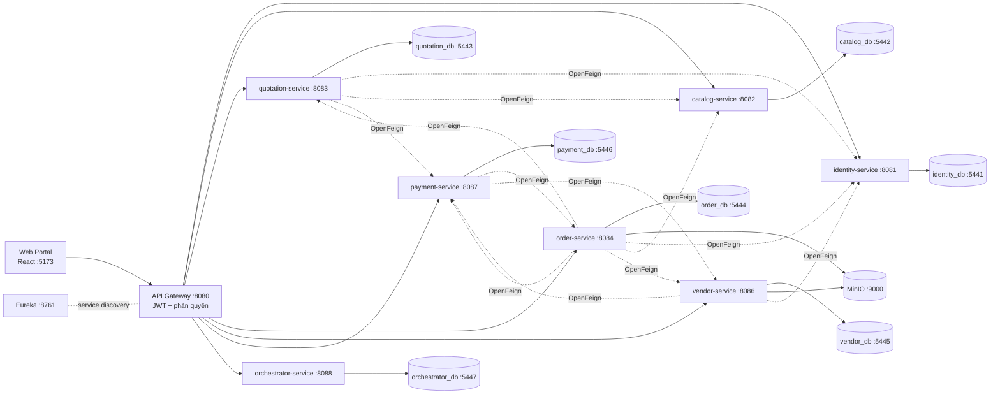

# Moonkage Platform

> Nền tảng B2B2C bánh trung thu: kết nối doanh nghiệp mua quà với các nhà bán bánh qua quy trình đấu thầu, đặt hàng và theo dõi sản xuất. Kiến trúc microservices.

[](https://github.com/LeTran30/MSS301-moonkage-platform-project/actions/workflows/code-quality.yml)
[](https://github.com/LeTran30/MSS301-moonkage-platform-project/actions/workflows/web-quality.yml)


[📚 Tài liệu](docs/README.md) · [📖 API Docs (Swagger, chạy local)](http://localhost:8080/swagger-ui.html) · [🐛 Báo lỗi](https://github.com/LeTran30/MSS301-moonkage-platform-project/issues)

## Mục lục
- [Tính năng](#tính-năng)
- [Tech Stack](#tech-stack)
- [Kiến trúc](#kiến-trúc)
- [Chạy nhanh](#chạy-nhanh)
- [Cấu trúc thư mục](#cấu-trúc-thư-mục)
- [Tài liệu](#tài-liệu)
- [CI/CD](#cicd)
- [Roadmap](#roadmap)
- [Đóng góp](#đóng-góp)
- [License](#license)

## Tính năng
Trạng thái đối chiếu với code và lần chạy E2E ngày 08/11/2026: 76/76 kịch bản của luồng 1–7 qua, gọi API thật qua gateway ([báo cáo](docs/work/reports/e2e-run-2026-11-08.md)).

**Tài khoản và bảo mật**
- ✅ Đăng ký có xác nhận OTP qua email, đăng nhập bằng email hoặc số điện thoại, refresh token, quên mật khẩu (JWT HS256)
- ✅ API Gateway kiểm JWT và phân quyền theo vai (`MEMBER`, `ADMIN`; làm chủ người bán không phải là một vai, D-19), chặn mọi đường dẫn `/internal/**`
- ✅ Sổ địa chỉ giao hàng
- ✅ Xác minh danh tính bằng chip CCCD qua NFC (F6): web mở phiên và hiện QR, app Moonkage Verify gửi dữ liệu thẻ đã mã hóa, khóa sau nhiều lần sai

**Mua hàng có sẵn (F1)**
- ✅ Khách chưa đăng nhập vẫn xem, tìm kiếm, lọc sản phẩm
- ✅ Giỏ hàng nhiều Shop, checkout, phí giao liên tỉnh, thanh toán VNPay
- ✅ Theo dõi đơn, xác nhận nhận hàng, đánh giá sản phẩm

**Đặt riêng theo báo giá (F2, F3)**
- ✅ Yêu cầu báo giá gửi nhiều xưởng, hoặc gửi riêng một Shop; Shop gửi báo giá hoặc từ chối kèm lý do
- ✅ So sánh báo giá, chấp nhận và đặt cọc qua VNPay, xin hóa đơn GTGT
- ✅ Duyệt maket theo phiên bản, cập nhật tiến độ sản xuất đến lúc giao
- ✅ Chat giữa người mua và Shop

**Người bán (F4, F7)**
- ✅ Đăng ký Shop: tải giấy tờ lên MinIO qua presigned URL, admin duyệt, đóng phí mở bán qua VNPay; số tài khoản ngân hàng mã hóa AES-256-GCM
- ✅ Quản lý sản phẩm: tạo, sửa, ẩn/hiện, bảng giá theo số lượng, tồn kho, ảnh upload thẳng lên MinIO

**Tiền và tranh chấp (F5)**
- ✅ Sổ tiền theo đơn: giữ tiền, giải ngân cho Shop, hoàn tiền
- ✅ Khiếu nại kèm bằng chứng, admin phân xử

**Quản trị và vận hành**
- ✅ Duyệt Shop, danh mục vỏ/nhân bánh, phí liên tỉnh, phí mở bán, đối soát, giải ngân
- ✅ Audit log toàn nền tảng qua RabbitMQ (transactional outbox), gửi email
- ✅ Swagger UI gộp tất cả service tại gateway
- ✅ Web portal: 64 màn hình theo IA (6 khu vực: base / auth / account / vendor / admin / system), tất cả nối API thật qua gateway

**Chưa xong**
- 🚧 Thông báo trong ứng dụng: trung tâm thông báo và kênh WebSocket đã có, nhưng chưa service nào phát sự kiện thông báo nên danh sách luôn trống
- 🚧 Voucher: mới có bảng dữ liệu ở order-service, chưa có API
- 🚧 Chưa có môi trường deploy, hệ thống chạy local bằng Docker Compose

## Tech Stack
| Tầng | Công nghệ |
|---|---|
| Frontend | React 19, TypeScript, Vite, FSD 2.0 (app → pages → widgets → features → entities → shared), CSS Modules + CSS Tokens, React Router, TanStack Query, Axios |
| Backend | Java 21, Spring Boot, Spring Cloud (Eureka, Gateway, OpenFeign), Spring Data JPA, Spring Security, springdoc-openapi |
| Database | PostgreSQL 17, mỗi service một database |
| Lưu trữ file | MinIO (S3-compatible) |
| DevOps | Docker Compose, GitHub Actions, Maven Wrapper |
| Chất lượng code | Spotless (palantir-java-format), Checkstyle, Error Prone, oxlint |

## Kiến trúc



**Service nghiệp vụ**: mỗi service một database riêng; gateway định tuyến theo aggregate root (D-30), ví dụ `/api/orders/**` vào order-service.

| Service | Phụ trách | Port | Database |
|---|---|---|---|
| **identity-service** | Tài khoản, hồ sơ người dùng, địa chỉ, xác minh NFC | `8081` | `identity_db` · `5441` |
| **catalog-service** | Bản đọc sản phẩm (chỉ đọc, dựng từ sự kiện của vendor), tìm kiếm, đánh giá, phí liên tỉnh | `8082` | `catalog_db` · `5442` |
| **quotation-service** | Yêu cầu báo giá, lời mời, báo giá | `8083` | `quotation_db` · `5443` |
| **order-service** | Giỏ hàng, checkout, đơn hàng, maket, tiến độ, hóa đơn, khiếu nại, đánh giá, chat | `8084` | `order_db` · `5444` |
| **vendor-service** | Hồ sơ người bán, duyệt, vùng giao, hồ sơ nhận đặt hàng, phí đăng ký; ghi sản phẩm, bậc giá, tồn kho | `8086` | `vendor_db` · `5445` |
| **payment-service** | Thanh toán VNPay, sổ tiền theo đơn, giải ngân, hoàn tiền | `8087` | `payment_db` · `5446` |
| **orchestrator-service** | Audit log toàn nền tảng (nhận qua RabbitMQ), gửi email, trung tâm thông báo và WebSocket | `8088` | `orchestrator_db` · `5447` |

**Hạ tầng & thành phần dùng chung**: không chứa nghiệp vụ, mọi service đều dựa vào.

| Thành phần | Công nghệ | Vai trò | Port |
|---|---|---|---|
| **API Gateway** | Spring Cloud Gateway | Cửa vào duy nhất: định tuyến, kiểm JWT, CORS, Swagger tổng | `8080` |
| **Discovery Server** | Spring Cloud Eureka | Service đăng ký và tìm nhau | `8761` |
| **RabbitMQ** | RabbitMQ 4 | Sự kiện giữa các service (outbox → orchestrator); UI quản trị | `5672`, `15672` |
| **PostgreSQL ×7** | PostgreSQL 17 | Mỗi service một DB; schema do Flyway quản lý | `5441`–`5447` |
| **MinIO** | S3-compatible | Lưu file: ảnh sản phẩm (public), file riêng tư; API / web console | `9000` / `9001` |
| **common-storage** | Thư viện Java | Không phải service: presigned upload/xem file MinIO cho service sở hữu file | – |
| **common-reference** | Thư viện Java | Không phải service: danh mục dùng chung, hiện có 34 tỉnh/thành (Quyết định 19/2025/QĐ-TTg) | – |
| **common-api** | Thư viện Java | Không phải service: vỏ câu trả lời HTTP và mã lỗi dùng chung | – |
| **common-outbox** | Thư viện Java | Không phải service: relay transactional outbox lên RabbitMQ | – |
| **common-observability** | Thư viện Java | Không phải service: tên metric dùng chung, che PII trong log | – |
| **Web Portal** | React SPA | Giao diện cho người mua, người bán, quản trị | `5173` |

Mọi request đi qua gateway theo đường dẫn của aggregate root, ví dụ `http://localhost:8080/api/auth/login`; Swagger của từng service ở `/<service>/v3/api-docs`. Khi chạy bằng Docker, các business service không mở port ra máy host. Đường dẫn `/internal/**` chỉ dùng cho các service gọi nhau, gateway luôn chặn.

## Chạy nhanh
```bash
cp .env.example .env          # điền JWT_SECRET; SEED_PASSWORD mặc định 12345678
docker compose up -d --build  # tạo bảng (Flyway) và nạp dữ liệu mẫu
cd web && npm install && npm run dev   # http://localhost:5173
```

Đăng nhập thử bằng `member1@mk.com` / `SEED_PASSWORD`. Chi tiết (chạy từ IDE, biến môi trường, tài khoản): [docs/guides/getting-started.md](docs/guides/getting-started.md).

## Cấu trúc thư mục
```
├── api/
│   ├── pom.xml                 # Parent POM (Java 21, Spotless, Checkstyle, Error Prone)
│   ├── mvnw, mvnw.cmd          # Maven wrapper
│   ├── config/                 # Luật Checkstyle, ArchUnit dùng chung
│   ├── common-storage/         # Thư viện presigned upload/xem file MinIO (không phải service)
│   ├── common-reference/       # Thư viện danh mục dùng chung: tỉnh/thành (không phải service)
│   ├── common-observability/   # Thư viện tên metric dùng chung, che PII trong log (không phải service)
│   ├── common-api/             # Thư viện vỏ câu trả lời HTTP và mã lỗi dùng chung (không phải service)
│   ├── common-outbox/          # Thư viện relay transactional outbox lên RabbitMQ (không phải service)
│   ├── discovery-server/       # Eureka Server
│   ├── api-gateway/            # Gateway, JWT, CORS, Swagger tổng
│   ├── identity-service/       # Tài khoản, hồ sơ người dùng, địa chỉ, xác minh NFC
│   ├── catalog-service/        # Bản đọc sản phẩm (chỉ đọc), tìm kiếm, đánh giá, phí liên tỉnh
│   ├── quotation-service/      # Yêu cầu báo giá, lời mời, báo giá
│   ├── order-service/          # Giỏ hàng, đơn hàng, maket, khiếu nại, đánh giá, voucher
│   ├── vendor-service/         # Hồ sơ người bán, duyệt, vùng giao, hồ sơ nhận đặt hàng, phí đăng ký; ghi sản phẩm, tồn kho
│   ├── payment-service/        # VNPay, giữ tiền, giải ngân, hoàn tiền
│   ├── orchestrator-service/   # Audit log (RabbitMQ), thông báo
│       (mỗi service có Dockerfile riêng, build context = api/;
│        schema ở src/main/resources/db/migration, dữ liệu mẫu ở db/seed)
├── web/                        # React SPA (web portal) — FSD 2.0, 64 màn hình IA
├── docs/                       # Toàn bộ tài liệu, mục lục ở docs/README.md
├── infra/
│   ├── minio/init.sh           # Tạo bucket, user, policy MinIO (container minio-init)
│   ├── otel/                   # Cấu hình OpenTelemetry Collector
│   └── dev/                    # Dữ liệu demo: demo_seed.py và ảnh mẫu
├── .githooks/pre-commit        # kiểm tra format/style trước mỗi commit
├── .github/workflows/          # CI: code quality, web quality, docs links, PR conventions
├── docker-compose.yml
└── .env.example
```

## Tài liệu
Mục lục đầy đủ: [docs/README.md](docs/README.md).

| Cần | Ở đâu |
|---|---|
| Requirement (FR, AC, BR) | [docs/product/requirements.md](docs/product/requirements.md) |
| Thiết kế hệ thống | [docs/architecture/software-design.md](docs/architecture/software-design.md) |
| Quy ước viết code | [docs/conventions/coding-rules.md](docs/conventions/coding-rules.md) |
| Schema, dữ liệu mẫu, tài khoản mẫu | [docs/guides/database.md](docs/guides/database.md) |
| API | Swagger UI http://localhost:8080/swagger-ui.html (gọi qua gateway `http://localhost:8080/api/...`) · tổng quan từng service trong [docs/services/](docs/services/) |
| Kiểm tra chất lượng code trước khi push | [CONTRIBUTING §4–5, §11](.github/CONTRIBUTING.md) |

## CI/CD
- Workflow [`code-quality.yml`](.github/workflows/code-quality.yml) chạy `./mvnw clean verify` trên JDK 21 cho mọi pull request và mỗi lần push lên `main`/`develop` có thay đổi trong `api`.
- Workflow [`web-quality.yml`](.github/workflows/web-quality.yml) chạy `npm ci`, `oxlint --deny-warnings`, kiểm tra CSS Modules + encoding UTF-8, `npm run build` (type-check + build), ngân sách bundle, `npm test`, ngưỡng coverage và E2E Playwright trên Node 24 cho mọi pull request và mỗi lần push lên `main`/`develop` có thay đổi trong `web/`.
- Workflow [`docs-links.yml`](.github/workflows/docs-links.yml) chạy lychee kiểm link tương đối trong mọi file Markdown khi có file `.md` thay đổi.
- Workflow [`pr-conventions.yml`](.github/workflows/pr-conventions.yml) kiểm hướng merge, tên branch và tiêu đề PR theo Conventional Commits (CONTRIBUTING §14–§17).

## Roadmap
- [x] Hạ tầng microservices: Eureka, Gateway, mỗi service một DB
- [x] Xác thực: đăng ký OTP, đăng nhập, refresh token, quên mật khẩu
- [x] Quản lý sản phẩm của shop, upload file MinIO
- [x] Tự động kiểm tra chất lượng code (T0–T1) và CI
- [x] Đăng ký và duyệt nhà bán, địa chỉ
- [x] Báo giá: yêu cầu báo giá, lời mời, báo giá, chấp nhận và đặt cọc
- [x] Giỏ hàng, đơn hàng, thanh toán VNPay, maket, theo dõi sản xuất
- [x] Khiếu nại, đối soát, giải ngân, hoàn tiền
- [x] Giao diện web portal (64 màn hình IA, 7 luồng F1–F7)
- [ ] Thông báo trong ứng dụng: các service phát sự kiện thông báo
- [ ] Voucher
- [ ] Triển khai lên môi trường cloud

## Đóng góp
Quy trình branch, commit, PR và review: [.github/CONTRIBUTING.md](.github/CONTRIBUTING.md). Trước khi push: `cd api && ./mvnw clean verify` (giống CI).

## License
Dự án học tập cho môn MSS301, Đại học FPT, Fall 2026. Phát hành theo giấy phép [MIT](LICENSE), © 2026 The Moonkage Team.
