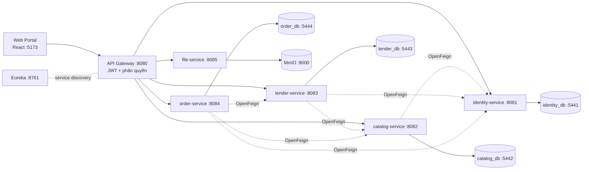

# MoonKage Platform

> Nền tảng B2B2C bánh trung thu: kết nối doanh nghiệp mua quà với các nhà bán bánh qua quy trình đấu thầu, đặt hàng và theo dõi sản xuất. Kiến trúc microservices.

[](https://github.com/LeTran30/MSS301-moonkage-platform-project/actions/workflows/code-quality.yml)
[](https://github.com/LeTran30/MSS301-moonkage-platform-project/actions/workflows/web-quality.yml)


[📖 API Docs (Swagger, chạy local)](http://localhost:8080/swagger-ui.html) · [🔐 Tài liệu xác thực](docs/auth.md) · [🐛 Báo lỗi](https://github.com/LeTran30/MSS301-moonkage-platform-project/issues)

## Mục lục
- [Tính năng](#tính-năng)
- [Tech Stack](#tech-stack)
- [Kiến trúc](#kiến-trúc)
- [Bắt đầu](#bắt-đầu)
- [Biến môi trường](#biến-môi-trường)
- [Cấu trúc thư mục](#cấu-trúc-thư-mục)
- [API](#api)
- [Testing & chất lượng code](#testing--chất-lượng-code)
- [CI/CD](#cicd)
- [Roadmap](#roadmap)
- [Đóng góp](#đóng-góp)
- [License](#license)

## Tính năng
- ✅ Đăng ký có xác nhận OTP qua email, đăng nhập bằng email hoặc số điện thoại, refresh token, quên mật khẩu (JWT HS256)
- ✅ API Gateway kiểm tra JWT và phân quyền theo role (`CUSTOMER`, `SELLER`, `ADMIN`)
- ✅ Khách chưa đăng nhập vẫn xem và tìm kiếm sản phẩm
- ✅ Shop quản lý sản phẩm: tạo, sửa, ẩn/hiện, xóa, bảng giá theo số lượng
- ✅ Upload file lên MinIO dùng chung cho mọi service, có presigned URL
- ✅ Swagger UI gộp tất cả service tại gateway
- 🚧 Địa chỉ, đăng ký nhà bán (vendor), khu vực giao hàng, đánh giá
- 🚧 Đấu thầu: yêu cầu báo giá, báo giá, mùa bán hàng
- 🚧 Giỏ hàng, đơn hàng, thanh toán ký quỹ, mockup, khiếu nại, voucher, đối soát, hoa hồng
- 🚧 Web portal (hiện mới có khung React)

## Tech Stack
| Tầng | Công nghệ |
|---|---|
| Frontend | React 19, TypeScript, Vite, TailwindCSS 4, React Router, Axios |
| Backend | Java 21, Spring Boot, Spring Cloud (Eureka, Gateway, OpenFeign), Spring Data JPA, Spring Security, springdoc-openapi |
| Database | PostgreSQL 17, mỗi service một database |
| Lưu trữ file | MinIO (S3-compatible) |
| DevOps | Docker Compose, GitHub Actions, Maven Wrapper |
| Chất lượng code | Spotless (palantir-java-format), Checkstyle, Error Prone, oxlint |

## Kiến trúc



| Thành phần | Công nghệ | Port |
|---|---|---|
| **Discovery Server** | Spring Cloud Eureka | `8761` |
| **API Gateway** | Spring Cloud Gateway | `8080` |
| **Identity Service** | Tài khoản, người dùng, địa chỉ, nhà bán | `8081` |
| **Catalog Service** | Sản phẩm, hồ sơ đặt hàng, khu vực giao hàng, đánh giá | `8082` |
| **Tender Service** | Yêu cầu báo giá, lời mời, báo giá, mùa bán hàng | `8083` |
| **Order Service** | Giỏ hàng, đơn hàng, thanh toán, ký quỹ, mockup, khiếu nại, voucher | `8084` |
| **File Service** | Upload file lên MinIO | `8085` |
| **Web Portal** | React SPA | `5173` |
| **PostgreSQL ×4** | Mỗi service một DB | `5441`–`5444` |
| **MinIO** | API / web console | `9000` / `9001` |

Mọi request đi qua gateway với prefix là tên service, ví dụ `http://localhost:8080/identity-service/api/auth/login`. Khi chạy bằng Docker, các business service không mở port ra máy host. Đường dẫn `/internal/**` chỉ dùng cho các service gọi nhau, gateway luôn chặn.

## Bắt đầu

### Yêu cầu
- JDK 21+ (không cần cài Maven, dùng wrapper `./mvnw`)
- Node.js 18+
- Docker & Docker Compose

### Cài đặt
```bash
git clone https://github.com/LeTran30/MSS301-moonkage-platform-project.git
cd MSS301-moonkage-platform-project
cp .env.example .env
openssl rand -base64 48               # dán vào JWT_SECRET, đặt thêm ADMIN_PASSWORD
git config core.hooksPath .githooks   # bật pre-commit kiểm tra format/style (mỗi lần clone)
```

Windows: nếu `git clone` báo `Filename too long`, chạy `git config --global core.longpaths true` rồi clone lại.

### Cách A: chạy toàn bộ backend bằng Docker
```bash
docker compose up -d --build
docker compose logs -f identity-service   # mã OTP được in ra đây khi MAIL_HOST để trống
```

- Gateway: http://localhost:8080
- Eureka: http://localhost:8761
- Swagger UI: http://localhost:8080/swagger-ui.html (chọn service ở góc trên bên phải)
- MinIO console: http://localhost:9001

### Cách B: database chạy Docker, service chạy từ IDE
```bash
docker compose up -d identity-db catalog-db tender-db order-db minio

cd api
./mvnw -pl discovery-server spring-boot:run   # chạy Eureka trước
./mvnw -pl api-gateway spring-boot:run        # các service còn lại, mỗi cái một terminal
./mvnw -pl identity-service spring-boot:run
./mvnw -pl catalog-service spring-boot:run
./mvnw -pl tender-service spring-boot:run
./mvnw -pl order-service spring-boot:run
./mvnw -pl file-service spring-boot:run
```

Trên Windows `cmd`/PowerShell dùng `mvnw.cmd` thay cho `./mvnw`. Mỗi service tự đọc file `.env` ở thư mục gốc.

### Frontend
```bash
cd web
npm install
npm run dev        # http://localhost:5173
```

### Tài khoản mặc định
Khi identity-service khởi động lần đầu, một tài khoản admin được tạo từ `ADMIN_EMAIL` / `ADMIN_PASSWORD` trong `.env` (mặc định `admin@moonkage.vn`). Tài khoản khác đăng ký qua `/api/auth/register`. Khi `MAIL_HOST` để trống, mã OTP nằm trong log của identity-service.

## Biến môi trường
Danh sách đầy đủ và giá trị mẫu: [`.env.example`](.env.example).

| Biến | Mô tả | Ví dụ |
|---|---|---|
| `DB_USERNAME`, `DB_PASSWORD` | Tài khoản PostgreSQL dùng chung cho 4 DB | `bake2b` / `bake2b_secret` |
| `*_DB_HOST`, `*_DB_PORT` | Địa chỉ DB của từng service (Docker tự ghi đè) | `localhost`, `5441` |
| `EUREKA_URL` | Địa chỉ Eureka | `http://localhost:8761/eureka/` |
| `JWT_SECRET` | Khóa HS256 dạng Base64, ≥ 32 byte. identity-service và gateway phải dùng **cùng** giá trị | `openssl rand -base64 48` |
| `JWT_EXPIRATION`, `JWT_REFRESH_EXPIRATION` | Hạn token (ms) | `43200000` (12h), `604800000` (7 ngày) |
| `OTP_EXPIRATION`, `OTP_MAX_ATTEMPTS` | Hạn và số lần nhập sai OTP | `5m`, `5` |
| `MAIL_HOST`, `MAIL_PORT`, `MAIL_USERNAME`, `MAIL_PASSWORD` | SMTP gửi OTP. Để trống `MAIL_HOST` khi dev | `smtp.gmail.com`, `587` |
| `ADMIN_EMAIL`, `ADMIN_PASSWORD` | Tài khoản admin tạo lúc khởi động | `admin@moonkage.vn` |
| `CORS_ORIGINS` | Origin frontend được phép gọi gateway (phân cách bằng dấu phẩy) | `http://localhost:5173` |
| `MINIO_ROOT_USER`, `MINIO_ROOT_PASSWORD` | Tài khoản MinIO | `minioadmin` |
| `MINIO_API_PORT`, `MINIO_CONSOLE_PORT`, `MINIO_BUCKET_NAME` | Port và bucket MinIO | `9000`, `9001`, `ecommerce` |

## Cấu trúc thư mục
```
├── api/
│   ├── pom.xml                 # Parent POM (Java 21, Spotless, Checkstyle, Error Prone)
│   ├── mvnw, mvnw.cmd          # Maven wrapper
│   ├── config/checkstyle/      # Luật Checkstyle
│   ├── docs/                   # Ghi chú kỹ thuật backend
│   ├── discovery-server/       # Eureka Server
│   ├── api-gateway/            # Gateway, JWT, CORS, Swagger tổng
│   ├── identity-service/       # Tài khoản, người dùng, địa chỉ, nhà bán
│   ├── catalog-service/        # Sản phẩm, hồ sơ đặt hàng, khu vực giao hàng, đánh giá
│   ├── tender-service/         # Yêu cầu báo giá, lời mời, báo giá, mùa bán hàng
│   ├── order-service/          # Giỏ hàng, đơn hàng, thanh toán, ký quỹ, khiếu nại, voucher
│   └── file-service/           # Upload file lên MinIO
│       (mỗi service có Dockerfile riêng, build context = api/)
├── web/                        # React SPA (web portal)
├── docs/                       # auth.md, ERD (PlantUML), Postman collection
├── .githooks/pre-commit        # kiểm tra format/style trước mỗi commit
├── .github/workflows/          # CI: Code quality (backend), Web quality (web)
├── docker-compose.yml
└── .env.example
```

## API
Gọi qua gateway `http://localhost:8080/<service>/...`. Một số endpoint chính:

| Method | Endpoint | Mô tả | Auth |
|---|---|---|---|
| POST | `/identity-service/api/auth/register` | Đăng ký, gửi OTP | ❌ |
| POST | `/identity-service/api/auth/verify` | Xác nhận OTP, kích hoạt tài khoản | ❌ |
| POST | `/identity-service/api/auth/login` | Đăng nhập (email hoặc số điện thoại) | ❌ |
| POST | `/identity-service/api/auth/refresh-token` | Lấy cặp token mới | ❌ |
| GET | `/identity-service/api/auth/me` | Thông tin tài khoản hiện tại | ✅ |
| POST | `/identity-service/api/auth/forgot-password/send-otp` | Gửi OTP quên mật khẩu | ❌ |
| POST | `/identity-service/api/auth/forgot-password/reset` | Đặt lại mật khẩu | ❌ |
| GET | `/catalog-service/api/products` | Tìm kiếm sản phẩm | ❌ |
| GET | `/catalog-service/api/products/{productId}` | Chi tiết sản phẩm | ❌ |
| POST | `/catalog-service/api/seller/products` | Shop tạo sản phẩm | ✅ `SELLER` |
| PUT | `/catalog-service/api/seller/products/{productId}` | Shop sửa sản phẩm | ✅ `SELLER` |
| PATCH | `/catalog-service/api/seller/products/{productId}/visibility` | Ẩn/hiện sản phẩm | ✅ `SELLER` |
| DELETE | `/catalog-service/api/seller/products/{productId}` | Xóa sản phẩm | ✅ `SELLER` |
| POST | `/file-service/api/files` | Upload file (multipart) | ✅ |
| GET | `/file-service/api/files/presigned` | Lấy presigned URL | ✅ |

- Tài liệu đầy đủ: [Swagger UI](http://localhost:8080/swagger-ui.html). Đăng nhập qua `/api/auth/login`, dán `token` vào nút **Authorize**.
- Chi tiết luồng xác thực, token, OTP và định dạng lỗi: [`docs/auth.md`](docs/auth.md).
- Postman: [`docs/MoonKage-Auth.postman_collection.json`](docs/MoonKage-Auth.postman_collection.json).

## Testing & chất lượng code
```bash
cd api
./mvnw spotless:apply   # tự format trước khi commit
./mvnw test             # chỉ chạy test
./mvnw clean verify     # format + Checkstyle + Error Prone + test, giống CI
```

```bash
cd web
npm run lint            # oxlint
npm run build           # type-check + build
```

Spotless, Checkstyle và Error Prone chạy trong mỗi lần build. Hook `pre-commit` kiểm tra trước khi commit. Chi tiết: [`api`](api/docs/t0-t1-automation.md).

## CI/CD
- Workflow [`code-quality.yml`](.github/workflows/code-quality.yml) chạy `./mvnw clean verify` trên JDK 21 cho mọi pull request và mỗi lần push lên `main`/`develop` có thay đổi trong `api`.
- Workflow [`web-quality.yml`](.github/workflows/web-quality.yml) chạy `npm ci`, `oxlint --deny-warnings` và `npm run build` (type-check + build) trên Node 24 cho mọi pull request và mỗi lần push lên `main`/`develop` có thay đổi trong `web/`.
- Chưa có môi trường deploy, hệ thống chạy local bằng Docker Compose.

## Roadmap
- [x] Hạ tầng microservices: Eureka, Gateway, mỗi service một DB
- [x] Xác thực: đăng ký OTP, đăng nhập, refresh token, quên mật khẩu
- [x] Quản lý sản phẩm của shop, upload file MinIO
- [x] Tự động kiểm tra chất lượng code (T0–T1) và CI
- [ ] Đăng ký và duyệt nhà bán, địa chỉ
- [ ] Đấu thầu: yêu cầu báo giá, lời mời, báo giá
- [ ] Giỏ hàng, đơn hàng, thanh toán ký quỹ, mockup, theo dõi sản xuất
- [ ] Khiếu nại, voucher, đối soát, hoa hồng
- [ ] Giao diện web portal

## Đóng góp
1. Tạo nhánh từ `develop`: `git checkout -b feature/ten-tinh-nang`
2. Chạy `./mvnw spotless:apply` và `./mvnw clean verify` trong `api` trước khi commit
3. Commit theo [Conventional Commits](https://www.conventionalcommits.org) (`feat:`, `fix:`, `chore:`, `docs:`...)
4. Mở Pull Request, CI phải pass trước khi merge

## License
Dự án học tập cho môn MSS301, Đại học FPT, Fall 2026. Phát hành theo giấy phép [MIT](LICENSE), © 2026 The Moonkage Team.
