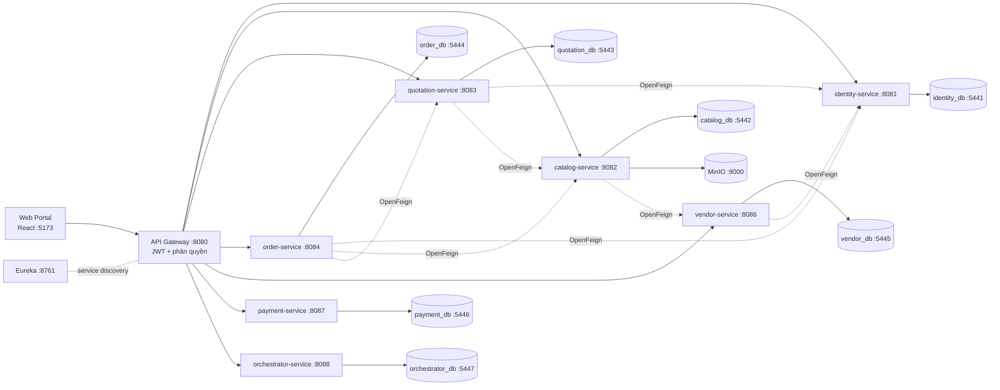

# Moonkage Platform

> Nền tảng B2B2C bánh trung thu: kết nối doanh nghiệp mua quà với các nhà bán bánh qua quy trình đấu thầu, đặt hàng và theo dõi sản xuất. Kiến trúc microservices.

[](https://github.com/LeTran30/MSS301-moonkage-platform-project/actions/workflows/code-quality.yml)
[](https://github.com/LeTran30/MSS301-moonkage-platform-project/actions/workflows/web-quality.yml)


[📚 Tài liệu](docs/README.md) · [📖 API Docs (Swagger, chạy local)](http://localhost:8080/swagger-ui.html) · [🐛 Báo lỗi](https://github.com/LeTran30/MSS301-moonkage-platform-project/issues)

## Mục lục
- [Tính năng](#tính-năng)
- [Tech Stack](#tech-stack)
- [Kiến trúc](#kiến-trúc)
- [Chạy nhanh](#chạy-nhanh)
- [Cấu trúc thư mục](#cấu-trúc-thư-mục)
- [Tài liệu](#tài-liệu)
- [CI/CD](#cicd)
- [Roadmap](#roadmap)
- [Đóng góp](#đóng-góp)
- [License](#license)

## Tính năng
- ✅ Đăng ký có xác nhận OTP qua email, đăng nhập bằng email hoặc số điện thoại, refresh token, quên mật khẩu (JWT HS256)
- ✅ API Gateway kiểm tra JWT và phân quyền theo vai (`MEMBER`, `ADMIN`; làm chủ người bán không phải là một vai, D-19)
- ✅ Khách chưa đăng nhập vẫn xem và tìm kiếm sản phẩm
- ✅ Shop quản lý sản phẩm: tạo, sửa, ẩn/hiện, xóa, bảng giá theo số lượng
- ✅ Ảnh sản phẩm upload thẳng lên MinIO qua presigned URL do catalog-service cấp (không có file-service)
- ✅ Swagger UI gộp tất cả service tại gateway
- 🚧 Địa chỉ, đăng ký nhà bán (vendor), khu vực giao hàng, đánh giá
- 🚧 Đấu thầu: yêu cầu báo giá, báo giá, mùa bán hàng
- 🚧 Giỏ hàng, đơn hàng, thanh toán ký quỹ, mockup, khiếu nại, voucher, đối soát, hoa hồng
- 🚧 Web portal (hiện mới có khung React)

## Tech Stack
| Tầng | Công nghệ |
|---|---|
| Frontend | React 19, TypeScript, Vite, TailwindCSS 4, React Router, Axios |
| Backend | Java 21, Spring Boot, Spring Cloud (Eureka, Gateway, OpenFeign), Spring Data JPA, Spring Security, springdoc-openapi |
| Database | PostgreSQL 17, mỗi service một database |
| Lưu trữ file | MinIO (S3-compatible) |
| DevOps | Docker Compose, GitHub Actions, Maven Wrapper |
| Chất lượng code | Spotless (palantir-java-format), Checkstyle, Error Prone, oxlint |

## Kiến trúc



**Service nghiệp vụ**: mỗi service một database riêng, gọi qua gateway với prefix là tên service.

| Service | Phụ trách | Port | Database |
|---|---|---|---|
| **identity-service** | Tài khoản, hồ sơ người dùng, địa chỉ, xác minh NFC | `8081` | `identity_db` · `5441` |
| **catalog-service** | Sản phẩm, bậc giá, tồn kho | `8082` | `catalog_db` · `5442` |
| **quotation-service** | Yêu cầu báo giá, lời mời, báo giá | `8083` | `quotation_db` · `5443` |
| **order-service** | Giỏ hàng, đơn hàng, maket, tiến độ, khiếu nại, đánh giá, voucher | `8084` | `order_db` · `5444` |
| **vendor-service** | Hồ sơ người bán, duyệt, vùng giao, hồ sơ nhận đặt hàng, phí đăng ký | `8086` | `vendor_db` · `5445` |
| **payment-service** | Thanh toán VNPay, sổ giữ tiền, giải ngân cọc, hoàn tiền (chưa có nghiệp vụ) | `8087` | `payment_db` · `5446` |
| **orchestrator-service** | Audit log toàn nền tảng (nhận qua RabbitMQ), thông báo trong ứng dụng, gửi email | `8088` | `orchestrator_db` · `5447` |

**Hạ tầng & thành phần dùng chung**: không chứa nghiệp vụ, mọi service đều dựa vào.

| Thành phần | Công nghệ | Vai trò | Port |
|---|---|---|---|
| **API Gateway** | Spring Cloud Gateway | Cửa vào duy nhất: định tuyến, kiểm JWT, CORS, Swagger tổng | `8080` |
| **Discovery Server** | Spring Cloud Eureka | Service đăng ký và tìm nhau | `8761` |
| **RabbitMQ** | RabbitMQ 4 | Sự kiện giữa các service (outbox → orchestrator); UI quản trị | `5672`, `15672` |
| **PostgreSQL ×7** | PostgreSQL 17 | Mỗi service một DB; schema do Flyway quản lý | `5441`–`5447` |
| **MinIO** | S3-compatible | Lưu file: ảnh sản phẩm (public), file riêng tư; API / web console | `9000` / `9001` |
| **common-storage** | Thư viện Java | Không phải service: presigned upload/xem file MinIO cho service sở hữu file | – |
| **common-reference** | Thư viện Java | Không phải service: danh mục dùng chung, hiện có 34 tỉnh/thành (Quyết định 19/2025/QĐ-TTg) | – |
| **Web Portal** | React SPA | Giao diện cho người mua, người bán, quản trị | `5173` |

Mọi request đi qua gateway với prefix là tên service, ví dụ `http://localhost:8080/identity-service/api/auth/login`. Khi chạy bằng Docker, các business service không mở port ra máy host. Đường dẫn `/internal/**` chỉ dùng cho các service gọi nhau, gateway luôn chặn.

## Chạy nhanh
```bash
cp .env.example .env          # điền JWT_SECRET, ADMIN_PASSWORD, SEED_PASSWORD
docker compose up -d --build  # tạo bảng (Flyway) và nạp dữ liệu mẫu
cd web && npm install && npm run dev   # http://localhost:5173
```

Đăng nhập thử bằng `member1@mk.com` / `SEED_PASSWORD`. Chi tiết (chạy từ IDE, biến môi trường, tài khoản): [docs/guides/getting-started.md](docs/guides/getting-started.md).

## Cấu trúc thư mục
```
├── api/
│   ├── pom.xml                 # Parent POM (Java 21, Spotless, Checkstyle, Error Prone)
│   ├── mvnw, mvnw.cmd          # Maven wrapper
│   ├── config/                 # Luật Checkstyle, ArchUnit dùng chung
│   ├── common-storage/         # Thư viện presigned upload/xem file MinIO (không phải service)
│   ├── common-reference/       # Thư viện danh mục dùng chung: tỉnh/thành (không phải service)
│   ├── discovery-server/       # Eureka Server
│   ├── api-gateway/            # Gateway, JWT, CORS, Swagger tổng
│   ├── identity-service/       # Tài khoản, hồ sơ người dùng, địa chỉ, xác minh NFC
│   ├── catalog-service/        # Sản phẩm, bậc giá, tồn kho
│   ├── quotation-service/      # Yêu cầu báo giá, lời mời, báo giá
│   ├── order-service/          # Giỏ hàng, đơn hàng, maket, khiếu nại, đánh giá, voucher
│   ├── vendor-service/         # Hồ sơ người bán, duyệt, vùng giao, hồ sơ nhận đặt hàng, phí đăng ký
│   ├── payment-service/        # VNPay, giữ tiền, giải ngân, hoàn tiền
│   ├── orchestrator-service/   # Audit log (RabbitMQ), thông báo
│       (mỗi service có Dockerfile riêng, build context = api/;
│        schema ở src/main/resources/db/migration, dữ liệu mẫu ở db/seed)
├── web/                        # React SPA (web portal)
├── docs/                       # Toàn bộ tài liệu, mục lục ở docs/README.md
├── infra/minio/init.sh         # Tạo bucket, user, policy MinIO (container minio-init)
├── .githooks/pre-commit        # kiểm tra format/style trước mỗi commit
├── .github/workflows/          # CI: Code quality (backend), Web quality (web)
├── docker-compose.yml
└── .env.example
```

## Tài liệu
Mục lục đầy đủ: [docs/README.md](docs/README.md).

| Cần | Ở đâu |
|---|---|
| Requirement (FR, AC, BR) | [docs/product/requirements.md](docs/product/requirements.md) |
| Thiết kế hệ thống | [docs/architecture/software-design.md](docs/architecture/software-design.md) |
| Quy ước viết code | [docs/conventions/coding-rules.md](docs/conventions/coding-rules.md) |
| Schema, dữ liệu mẫu, tài khoản mẫu | [docs/guides/database.md](docs/guides/database.md) |
| API | Swagger UI http://localhost:8080/swagger-ui.html (gọi qua gateway `http://localhost:8080/<service>/...`) · tổng quan từng service trong [docs/services/](docs/services/) |
| Kiểm tra chất lượng code trước khi push | [CONTRIBUTING §4–5, §11](.github/CONTRIBUTING.md) |

## CI/CD
- Workflow [`code-quality.yml`](.github/workflows/code-quality.yml) chạy `./mvnw clean verify` trên JDK 21 cho mọi pull request và mỗi lần push lên `main`/`develop` có thay đổi trong `api`.
- Workflow [`web-quality.yml`](.github/workflows/web-quality.yml) chạy `npm ci`, `oxlint --deny-warnings` và `npm run build` (type-check + build) trên Node 24 cho mọi pull request và mỗi lần push lên `main`/`develop` có thay đổi trong `web/`.
- Chưa có môi trường deploy, hệ thống chạy local bằng Docker Compose.

## Roadmap
- [x] Hạ tầng microservices: Eureka, Gateway, mỗi service một DB
- [x] Xác thực: đăng ký OTP, đăng nhập, refresh token, quên mật khẩu
- [x] Quản lý sản phẩm của shop, upload file MinIO
- [x] Tự động kiểm tra chất lượng code (T0–T1) và CI
- [ ] Đăng ký và duyệt nhà bán, địa chỉ
- [ ] Đấu thầu: yêu cầu báo giá, lời mời, báo giá
- [ ] Giỏ hàng, đơn hàng, thanh toán ký quỹ, mockup, theo dõi sản xuất
- [ ] Khiếu nại, voucher, đối soát, hoa hồng
- [ ] Giao diện web portal

## Đóng góp
Quy trình branch, commit, PR và review: [.github/CONTRIBUTING.md](.github/CONTRIBUTING.md). Trước khi push: `cd api && ./mvnw clean verify` (giống CI).

## License
Dự án học tập cho môn MSS301, Đại học FPT, Fall 2026. Phát hành theo giấy phép [MIT](LICENSE), © 2026 The Moonkage Team.
