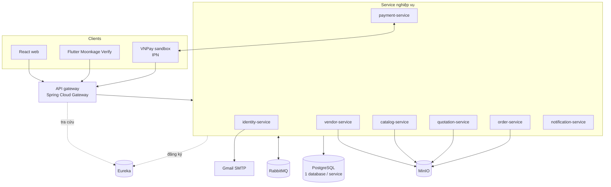

# SOFTWARE DESIGN: Moonkage – Marketplace quà Trung thu

> **Hướng dẫn cho AI đọc tài liệu này**
> - Tài liệu này mô tả **cách xây** hệ thống. **Xây gì** nằm ở `Moonkage Requirement Final.md` (nguồn sự thật, v1.6). Chuỗi tài liệu: Context → User Stories → Requirement → Design. Design chỉ hiện thực hóa Requirement; không thêm nghiệp vụ, trạng thái nghiệp vụ hay quy tắc mới. Khi hai tài liệu khác nhau, theo Requirement và báo lại điểm khác.
> - Mọi quyết định thiết kế tham chiếu mã của Requirement v1.6 (FR-xx, AC-xx.y, NFR-xx, BR-xx, A-xx, Q-xx). Mã FR, AC đánh số theo v1.5; bảng đổi số với mã cũ ở Requirement mục 14.
> - Mục ghi **Đề xuất** là phương án của tài liệu này, chưa phải quyết định của nhóm. Mục ghi **Đã chốt** thì không tự đổi.
> - Bảng hay bản ghi chỉ phục vụ kỹ thuật (outbox, bản sao, phiên checkout) được đánh dấu **kỹ thuật**: chúng không có trạng thái nghiệp vụ riêng và không thay thực thể của Requirement mục 7.1.
> - Gặp điểm thiết kế chưa có ở đây: dừng lại và hỏi, không tự thêm service, bảng dữ liệu hay sự kiện mới.
> - App mobile: kế hoạch chi tiết ở `Flutter_App_Plan`.

---

## 0. Thông tin tài liệu

| Mục | Giá trị |
|---|---|
| Phiên bản | v0.6 |
| Ngày cập nhật | 2026-10-17 |
| Dựa trên | Requirement v1.6 |
| Người viết | |
| Người phê duyệt | |
| Trạng thái | Draft |

---

## 1. Mục đích và phạm vi

Tài liệu mô tả kiến trúc microservices của Moonkage: tech stack, cách chia service, dữ liệu mỗi service sở hữu, cách các service giao tiếp, các luồng nghiệp vụ chạy qua nhiều service, bảo mật và môi trường chạy.

Phạm vi thiết kế bám theo **Phạm vi demo** (Requirement mục 4.3). Các FR bị hoãn (FR-13, FR-18, FR-23, FR-37, FR-50) vẫn được gán service để làm tiếp sau, nhưng không có API hay sự kiện chi tiết trong bản này.

---

## 2. Tech stack

### 2.1 Ràng buộc của môn học (Đã chốt)

Dự án môn Microservices (FPT University) bắt buộc:
- Kiến trúc **microservices**.
- Backend **Java Spring Boot**.
- Đóng gói và chạy bằng **Docker**.

### 2.2 Bảng tech stack

| Lớp                                | Công nghệ                                                                                                         | Trạng thái                              | Ghi chú                                                                           |
| ---------------------------------- | ----------------------------------------------------------------------------------------------------------------- | --------------------------------------- | --------------------------------------------------------------------------------- |
| Web frontend                       | React                                                                                                             | Đã chốt (Requirement mục 9)             | Khách, người mua, chủ người bán, quản trị; responsive từ 360px (NFR-04)           |
| App mobile                         | Flutter (Moonkage Verify)                                                                                         | Đã chốt (Requirement mục 9)             | Chỉ FR-04. Chỉ làm Android                                                        |
| Thư viện NFC                       | `nfc_manager`                                                                                                     | Gợi ý (Q-07)                            | Chỉ đọc NDEF Text record trên NTAG215                                             |
| Thẻ NFC mô phỏng                   | Người dùng tự có, ngoài hệ thống                                                                                  | Đã chốt (Requirement A-08)              | Hệ thống không cấp thẻ. Demo dùng thẻ mẫu ghi sẵn bằng công cụ ghi NFC bên ngoài  |
| Backend                            | Spring Boot                                                                                                       | Đã chốt                                 | Mọi kiểm tra nghiệp vụ làm ở backend                                              |
| Cơ sở dữ liệu                      | PostgreSQL                                                                                                        | Đã chốt (Requirement mục 9)             | Đề xuất: một database cho mỗi service                                             |
| API gateway                        | Spring Cloud Gateway                                                                                              | Đề xuất                                 |                                                                                   |
| Service discovery                  | Eureka (Spring Cloud Netflix)                                                                                     | Đề xuất                                 | Phương án thay: Consul                                                            |
| Message broker                     | RabbitMQ (Spring AMQP)                                                                                            | Đề xuất                                 | Kafka nặng hơn mức cần                                                            |
| Object storage                     | MinIO (API S3)                                                                                                    | Đề xuất                                 | Chuyển sang S3 không đổi code                                                     |
| Cổng thanh toán                    | VNPay sandbox                                                                                                     | Đã chốt (A-11)                          | IPN, API hoàn tiền                                                                |
| Gửi email                          | Spring Boot Mail + Gmail SMTP                                                                                     | Đã chốt (A-17)                          | Mã xác nhận tài khoản và đặt lại mật khẩu; mật khẩu ứng dụng Gmail                |
| Chạy hệ thống                      | Docker Compose                                                                                                    | Đã chốt                                 | Môi trường triển khai cuối: còn mở (Q-07)                                         |
| Quy ước API                        | REST JSON, đường dẫn `/api/<tài-nguyên>` theo tài nguyên, không tên service, không số phiên bản; JSON `camelCase` | Đã chốt (D-18)                          | Mục 5.1                                                                           |
| Hash mật khẩu                      | bcrypt                                                                                                            | Đề xuất (NFR-03 cho phép bcrypt/argon2) | Spring Security `BCryptPasswordEncoder`                                           |
| Mã hóa dữ liệu xác minh khi truyền | JWE compact (`RSA-OAEP-256` + `A256GCM`), khóa công khai của identity cấu hình sẵn trong app                      | Đã chốt (D-17)                          | AC-04.10. Chỉ bọc số định danh, ngày sinh, nơi thường trú                         |
| Mã hóa dữ liệu xác minh khi lưu    | AES-256-GCM, khóa có phiên bản, chỉ ở identity-service                                                            | Đã chốt (D-17)                          | AC-04.11: số định danh, ngày sinh                                                 |
| Xác thực                           | JWT HS256 theo backend hiện có (`docs/auth.md`); hai vai `MEMBER`, `ADMIN`                                        | Vai: đã chốt; HS256: đề xuất (D-19)     | App mobile dùng chung endpoint đăng nhập                                          |
| Băm số CCCD / số định danh         | HMAC-SHA256 với khóa bí mật (pepper) có phiên bản                                                                 | Đã chốt (D-07, D-08)                    | Pepper chỉ nằm ở identity-service; mỗi mã băm lưu kèm phiên bản khóa (mục 4.2, 8) |
| Phần cứng demo                     | Thẻ NFC NTAG215                                                                                                   | Đã chốt (A-08)                          |                                                                                   |

Requirement v1.5 không còn quy định cách chia service và hạ tầng; các lựa chọn đó là quyết định của tài liệu này.

### 2.3 Còn mở

- Môi trường triển khai cuối: chỉ Docker Compose trên máy hay đưa lên cloud (Q-07).
- Phiên bản Android/iOS tối thiểu và thư viện NFC chính thức (Q-07; đề xuất `minSdk 26`, `nfc_manager`).
- Có dùng Spring Cloud Config Server để quản lý cấu hình tập trung hay không. Bản này dùng biến môi trường trong Docker Compose.

---

## 3. Kiến trúc tổng thể



**Nguyên tắc chia service**
1. Mỗi service sở hữu trọn một nhóm thực thể (Requirement 7.1). Service khác không đọc thẳng database của nó.
2. Quy tắc nào cần một transaction thì các thực thể liên quan nằm cùng service. Ví dụ NFR-09 buộc Payment, Escrow/Ledger, DisbursementRequest nằm chung.
3. Không chia mịn hơn khi các phần luôn thay đổi cùng nhau (giỏ, đơn, maket, tiến độ, khiếu nại đều xoay quanh Order).
4. Không có admin-service. Quản trị là một vai; mỗi service tự có endpoint quản trị cho dữ liệu nó sở hữu.
5. Không có file-service. Service sở hữu file tự cấp presigned URL MinIO.
6. Không tạo thực thể nghiệp vụ trước khi Requirement cho phép tạo. Ví dụ Order chỉ được tạo sau khi thanh toán thành công (FR-09, FR-19); trạng thái chờ thanh toán nằm ở bản ghi kỹ thuật (D-10, D-11).

---

## 4. Danh sách service

### 4.1 Tổng quan

| Service | Sở hữu thực thể | FR | Database |
|---|---|---|---|
| identity-service | Account (lưu thành `accounts`, `user_profiles`, `legal_profiles`, D-21), Address, NfcSession; khóa băm số CCCD (pepper) | FR-01, 02, 03, 04; so số định danh cho FR-26 (BR-27); gửi email xác nhận và đặt lại mật khẩu (A-17) | `identity_db` |
| vendor-service | Vendor (gồm thông tin người đại diện, owner_check, onboarding_meeting, phí giao nội thành, phí đăng ký mở bán), OrderProfile, RegistrationFeeConfig | FR-26, 27, 28, 35, 45, 53; BR-26, BR-27, BR-31; khóa người bán (FR-46) | `vendor_db` |
| catalog-service | Product, StockReservation, bậc giá, InterprovinceFee | FR-05, 06, 07, 29, 30, 31, 33, 34, 52; giữ tồn kho (BR-28); tính phí giao (BR-30); gỡ sản phẩm (FR-46) | `catalog_db` |
| quotation-service | Request, Quote | FR-14, 15, 16, 17, 36, 38; phía báo giá của FR-19; hoãn: FR-18, 23, 37 | `quotation_db` |
| order-service | Order, MockupVersion, ProgressUpdate, Review, Dispute; giỏ hàng | FR-08, 10, 11, 12, 20, 21, 24, 25, 32, 39, 40, 42, 44; quyết định khiếu nại (FR-49) | `order_db` |
| payment-service | Payment, Escrow/Ledger, DisbursementRequest | FR-09 và FR-19 (phần thanh toán), 22, 41, 43, 47, 48, 51; thanh toán phí đăng ký mở bán (BR-31); thực hiện hoàn tiền (FR-49); hoãn: FR-13, 50 | `payment_db` |
| notification-service | Notification, AuditLog | NFR-07, NFR-10 | `notification_db` |

Hạ tầng: `api-gateway`, `discovery-server` (Eureka), `postgres`, `rabbitmq`, `minio`.

**Bản sao người bán** (`vendor_snapshot`, kỹ thuật) ở catalog, quotation và order được cập nhật từ sự kiện `vendor.updated` (mục 5.4). Trường `can_operate` trên bản sao là kết quả tính sẵn của BR-31 và BR-20: `status = đã duyệt` và đã đóng phí đăng ký mở bán.

### 4.2 identity-service

**Trách nhiệm**
- Đăng ký, xác nhận, đăng nhập, khôi phục (FR-01, FR-02). Phát JWT.
- Gửi email mã xác nhận và liên kết đặt lại mật khẩu qua Gmail SMTP bằng `JavaMailSender` (A-17). Demo chỉ đăng ký bằng email.
- Địa chỉ giao hàng (FR-03).
- Xác minh NFC (FR-04): tạo phiên gắn với tài khoản; nhận thẻ từ app đã đăng nhập (JWT) qua một endpoint duy nhất, sau khi người dùng đã xác nhận trên điện thoại (D-20). Kiểm theo thứ tự: phiên tồn tại và còn hạn; phiên thuộc tài khoản trong JWT; phiên chưa dùng; tài khoản không bị tạm khóa; giải mã `encryptedFields`; định dạng 9 trường theo A-08; CCCD còn hạn (AC-04.8); số định danh chưa gắn tài khoản khác. Đếm lần thử và tạm khóa (demo: 5 lần, 15 phút; phiên QR 5 phút). Thành công thì ghi `legal_name`, `sex`, `nationality`, `id_number_hash`, `id_hash_key_ver`, `id_number_masked`, `id_number_enc`, `date_of_birth_enc`, `pii_key_ver`, `nfc_verified_at` và chuyển `nfc_status` sang đã xác minh. Nơi sinh, nơi thường trú, ngày cấp, ngày hết hạn bị bỏ ngay sau khi kiểm (AC-04.11). **Không** kiểm chữ ký hay UID (A-08). Thẻ do người dùng tự có; hệ thống không cấp thẻ.
- **Giữ khóa mã hóa (D-17):** khóa riêng để giải mã JWE app gửi lên, và khóa AES để mã hóa số định danh, ngày sinh khi lưu. Cả hai có phiên bản và chỉ nằm ở identity-service.
- **Giữ khóa băm (pepper) và là nơi duy nhất băm số CCCD / số định danh** (NFR-03). Cung cấp cho vendor-service phép so số định danh khai ở hồ sơ người bán với CCCD đã xác minh của chủ tài khoản (AC-26.6, AC-26.8), mà không để pepper rời identity-service.

**Dữ liệu:** theo Requirement 7.1 (Account, NfcSession, Address). Chỉ lưu dữ liệu tối thiểu theo AC-04.11; không lưu nội dung thô của thẻ. `id_number_enc`, `date_of_birth_enc` = AES-256-GCM(khóa lưu[k], giá trị), lưu kèm `pii_key_ver = k`. `id_number_hash = HMAC-SHA256(pepper[v], số CCCD đã chuẩn hóa 12 chữ số)`, lưu kèm `id_hash_key_ver = v`.

**Kiểm nội dung thẻ (A-08):** đủ 9 trường, đều là chuỗi; `idNumber` đúng 12 chữ số; `fullName` in hoa, không dấu, các từ cách nhau một khoảng trắng; `sex` thuộc `MALE` / `FEMALE` (app đổi từ `Nam`, `Nu`, `Nữ`); ngày dạng `yyyy-MM-dd` và tồn tại thật; ngày cấp sau ngày sinh, ngày hết hạn sau ngày cấp. Máy chủ kiểm lại toàn bộ, không tin kết quả kiểm ở app.

**Pepper có phiên bản (D-08, đã chốt).** identity-service nạp tập khóa `{v → pepper}` và một phiên bản hiện hành từ biến môi trường (mục 9). Không service nào khác giữ pepper (D-07).
- **Băm mới** (xác minh NFC, nộp hồ sơ người bán) luôn dùng phiên bản hiện hành.
- **So khớp với một bản ghi** dùng đúng phiên bản ghi trên bản ghi đó.
- **Kiểm trùng CCCD** (AC-04.6) băm số theo mọi phiên bản còn nạp và tìm trong `(id_number_hash, id_hash_key_ver)`; ràng buộc duy nhất đặt trên cặp này.
- **Đổi khóa:** thêm phiên bản mới, chuyển phiên bản hiện hành; với tài khoản, một tác vụ nền giải mã `id_number_enc` và băm lại bằng phiên bản mới (NFR-03); với số định danh ở hồ sơ người bán, băm lại khi chủ nộp lại hồ sơ. Phiên bản cũ chỉ bị gỡ khi không còn bản ghi nào dùng. Trong phạm vi dự án chỉ có phiên bản 1; cơ chế đổi khóa không cần giao diện, chỉ cần cấu hình.

**API công khai (qua gateway):** xem mục 5.1.

**API nội bộ cung cấp:**
- `GET /internal/accounts/{accountId}/nfc-status` → `{nfcStatus, legalName, idNumberMasked, nfcVerifiedAt}`. Dùng cho BR-23 và hiển thị kết quả NFC của chủ ở FR-45 (AC-45.1).
- `POST /internal/id-numbers/check` với body `{accountId, idNumber}` → `{idHash, idHashKeyVer, idMasked, matchesAccount, ownerLegalName, ownerIdMasked, nfcVerifiedAt}`. Chuẩn hóa số (chỉ giữ chữ số, đúng 12 chữ số, nếu sai trả lỗi định dạng). `idHash` băm bằng phiên bản hiện hành để vendor lưu; `matchesAccount` so bằng phiên bản ghi trên tài khoản. Số đầy đủ chỉ tồn tại trong bộ nhớ khi xử lý, không ghi log, không lưu (NFR-03).

### 4.3 vendor-service

**Trách nhiệm**
- Khai, nộp lại hồ sơ người bán (FR-26, FR-27); kiểm BR-23 bằng cách gọi identity. Form khai hồ sơ báo mức phí đăng ký hiện hành (AC-26.9).
- **Xác minh theo tư cách pháp nhân (BR-26, BR-27):**
  - Khi nộp hoặc nộp lại, gọi `POST /internal/id-numbers/check` với số định danh người đại diện / chủ vừa khai. Lưu `idHash`, `idHashKeyVer`, `idMasked` của kết quả vào `representative_id_hash`, `representative_id_key_ver`, `representative_id_masked`; **không** lưu số đầy đủ, **không** tự băm (vendor không có pepper).
  - `entity_type` là hộ kinh doanh hoặc doanh nghiệp tư nhân và `matchesAccount = false` → từ chối nộp, trả lỗi nghiệp vụ (AC-26.6). Kiểm ở máy chủ, không phụ thuộc giao diện.
  - `entity_type` là công ty → cho nộp dù không trùng (AC-26.7).
  - So họ tên khai báo với `ownerLegalName` theo A-15 bằng một hàm thuần, không I/O (mục 4.3.1).
  - Ghi `owner_check` (bất biến cho mỗi lần nộp) trong cùng transaction với hồ sơ (AC-26.8).
- Quản trị duyệt / yêu cầu bổ sung / từ chối (FR-45):
  - Hiện kết quả NFC của chủ, thông tin người đại diện đã che, kết quả `owner_check` và cảnh báo (AC-45.1, AC-45.4).
  - Nút duyệt yêu cầu các xác nhận đối chiếu của quản trị (AC-45.5).
  - Với công ty, chặn duyệt khi chưa có `onboarding_meeting` đủ trường (AC-45.6). Kiểm ở máy chủ khi nhận lệnh duyệt.
- Ghi nhận buổi làm việc trực tiếp với công ty (BR-26): quản trị nhập ngày, họ tên người đại diện đã làm việc, ô xác nhận đã tra cứu cổng quốc gia, và tải file thỏa thuận.
- **Phí đăng ký mở bán (BR-31, FR-27, FR-53):**
  - Giữ `RegistrationFeeConfig` (mức hiện hành, mặc định 200.000đ). Quản trị đổi mức qua endpoint quản trị; mỗi lần đổi phát `registration_fee.changed` để audit (NFR-07).
  - Sau khi duyệt, chủ bấm đóng phí: vendor đọc mức hiện hành, gọi `POST /internal/payments` với `purpose = REGISTRATION_FEE`, `vendorId`, `amount` (AC-53.3). Giao dịch đã tạo giữ mức đó, kể cả khi quản trị đổi mức sau (trường hợp đặc biệt của FR-53).
  - Nhận `payment.succeeded` có `purpose = REGISTRATION_FEE` → ghi `registration_fee_payment_id`, `registration_fee_amount`, `registration_fee_paid_at`, tính lại `can_operate` và phát `vendor.updated` (AC-27.5). Xử lý lặp lại an toàn: đã có `registration_fee_paid_at` thì bỏ qua, không ghi lần hai.
  - Quản trị tải file hóa đơn phí đăng ký lên hồ sơ (giá trị tạm Q-36); chủ tải về (AC-27.6).
- Vùng giao và phí giao nội thành (FR-28), hồ sơ nhận đặt hàng (FR-35).
- Khóa người bán (FR-46, BR-20).

**Tên trường:** tên đơn vị là `business_name`, dùng thống nhất từ bảng database, entity, DTO đến giao diện. Không dùng `legal_name` ở vendor-service; tên đó chỉ thuộc về `Account` ở identity (họ tên người).

**File:** giấy chứng nhận đăng ký, giấy tờ an toàn thực phẩm, file thỏa thuận hợp tác và hóa đơn phí đăng ký lưu ở bucket MinIO riêng tư `vendor-docs`; chỉ chủ và quản trị được cấp URL (NFR-03).

**Phát sự kiện `vendor.updated`** mỗi khi dữ liệu dưới đây đổi. Đây là nguồn cho bản sao ở catalog, quotation, order:
`vendor_id, owner_account_id, business_name, status, can_operate, sells_shop, accepts_orders, supply_source, delivery_areas, local_delivery_fee, order_profile {min_qty, ref_price_tiers, lead_time_days, custom_capabilities, early_bird_offer, weekly_capacity, cake_types, packaging_types, logo_printing, distributed_brands, gatherable_qty}`.
Thông tin người đại diện, `owner_check`, `onboarding_meeting`, tài khoản ngân hàng và giấy tờ **không** nằm trong sự kiện này; service khác không cần chúng.

#### 4.3.1 Hàm so họ tên (A-15)

```
normalize(s)   = NFC(s) → trim → gộp khoảng trắng liên tiếp → viết hoa
strip_marks(s) = bỏ dấu thanh và dấu phụ (NFD rồi bỏ ký tự kết hợp), đổi Đ/đ → D

compare(a, b):
  if strip_marks(normalize(a)) == strip_marks(normalize(b)) → KHOP
  else                                                      → KHONG_KHOP
```

Hai mức theo A-15 (v1.6): form hồ sơ người bán bắt nhập họ tên không dấu (từ chối ký tự có dấu ở máy chủ), họ tên trên thẻ cũng in hoa không dấu; vẫn bỏ dấu hai phía để phòng dữ liệu cũ. Không dùng so gần đúng (khoảng cách ký tự, đảo thứ tự từ). Unit test tối thiểu: khác hoa thường, thừa khoảng trắng, "Đ" so với "D", tên hoàn toàn khác, chuỗi rỗng; form từ chối họ tên có dấu.

### 4.4 catalog-service

**Trách nhiệm**
- Đăng, sửa, ẩn/hiện sản phẩm (FR-29, 30, 31, 33, 34); sản phẩm hiển thị ngay (BR-24). Không có thao tác xóa (AC-34.6).
- Tìm, lọc, sắp xếp, chi tiết sản phẩm theo vùng giao (FR-05 → FR-07); kết quả tìm kiếm hiện ảnh, giá, thương hiệu và tên Shop (AC-06.5).
- Tồn kho và giữ hàng khi thanh toán (FR-09, BR-28, NFR-02).
- Bảng phí giao liên tỉnh (FR-52) và tính phí giao (BR-30).
- Gỡ sản phẩm vi phạm (FR-46, BR-24).

**Bản sao người bán:** `vendor_snapshot` dùng cho:
- Lọc người bán bán lẻ (BR-21: `sells_shop = true`) và người bán được hoạt động (`can_operate = true`, BR-20, BR-31).
- Vùng giao (FR-05), tên Shop trên kết quả và bộ lọc Shop (FR-06), nhãn "Sản phẩm của bạn" (AC-07.4).
- Bắt buộc thương hiệu và nơi sản xuất khi `supply_source` có bán lại (AC-29.2).
- Chặn đăng sản phẩm khi người bán chưa `can_operate` (AC-27.4).

**Giữ tồn kho (BR-28, D-01 đã chốt):** giữ hàng bằng một câu lệnh có điều kiện, không đọc rồi ghi:
```sql
UPDATE product SET stock = stock - :qty
WHERE product_id = :id AND status = 'DANG_BAN' AND stock >= :qty;
```
0 dòng bị ảnh hưởng = không đủ hàng. Mỗi lần giữ ghi một bản `stock_reservation` (reservation_id, product_id, qty, payment_ref, status, expires_at) trong cùng transaction.
- `payment.succeeded` → chuyển reservation sang `DA_CHOT` (số đã trừ trở thành số đã bán).
- `payment.failed` → cộng lại `stock` và chuyển sang `DA_TRA`.
- Tác vụ định kỳ quét reservation `DANG_GIU` đã quá `expires_at` → trả lại như thất bại. `expires_at` bằng thời hạn thanh toán VNPay.
- Xử lý sự kiện lặp lại an toàn: chỉ đổi trạng thái khi reservation đang ở `DANG_GIU`.

**Tính phí giao (BR-30, D-14).** Catalog là nơi duy nhất tính phí giao cho đơn mua ngay, để trang chi tiết (AC-07.3) và bước thanh toán (AC-09.1) ra cùng một số:
- Địa chỉ giao nằm trong `delivery_areas` của người bán → `local_delivery_fee` từ bản sao.
- Ngoài vùng (chỉ sản phẩm "giao toàn quốc") → mức của tỉnh nhận hàng trong `InterprovinceFee`; đơn đánh dấu liên tỉnh.
- Mỗi người bán một khoản phí cho mỗi lần thanh toán, vì mỗi Shop là một đơn (BR-29).

**Bảng phí liên tỉnh (FR-52):** lưu theo `province_code` kèm `effective_from`. Lệnh lưu bảng bị từ chối nếu còn tỉnh/thành chưa có mức phí (AC-52.3, A-18). Mỗi lần đổi phát `interprovince_fee.changed` để audit (NFR-07). Đơn đã tạo giữ phí đã chép (AC-52.2).

**File:** ảnh sản phẩm ở bucket `product-images`.

**Đánh giá:** điểm trung bình để sắp xếp (AC-06.3) cập nhật từ sự kiện `review.created` của order-service.

### 4.5 quotation-service

**Trách nhiệm**
- Hiển thị hồ sơ nhận đặt hàng và danh sách đơn vị cung cấp (FR-14), đọc từ bản sao người bán (gồm `ref_price_tiers`, `early_bird_offer`, `supply_source`, `business_name`).
- Yêu cầu trực tiếp và yêu cầu mở (FR-15, FR-16); ghép người bán theo BR-16 trên bản sao, chỉ ghép người bán `can_operate`.
- Người bán nhận, từ chối yêu cầu (FR-36); soạn, gửi, thu hồi báo giá (FR-38, BR-05). Báo giá có phí giao nằm trong tổng tiền (AC-38.1, BR-30). Đơn giá gợi ý lấy từ `ref_price_tiers` trên bản sao (AC-38.2).
- So sánh báo giá (FR-17); chấp nhận báo giá ở phía báo giá (FR-19, mục 7.2).

**Kiểm tra ở máy chủ khi tạo yêu cầu:** BR-23 (gọi identity), BR-22 (so với bản sao), số lượng tối thiểu, người bán đích `can_operate` (BR-20, BR-31).

**Lần chấp nhận báo giá (`quote_acceptance`, kỹ thuật, D-11):** khi người mua bấm chấp nhận, quotation ghi một bản `quote_acceptance` (acceptance_id, quote_id, buyer_account_id, invoice_info, payment_ref, status `CHO_THANH_TOAN / THANH_CONG / THAT_BAI`) rồi tạo giao dịch cọc. Báo giá vẫn ở trạng thái "đã gửi" cho đến khi cọc thành công; Quote không có trạng thái "chờ cọc".

**File:** logo người mua gửi kèm yêu cầu ở bucket `request-logos`.

### 4.6 order-service

**Trách nhiệm**
- Giỏ hàng nhiều Shop (FR-08), kiểm BR-22 khi thêm vào giỏ.
- Thanh toán giỏ qua phiên checkout (mục 7.1, D-10); tạo mỗi Shop một đơn sau khi thanh toán thành công (FR-09, BR-29).
- Tạo đơn đặt hàng từ sự kiện `quote.accepted` (FR-19, BR-04, D-12).
- Chép giá, phí giao, địa chỉ và `invoice_info` (FR-24) vào đơn (BR-19, BR-30). Không có hoa hồng.
- Trạng thái đơn mua ngay (FR-10, FR-32) và đơn đặt hàng (FR-21, FR-40, FR-42).
- Maket có phiên bản (FR-20, FR-39, BR-15).
- Xác nhận nhận hàng, đánh giá chỉ cho đơn mua ngay (FR-11, BR-32); khiếu nại và quyết định của quản trị (FR-12, FR-49).
- Gắn và tải hóa đơn (FR-44, FR-25).

**Phiên checkout (`checkout`, kỹ thuật, D-10):** `checkout_id` (dùng làm `payment_group_id`), buyer_account_id, delivery_address, invoice_info, các nhóm theo Shop (items, giá, phí giao, cờ liên tỉnh), payment_ref, status `CHO_THANH_TOAN / THANH_CONG / THAT_BAI`. Đây không phải Order; Order chỉ được tạo khi có `payment.succeeded`.

**Thời hạn khiếu nại (D-13):** order-service sở hữu Dispute nên giữ cấu hình thời hạn khiếu nại (giá trị tạm Q-10: 3 ngày nội thành; 7 ngày liên tỉnh và đơn đặt hàng). Khi đơn chuyển sang đã giao, order tính `complaint_deadline` và gửi kèm `order.delivered`; payment dùng chính mốc đó để xét chuyển tiền (AC-48.1, AC-48.2).

**Bản sao người bán:** như catalog, dùng cho BR-22 và hiển thị.

**File:** bucket `mockups` bật versioning (NFR-08: phiên bản maket không bị ghi đè), `invoices`, `dispute-evidence`, `progress-photos`.

### 4.7 payment-service

**Trách nhiệm**
- Tạo giao dịch VNPay cho bốn mục đích: thanh toán mua ngay (`CHECKOUT`), cọc (`DEPOSIT`), phần còn lại (`REMAINDER`), phí đăng ký mở bán (`REGISTRATION_FEE`). Nhận IPN (BR-25).
- Sổ tiền theo đơn: `held, disbursed, refunded, paid_out` (NFR-09). Không có hoa hồng.
- Yêu cầu và duyệt giải ngân cọc (FR-41, FR-47, BR-09; ghi sổ theo A-12).
- Liệt kê đơn đủ điều kiện và duyệt chuyển tiền (FR-48, BR-18; ghi sổ theo A-12). Số chuyển = tổng tiền (gồm phí giao) − đã giải ngân − đã hoàn (AC-48.3).
- Đối soát cho người bán (FR-43) và đối soát toàn nền tảng cho quản trị (FR-51): theo đơn, tổng theo khoảng thời gian, các khoản phí đăng ký đã thu, đánh dấu đơn vi phạm NFR-09 (AC-51.4).
- Thực hiện hoàn tiền qua API VNPay sau quyết định khiếu nại (AC-49.3).
- Phát `payment.failed` khi IPN báo thất bại hoặc khi giao dịch quá thời hạn thanh toán mà chưa có IPN thành công (BR-25), để catalog trả tồn kho (BR-28) và order, quotation đóng bản ghi chờ.

**Payment phí đăng ký** gắn `vendor_id`, không gắn đơn và không mở sổ tiền theo đơn (Requirement 7.1, BR-31).

**Bản sao trạng thái đơn:** `order_snapshot` từ sự kiện của order-service (`order.created`, `order.delivered`, `order.received_confirmed`, `dispute.opened`, `dispute.resolved`), dùng để xét điều kiện chuyển tiền (AC-48.1, AC-48.5).

**Bất biến tiền (NFR-09):** kiểm trong cùng transaction với mỗi lần ghi sổ: `disbursed + refunded + paid_out ≤ tổng đã thu của đơn`. Tiền lưu `bigint` (VND, không số lẻ).

### 4.8 notification-service (gồm audit)

| Phần | Queue | Dữ liệu | Ai đọc |
|---|---|---|---|
| Thông báo | `notification.q` | `notification` (account_id, loại, nội dung, link, đã đọc) | Người dùng, chỉ của mình |
| Audit | `audit.q` | `audit_log` (actor_account_id, vai, thao tác, đối tượng, giá trị trước/sau, thời điểm) | Chỉ quản trị |

- **Đẩy thông báo** về web qua WebSocket (STOMP) hoặc SSE để đạt NFR-10 (dưới 1 phút). Dùng chung kênh này để web tự cập nhật khi xác minh NFC xong (AC-04.5).
- Thông báo trạng thái chỉ trong ứng dụng (Requirement mục 4.3). Email xác nhận tài khoản và đặt lại mật khẩu do identity-service gửi trực tiếp, không đi qua service này.
- **Hai queue tách nhau:** lỗi ở phần thông báo không chặn việc ghi audit.
- **Không mất audit:** queue durable; consumer chỉ ack sau khi đã ghi database.
- **Bất biến ở mức database:** user PostgreSQL của service chỉ có `INSERT`, `SELECT` trên `audit_log`.
- Thao tác trên người bán luôn ghi actor là chủ người bán (NFR-07).
- Payload audit không bao giờ chứa số CCCD hay số định danh đầy đủ; chỉ dạng đã che.

---

## 5. Giao tiếp giữa các service

### 5.1 Quy ước API (D-18)

**Quy tắc chung** (áp cho API công khai qua gateway và API nội bộ):

1. Client chỉ thấy gateway. Đường dẫn công khai có dạng `/api/<tài-nguyên>/...`, **không** chứa tên service và **không** có số phiên bản. Gateway định tuyến theo tiền tố tài nguyên (bảng dưới); đổi cách chia service bên trong không làm đổi URL của client.
2. Tên tài nguyên là danh từ tiếng Anh, số nhiều, `kebab-case`: `nfc-sessions`, `interprovince-fees`. Tài nguyên mà mỗi người gọi chỉ có một thì dùng số ít: `cart`, `seller/vendor`, `admin/registration-fee`.
3. Thao tác CRUD dùng method HTTP: `GET` đọc, `POST` tạo, `PUT` thay toàn bộ, `PATCH` sửa một phần, `DELETE` xóa. Thao tác nghiệp vụ không phải CRUD đặt thành tài nguyên con là danh từ, gọi bằng `POST`: `.../nfc-sessions/{sessionId}/card`, `.../vendors/{vendorId}/approval`. Không đặt động từ trong URL.
4. Biến đường dẫn và tham số truy vấn viết `camelCase`: `{sessionId}`, `?provinceCode=...&page=0&size=20`. Không đưa dữ liệu cá nhân vào URL (NFR-03).
5. Theo vai:
   - `/api/seller/...`: thao tác của chủ người bán trên dữ liệu người bán của mình. Gateway yêu cầu JWT; service tự kiểm quyền chủ trên bản sao người bán (mục 8).
   - `/api/admin/...`: thao tác của quản trị. Gateway yêu cầu vai `ADMIN`; service kiểm lại.
   - Các đường dẫn `/api/...` còn lại: thao tác của người mua (Member) hoặc khách. Đường dẫn cho khách (không JWT) liệt kê ở mục 8.
6. Service gọi nhau qua `/internal/<tài-nguyên>/...`, cùng quy tắc đặt tên. Gateway không định tuyến `/internal/**`.
7. JSON: tên trường `camelCase`; giá trị enum viết `UPPER_SNAKE_CASE` (`VERIFIED`, `REGISTRATION_FEE`); ngày `yyyy-MM-dd`, thời điểm ISO 8601 có múi giờ; tiền là số nguyên VND. Tên cột database vẫn `snake_case`, không lộ ra API.
8. Danh sách trả về có phân trang theo tham số `page`, `size`, `sort`. API công khai trả **một dạng body** cho cả thành công và lỗi (`ApiResponse<T>`, `docs/auth.md`): `{status, code, message, data, timestamp}`. Thành công: `code = SUCCESS`, dữ liệu trong `data`. Lỗi: `code` là mã lỗi nghiệp vụ, `data = null`, thêm `path`, và `errors` khi lỗi validation. Kết quả nghiệp vụ không phải lỗi (ví dụ `status`/`reasonCode` của xác minh NFC) nằm trong `data`. API nội bộ `/internal/**` trả thẳng dữ liệu; lỗi của nó cùng dạng trên. (Cập nhật 2026-10-19.)
9. WebSocket thông báo đi qua gateway ở `/ws` (notification-service).

**Bảng định tuyến ở gateway.** Mỗi tiền tố trỏ tới đúng một service (`lb://<service>`); đường dẫn giữ nguyên khi chuyển vào service. Tiền tố cụ thể của từng nhóm FR có thể bổ sung khi thiết kế chi tiết API, nhưng phải theo quy tắc trên và mỗi tiền tố chỉ thuộc một service.

| Service | Member, khách | Chủ người bán | Quản trị |
|---|---|---|---|
| identity | `/api/auth/**`, `/api/addresses/**`, `/api/nfc-sessions/**` | | |
| vendor | `/api/vendors/**` (nộp hồ sơ người bán, FR-26) | `/api/seller/vendor/**` (hồ sơ, nộp lại, vùng giao, phí nội thành, hồ sơ nhận đặt hàng, đóng phí đăng ký) | `/api/admin/vendors/**`, `/api/admin/registration-fee` |
| catalog | `/api/products/**` | `/api/seller/products/**` | `/api/admin/products/**`, `/api/admin/interprovince-fees/**` |
| quotation | `/api/suppliers/**` (FR-14), `/api/requests/**`, `/api/quotes/**` | `/api/seller/requests/**`, `/api/seller/quotes/**` | |
| order | `/api/cart/**`, `/api/checkouts/**`, `/api/orders/**`, `/api/reviews/**` | `/api/seller/orders/**` | `/api/admin/disputes/**` |
| payment | `/api/payments/**` (gồm IPN VNPay) | `/api/seller/disbursements/**`, `/api/seller/reconciliation/**` | `/api/admin/disbursements/**`, `/api/admin/payouts/**`, `/api/admin/reconciliation/**` |
| notification | `/api/notifications/**`, `/ws` | | `/api/admin/audit-logs/**` |

**API xác minh NFC.** Ghi rõ vì có cả web và app mobile gọi:

| Method, đường dẫn | Ai gọi | Xác thực | Mục đích |
|---|---|---|---|
| `POST /api/nfc-sessions` | React | JWT `MEMBER` | Tạo phiên gắn với tài khoản (AC-04.1) → `{sessionId, expiresAt}` |
| `GET /api/nfc-sessions/{sessionId}` | React | JWT, chỉ chủ phiên | Xem trạng thái phiên (dự phòng khi WebSocket lỗi) |
| `POST /api/nfc-sessions/{sessionId}/card` | App Flutter | JWT, phiên phải thuộc tài khoản trong token (AC-04.2) | Gửi một lần sau khi người dùng bấm Lưu. Body `{fullName, sex, nationality, placeOfBirth, dateOfIssue, dateOfExpiry, encryptedFields, appVersion}`; `encryptedFields` là JWE bọc `{idNumber, dateOfBirth, placeOfResidence}` (AC-04.10, D-17) → `{status, reasonCode, attemptsLeft, lockedUntil}` |

`status`: `VERIFIED` hoặc `REJECTED`. `reasonCode`: `SESSION_EXPIRED`, `SESSION_NOT_OWNED`, `SESSION_USED`, `LOCKED`, `BAD_FORMAT`, `CARD_EXPIRED`, `ID_ALREADY_LINKED`. `BAD_FORMAT`, `CARD_EXPIRED` và `ID_ALREADY_LINKED` tính một lần thử thất bại (AC-04.9). JWE không giải mã được thì trả `BAD_FORMAT`. Phản hồi không chứa dữ liệu thẻ: app đã hiện dữ liệu từ thẻ trước khi gửi (AC-04.4). `sessionId` là chuỗi base64url ngẫu nhiên ≥ 128 bit (ít nhất 22 ký tự), nằm trong khoảng app chấp nhận (16–128 ký tự). Máy chủ không có bản lưu tạm dữ liệu thẻ (D-20).

### 5.2 Khi nào đồng bộ, khi nào bất đồng bộ

- **REST đồng bộ** chỉ khi bên gọi cần câu trả lời ngay và chính xác để quyết định tiếp. Gọi qua tên service trên Eureka (`lb://catalog-service`) bằng Spring Cloud OpenFeign hoặc `RestClient` có load balancer.
- **RabbitMQ** cho mọi thứ còn lại: đồng bộ bản sao, kết quả thanh toán, thay đổi trạng thái, thông báo, audit.

### 5.3 API nội bộ (đồng bộ)

Mọi đường dẫn `/internal/**` không mở qua gateway (mục 8). Đặt tên theo quy ước mục 5.1.

| Bên gọi | Bên được gọi | Endpoint | Dùng cho |
|---|---|---|---|
| vendor, quotation | identity | `GET /internal/accounts/{accountId}/nfc-status` | BR-23; vendor dùng thêm họ tên, CCCD đã che, thời điểm xác minh cho AC-45.1 |
| vendor | identity | `POST /internal/id-numbers/check` | Băm số định danh khai ở hồ sơ người bán và so với CCCD của chủ tài khoản (BR-27, AC-26.6, AC-26.8) |
| order | catalog | `POST /internal/products/snapshot` | Body: danh sách sản phẩm và địa chỉ giao. Trả giá, trạng thái, tồn kho, vùng giao, và phí giao kèm cờ liên tỉnh theo từng người bán (BR-30, D-14) |
| order | catalog | `POST /internal/stock/reservations` | Giữ tồn kho trước khi chuyển sang VNPay (BR-28) |
| order | catalog | `DELETE /internal/stock/reservations/{paymentRef}` | Trả tồn kho khi không tạo được giao dịch thanh toán |
| order, quotation, vendor | payment | `POST /internal/payments` | Tạo giao dịch VNPay, trả URL thanh toán. Body có `purpose` (`CHECKOUT / DEPOSIT / REMAINDER / REGISTRATION_FEE`) và mã tham chiếu tương ứng (`checkoutId`, `acceptanceId`, `orderId`, `vendorId`) |

### 5.4 Sự kiện (bất đồng bộ)

Một topic exchange `moonkage.events`. Routing key dạng `<miền>.<sự_kiện>`. Mọi sự kiện có `event_id` (UUID) để consumer bỏ qua sự kiện trùng.

| Routing key | Phát bởi | Nghe bởi | Ý nghĩa |
|---|---|---|---|
| `account.nfc_verified` | identity | notification | Đẩy kết quả về web, audit |
| `account.nfc_failed`, `account.nfc_locked` | identity | notification | Audit (NFR-07) |
| `vendor.updated` | vendor | catalog, quotation, order | Cập nhật bản sao người bán (mục 4.3) |
| `vendor.submitted` | vendor | notification | Audit lần nộp / nộp lại kèm `owner_check` (dạng đã che) |
| `vendor.onboarding_recorded` | vendor | notification | Audit ghi nhận buổi làm việc và file thỏa thuận (BR-26, NFR-07) |
| `vendor.reviewed` | vendor | notification | Kết quả duyệt (FR-45, AC-45.3), audit kèm `owner_check` và các xác nhận đối chiếu |
| `vendor.registration_fee_paid` | vendor | notification | Báo chủ được mở bán (AC-27.5), audit |
| `registration_fee.changed` | vendor | notification | Audit đổi mức phí đăng ký (FR-53, NFR-07) |
| `vendor.locked` | vendor | catalog, quotation, order, notification | BR-20, audit |
| `vendor.bank_account_changed` | vendor | notification | Audit |
| `product.removed` | catalog | order, notification | Loại khỏi giỏ (FR-46), audit |
| `interprovince_fee.changed` | catalog | notification | Audit đổi bảng phí liên tỉnh (FR-52, NFR-07) |
| `request.created` | quotation | notification | Mời người bán (FR-16, FR-36) |
| `request.declined` | quotation | notification | Báo người mua (AC-36.3) |
| `quote.submitted`, `quote.withdrawn` | quotation | notification | Báo người mua, audit |
| `quote.accepted` | quotation | order, notification | Mang bản chép báo giá, `invoice_info`, địa chỉ giao để order tạo đơn đặt hàng (D-12) |
| `order.created` | order | payment, notification | Mở sổ tiền cho đơn, báo người bán |
| `order.status_changed` | order | payment, notification | Cập nhật bản sao, báo người mua (FR-10, FR-21) |
| `order.delivered` | order | payment, notification | Kèm `complaint_deadline` (D-13); đơn đặt hàng: yêu cầu trả phần còn lại (FR-22) |
| `order.received_confirmed` | order | payment | Đủ điều kiện chuyển tiền (AC-11.2) |
| `mockup.uploaded`, `mockup.reviewed` | order | notification | FR-20, FR-39, audit |
| `progress.updated` | order | notification | FR-21, audit |
| `review.created` | order | catalog | Điểm đánh giá |
| `invoice.attached` | order | notification | FR-25 |
| `dispute.opened` | order | payment, notification | Giữ tiền (BR-18) |
| `dispute.resolved` | order | payment, notification | Thực hiện hoàn tiền (AC-49.3), audit |
| `payment.succeeded` | payment | order, quotation, catalog, vendor | Kèm `purpose` và mã tham chiếu. Order tạo đơn mua ngay / ghi phần còn lại; quotation chốt báo giá; catalog chốt giữ hàng; vendor ghi đã đóng phí |
| `payment.failed` | payment | order, quotation, catalog | Đóng phiên checkout hoặc lần chấp nhận; trả tồn kho đã giữ (BR-28) |
| `refund.completed`, `refund.manual_required` | payment | order, notification | Kết quả hoàn tiền, audit |
| `disbursement.requested`, `disbursement.reviewed` | payment | notification | FR-41, FR-47, audit |
| `payout.completed` | payment | order, notification | Đơn hoàn tất về tiền (AC-48.4), audit |

### 5.5 Outbox

Các service phát sự kiện liên quan đến tiền, trạng thái đơn, tồn kho, phí hoặc audit ghi sự kiện vào bảng `outbox` **trong cùng transaction** với dữ liệu nghiệp vụ. Một tác vụ định kỳ đọc `outbox` và đẩy lên RabbitMQ (publisher confirm bật), đẩy xong thì đánh dấu đã gửi. Mục đích: không mất sự kiện khi lỗi giữa chừng (NFR-05). Áp dụng cả cho `vendor.submitted`, `vendor.onboarding_recorded`, `vendor.reviewed`, `vendor.updated`, `quote.accepted`, `account.nfc_verified`.

---

## 6. Quy tắc xuyên service

| Quy tắc | Kiểm ở đâu | Cách kiểm |
|---|---|---|
| BR-22 cấm tự giao dịch | order (giỏ, thanh toán), quotation (yêu cầu, lời mời, chấp nhận báo giá) | So `account_id` trong JWT với `owner_account_id` ở bản sao người bán. Kiểm lại ở bước cuối (AC-09.5, AC-19.4) |
| BR-23 xác minh NFC | vendor (khai hồ sơ), quotation (tạo yêu cầu) | Gọi REST sang identity. Không dựa vào claim trong JWT vì token cũ không phản ánh lần xác minh mới |
| BR-23 một CCCD một tài khoản | identity (nhận kết quả thẻ) | Kiểm trùng mã băm theo mọi phiên bản pepper; ràng buộc duy nhất trên `(id_number_hash, id_hash_key_ver)` |
| BR-27 chủ tài khoản là chính chủ (hộ kinh doanh, doanh nghiệp tư nhân) | vendor (nộp, nộp lại hồ sơ) | Gọi `POST /internal/id-numbers/check`; `matchesAccount = false` thì từ chối nộp |
| BR-26 công ty có làm việc trực tiếp và thỏa thuận | vendor (lệnh duyệt của quản trị) | Từ chối lệnh duyệt khi `entity_type = công ty` mà `onboarding_meeting` thiếu ngày, quản trị thực hiện, họ tên người đại diện, file thỏa thuận hoặc xác nhận tra cứu |
| BR-31 phí đăng ký mở bán | vendor tính `can_operate`; catalog (đăng sản phẩm, hiển thị), quotation (yêu cầu trực tiếp, lời mời, báo giá) chặn theo bản sao | `can_operate = đã duyệt và đã đóng phí`. Chưa `can_operate` thì không đăng bán, không nhận yêu cầu, không được mời |
| BR-25 xác nhận qua IPN | payment | Kiểm checksum, `gateway_txn_ref` tồn tại, số tiền khớp; xử lý lặp lại an toàn nhờ khóa duy nhất trên `gateway_txn_ref` và trạng thái Payment. Return URL chỉ để hiển thị |
| BR-28 giữ tồn kho | catalog | Câu lệnh giữ hàng có điều kiện; chốt / trả theo `payment.succeeded` / `payment.failed`; quét reservation quá hạn (mục 4.4) |
| BR-29 một lần thanh toán, mỗi Shop một đơn | order | Phiên checkout nhóm theo Shop; khi thanh toán thành công tạo N đơn cùng `payment_group_id = checkout_id` trong một transaction |
| BR-30 phí giao | catalog tính; order và quotation chép vào đơn, báo giá | Mục 4.4. Phí đã chép không đổi khi bảng phí hay phí nội thành đổi (BR-19) |
| BR-32 đơn đặt hàng không đánh giá, không voucher | order (đánh giá); payment (voucher, khi làm FR-13) | Từ chối đánh giá khi `kind = đặt hàng`; voucher chỉ nhận ở `purpose = CHECKOUT` |
| NFR-09 toàn vẹn tiền | payment | Một transaction cho mỗi lần ghi sổ; ràng buộc kiểm trước khi commit |
| BR-18 giữ tiền khi khiếu nại | payment | Bản sao `dispute_open` chặn chuyển tiền |
| BR-20 người bán bị khóa | catalog, quotation, order | Bản sao `status = BI_KHOA` (khi đó `can_operate = false`) |
| BR-21 kênh bán lẻ | catalog | Lọc `sells_shop = true` trên bản sao |

**Độ trễ của bản sao:** bản sao cập nhật qua RabbitMQ nên có thể chậm vài giây. Chấp nhận được với hiển thị và lọc. Với BR-31, người bán vừa đóng phí có thể phải chờ vài giây mới đăng bán được; không có chiều ngược lại (đã đóng thì không mất quyền vì phí). Với BR-22, quyền chủ chỉ đổi khi chuyển quyền, mà chuyển quyền không có trong demo (giá trị tạm Q-03, Q-28). BR-26 và BR-27 không dùng bản sao: vendor gọi identity đồng bộ và kiểm trên dữ liệu của chính nó.

---

## 7. Luồng nghiệp vụ qua nhiều service

### 7.1 Mua ngay (FR-08, FR-09, BR-25, BR-28, BR-29, BR-30)

```mermaid
sequenceDiagram
    participant W as React
    participant O as order
    participant C as catalog
    participant P as payment
    participant V as VNPay
    W->>O: Thanh toán giỏ (địa chỉ, invoice_info)
    O->>C: Snapshot sản phẩm + phí giao theo người bán
    O->>O: Kiểm BR-22, vùng giao, trạng thái; tạo phiên checkout nhóm theo Shop
    O->>C: Giữ tồn kho (BR-28)
    alt Không đủ hàng
        C-->>O: Thiếu
        O-->>W: Báo sản phẩm thiếu, không chuyển VNPay
    else Đủ hàng
        O->>P: Tạo giao dịch CHECKOUT (checkout_id)
        P-->>W: URL VNPay
        W->>V: Thanh toán
        V->>P: IPN
        P->>P: Kiểm checksum, ghi Payment + outbox
        P-->>O: payment.succeeded
        P-->>C: payment.succeeded (chốt giữ hàng)
        O->>O: Tạo N đơn, mỗi Shop một đơn, payment_group_id = checkout_id
        O-->>P: order.created (mở sổ tiền từng đơn)
    end
```

Nếu IPN báo thất bại hoặc hết thời hạn thanh toán: `payment.failed` → order đóng phiên checkout (không có đơn nào được tạo), catalog trả tồn kho đã giữ.

> **Đã chốt (D-01):** tồn kho được giữ khi người mua chuyển sang VNPay và chốt khi có IPN thành công (BR-28).
> **Đã chốt (D-10):** trạng thái chờ thanh toán nằm ở phiên checkout kỹ thuật, không phải Order, để đúng "thanh toán thất bại thì không tạo đơn" (FR-09).

### 7.2 Chấp nhận báo giá và đặt cọc (FR-19, BR-04, BR-17)

```mermaid
sequenceDiagram
    participant W as React
    participant Q as quotation
    participant P as payment
    participant V as VNPay
    participant O as order
    W->>Q: Chấp nhận báo giá (+ invoice_info)
    Q->>Q: Kiểm hiệu lực, BR-22, can_operate; ghi quote_acceptance (chờ thanh toán)
    Q->>P: Tạo giao dịch DEPOSIT (acceptance_id)
    P-->>W: URL VNPay
    W->>V: Thanh toán cọc
    V->>P: IPN
    P->>P: Ghi Payment
    P-->>Q: payment.succeeded
    Q->>Q: Báo giá: được chấp nhận; báo giá khác của yêu cầu: đã đóng
    Q-->>O: quote.accepted (bản chép báo giá, invoice_info, địa chỉ)
    O->>O: Tạo đơn đặt hàng (đã cọc)
    O-->>P: order.created (mở sổ tiền, held = cọc)
```

Báo giá hết hiệu lực trong lúc thanh toán, hoặc một báo giá khác của cùng yêu cầu mở đã được chấp nhận trước: quotation đánh dấu lần chấp nhận thất bại và yêu cầu payment hoàn tiền giao dịch đó (trường hợp đặc biệt của FR-19).

> **Đã chốt (D-11, D-12):** Quote không có trạng thái "chờ cọc"; trạng thái chờ nằm ở `quote_acceptance`. Order nhận đủ dữ liệu tạo đơn qua `quote.accepted`, không gọi ngược quotation.

### 7.3 Thanh toán phần còn lại (FR-22)

1. Người bán đánh dấu đã giao (FR-42) → `order.delivered`.
2. Người mua mở yêu cầu thanh toán; order gọi payment tạo giao dịch `REMAINDER` với số tiền = tổng trong báo giá − cọc.
3. IPN thành công → `payment.succeeded` → order cho phép đơn chuyển hoàn tất (AC-22.2).

### 7.4 Giải ngân cọc (FR-41, FR-47)

Toàn bộ trong payment-service: người bán gửi yêu cầu → kiểm tổng đã giải ngân và đang chờ không vượt cọc đang giữ (AC-41.2) → quản trị duyệt → ghi `disbursed` trong một transaction → phát `disbursement.reviewed`.

### 7.5 Chuyển tiền cho người bán (FR-48)

Payment lọc đơn trên bản sao: đã xác nhận nhận hàng, hoặc đã qua `complaint_deadline` (D-13), và không có khiếu nại mở. Quản trị bấm duyệt → ghi `paid_out = tổng tiền (gồm phí giao) − đã giải ngân − đã hoàn` → `payout.completed`.

### 7.6 Khiếu nại và hoàn tiền (FR-12, FR-49)

1. Người mua mở khiếu nại ở order (trước `complaint_deadline`) → `dispute.opened` → payment giữ tiền.
2. Quản trị quyết định ở order → `dispute.resolved` (kèm số hoàn).
3. Payment gọi API hoàn tiền VNPay, ghi `refunded`. VNPay lỗi → vẫn ghi quyết định, phát `refund.manual_required` để báo quản trị.

> Số hoàn vượt số đang giữ (vì cọc đã giải ngân): chưa quyết (Q-01). Payment chặn và báo quản trị cho đến khi Q-01 được chốt (D-02).

### 7.7 Xác minh NFC (FR-04)

```mermaid
sequenceDiagram
    participant W as React
    participant I as identity
    participant A as Flutter app
    participant N as notification
    W->>I: POST /api/nfc-sessions (JWT)
    I-->>W: sessionId (QR, không chứa dữ liệu cá nhân)
    A->>I: Đăng nhập (POST /api/auth/login)
    A->>A: Quét QR, đọc Text record JSON, kiểm định dạng và hạn CCCD
    A->>A: Hiện đủ 9 trường; người dùng bấm Lưu (Hủy thì dừng, không gửi)
    A->>A: Mã hóa idNumber, dateOfBirth, placeOfResidence thành JWE
    A->>I: POST /api/nfc-sessions/{sessionId}/card (JWT, encryptedFields)
    I->>I: Kiểm phiên, chủ phiên, khóa; giải mã; kiểm định dạng, hạn CCCD; băm HMAC; kiểm trùng
    I->>I: Ghi 5 trường (mã hóa số định danh, ngày sinh); bỏ các trường còn lại; nfc_status = đã xác minh; outbox
    I-->>A: VERIFIED
    I--)N: account.nfc_verified
    N--)W: Đẩy qua WebSocket, web quay lại bước đang làm
```

Thẻ do người dùng tự có trước, nằm ngoài hệ thống (A-08); hệ thống không tham gia bước làm thẻ.

### 7.8 Khai, duyệt hồ sơ và đóng phí đăng ký mở bán (FR-26, FR-27, FR-45, FR-53, BR-26, BR-27, BR-31)

```mermaid
sequenceDiagram
    participant W as React (chủ tài khoản)
    participant VD as vendor
    participant I as identity
    participant AD as React (quản trị)
    participant P as payment
    participant N as notification
    W->>VD: Nộp hồ sơ (loại hình, thông tin đơn vị, họ tên + số định danh người đại diện/chủ, file)
    VD->>I: GET nfc-status (BR-23)
    VD->>I: POST /internal/id-numbers/check {accountId, idNumber}
    I-->>VD: idHash, idMasked, matchesAccount, ownerLegalName, ...
    alt Hộ kinh doanh / DNTN và không trùng
        VD-->>W: Từ chối nộp: chủ tài khoản phải là chính chủ (BR-27)
    else Được nộp
        VD->>VD: So họ tên (A-15); ghi hồ sơ + owner_check + outbox (một transaction)
        VD--)N: vendor.submitted (audit)
        VD-->>W: Đang chờ (công ty: kèm ghi chú chờ làm việc trực tiếp)
    end
    opt Công ty
        AD->>VD: Ghi nhận buổi làm việc + tải file thỏa thuận
        VD--)N: vendor.onboarding_recorded (audit)
    end
    AD->>VD: Duyệt (kèm các xác nhận đối chiếu)
    VD->>VD: Kiểm AC-45.5; công ty: kiểm onboarding_meeting đủ (AC-45.6)
    VD--)N: vendor.reviewed (thông báo chủ, audit)
    W->>VD: Đóng phí đăng ký mở bán
    VD->>P: Tạo giao dịch REGISTRATION_FEE (vendorId, mức hiện hành)
    P-->>W: URL VNPay
    P--)VD: payment.succeeded
    VD->>VD: Ghi đã đóng phí; can_operate = true; outbox
    VD--)N: vendor.registration_fee_paid
```

Số định danh đầy đủ chỉ đi một chặng: từ trình duyệt qua gateway tới vendor, rồi qua mạng nội bộ tới identity. Vendor không lưu, không ghi log số này; identity chỉ dùng trong bộ nhớ để băm.

---

## 8. Bảo mật

- **Xác thực:** identity phát JWT theo `docs/auth.md` (HS256; gateway và service kiểm bằng cùng khóa bí mật, D-19). Claim gồm `sub` (accountId), `type` (`ACCESS` / `REFRESH`) và `role`. Hệ thống có đúng hai vai: `MEMBER` (mọi tài khoản đã đăng ký) và `ADMIN` (quản trị). App mobile dùng cùng endpoint đăng nhập và cùng loại token. Chủ người bán không phải một vai: quyền chủ không nằm trong JWT, service tự tra bản sao người bán theo `sub`.
- **Phân quyền ở hai lớp:** gateway chặn theo đường dẫn (`/api/admin/**` cần `ADMIN`, `/api/seller/**` cần JWT); service kiểm lại bằng Spring Security. Mọi quy tắc nghiệp vụ kiểm ở service, không dựa vào giao diện (Requirement mục 9).
- **Endpoint nội bộ:** gateway không định tuyến `/internal/**`. Trong Docker Compose các service nằm trên mạng nội bộ, chỉ gateway mở cổng ra ngoài.
- **Endpoint công khai không JWT:** đăng ký, xác nhận, đăng nhập, làm mới token, khôi phục mật khẩu dưới `/api/auth/**` (trừ `/api/auth/me`); `GET` xem sản phẩm, đánh giá, đơn vị cung cấp (`/api/products/**`, `/api/reviews/**`, `/api/suppliers/**`); IPN VNPay dưới `/api/payments/**` (xác thực bằng checksum của VNPay). Gateway giới hạn số request cho `POST /api/nfc-sessions/{sessionId}/card` theo tài khoản và theo IP.
- **File:** bucket MinIO đều riêng tư; tải lên và tải xuống qua presigned URL có thời hạn; tên object là UUID, không chứa dữ liệu cá nhân (NFR-03). File thỏa thuận hợp tác và hóa đơn phí đăng ký thuộc `vendor-docs`, cùng mức bảo vệ với giấy tờ pháp lý.
- **Dữ liệu NFC và số định danh:**
  - Chỉ lưu theo AC-04.11 và mục 7.1 của Requirement; không lưu nội dung thô của thẻ. Số định danh và ngày sinh mã hóa khi lưu; nơi sinh, nơi thường trú, ngày cấp, ngày hết hạn chỉ tồn tại trong bộ nhớ lúc kiểm.
  - Số định danh, ngày sinh, nơi thường trú đi từ app lên dưới dạng JWE, ngoài HTTPS (AC-04.10); gateway không giải mã được.
  - Thẻ không có chữ ký: hệ thống không chứng minh được thẻ là thật. Đây là hệ quả được chấp nhận (Requirement A-08).
  - Mọi mã băm số CCCD / số định danh là HMAC-SHA256 với pepper chỉ nằm ở identity-service, lưu kèm phiên bản khóa. Không băm trần, vì 12 chữ số có thể dò ngược.
  - Pepper bị lộ thì xử lý theo mục 4.2: thêm phiên bản mới, băm lại tài khoản từ bản mã hóa, băm lại hồ sơ người bán khi chủ nộp lại. Trong lúc chuyển tiếp, mã băm phiên bản cũ vẫn bị coi là có thể dò được; đây là rủi ro còn lại được chấp nhận.
  - Số đầy đủ chỉ tồn tại trong bộ nhớ lúc kiểm và lúc băm. Log ứng dụng và gateway không ghi body của `POST /api/nfc-sessions/{sessionId}/card` và `POST /internal/id-numbers/check` (cấu hình bộ lọc log).
  - Payload sự kiện và audit chỉ chứa dạng đã che.
- **Bí mật cấu hình:** khóa VNPay, khóa JWT, pepper, khóa riêng giải mã JWE, khóa AES lưu dữ liệu xác minh, mật khẩu ứng dụng Gmail, mật khẩu database và MinIO đặt qua biến môi trường, không đưa vào repository.

---

## 9. Môi trường chạy (Docker Compose)

| Container | Cổng đề xuất | Mở ra ngoài |
|---|---|---|
| api-gateway | 8080 | Có |
| discovery-server | 8761 | Chỉ khi phát triển |
| identity-service | 8081 | Không |
| vendor-service | 8082 | Không |
| catalog-service | 8083 | Không |
| quotation-service | 8084 | Không |
| order-service | 8085 | Không |
| payment-service | 8086 | Không |
| notification-service | 8087 | Không (WebSocket đi qua gateway) |
| postgres | 5432 | Chỉ khi phát triển |
| rabbitmq | 5672, 15672 (giao diện quản lý) | Chỉ khi phát triển |
| minio | 9000, 9001 (giao diện quản lý) | 9000 cho presigned URL |
| React (dev server hoặc Nginx) | 3000 | Có |

- **Postgres:** một container, script khởi tạo tạo 7 database và 7 user, mỗi user chỉ có quyền trên database của mình.
- **VNPay IPN khi chạy ở máy cá nhân:** VNPay cần gọi được một URL công khai, nên dùng tunnel (ngrok hoặc Cloudflare Tunnel) trỏ vào gateway.
- **App mobile khi demo:** điện thoại phải gọi được gateway; dùng IP mạng LAN của máy chạy Docker hoặc chính tunnel ở trên.
- **Migration:** mỗi service tự quản schema bằng Flyway. Seed dữ liệu demo gồm bảng phí liên tỉnh đủ mọi tỉnh/thành (A-18) và mức phí đăng ký mặc định 200.000đ.
- **Pepper:** chỉ cấp cho identity-service, qua biến môi trường `ID_HASH_PEPPER_V1` (thêm `ID_HASH_PEPPER_V2`… khi đổi khóa) và `ID_HASH_PEPPER_CURRENT` (số phiên bản hiện hành, mặc định `1`). Mỗi môi trường (dev, demo) dùng giá trị khác nhau; không commit vào repository. Seed data dev (tài khoản đã xác minh) phải được băm bằng pepper của chính môi trường dev, kèm đúng phiên bản.
- **Khóa mã hóa dữ liệu xác minh (D-17):** chỉ cấp cho identity-service, qua `NFC_TRANSPORT_PRIVATE_KEY_V1` (khóa riêng RSA, PEM) và `PII_ENC_KEY_V1` (AES-256, Base64), kèm `NFC_TRANSPORT_KEY_CURRENT`, `PII_ENC_KEY_CURRENT`. Khóa công khai tương ứng và `kid` đặt trong `env/*.json` của app (`NFC_TRANSPORT_PUBLIC_KEY`, `NFC_TRANSPORT_KEY_ID`). Mỗi môi trường một bộ khóa; không commit khóa riêng.
- **Email:** chỉ cấp cho identity-service, qua `SPRING_MAIL_HOST=smtp.gmail.com`, `SPRING_MAIL_PORT=587` (STARTTLS), `SPRING_MAIL_USERNAME` và `SPRING_MAIL_PASSWORD` (mật khẩu ứng dụng Gmail, không phải mật khẩu tài khoản). Tài khoản Gmail cần bật xác minh 2 bước để tạo được mật khẩu ứng dụng.

---

## 10. Cấu trúc repository (đề xuất)

```
moonkage/
├── docker-compose.yml
├── infra/            # init SQL cho postgres, cấu hình rabbitmq, minio
├── api-gateway/
├── discovery-server/
├── services/
│   ├── identity-service/
│   ├── vendor-service/
│   ├── catalog-service/
│   ├── quotation-service/
│   ├── order-service/
│   ├── payment-service/
│   └── notification-service/
├── shared/
│   └── event-contracts/   # DTO sự kiện dùng chung (chỉ hợp đồng, không logic)
├── web/              # React
└── mobile/           # Flutter Moonkage Verify
```

`shared/event-contracts` chỉ chứa định nghĩa sự kiện và DTO API nội bộ. Không đặt logic nghiệp vụ hay entity dùng chung ở đây, để các service không bị ràng buộc database với nhau. Hàm so họ tên (mục 4.3.1) nằm trong vendor-service; hàm tính phí giao (mục 4.4) nằm trong catalog-service.

---

## 11. Điểm cần nhóm xác nhận

| # | Điểm | Liên quan |
|---|---|---|
| D-01 | **Đã chốt.** Giữ tồn kho khi người mua chuyển sang VNPay, chốt khi có IPN thành công, trả lại khi thất bại hoặc hết hạn (mục 4.4, 7.1) | FR-09, BR-28 |
| D-02 | Payment chặn hoàn tiền vượt số đang giữ cho đến khi chốt Q-01 | FR-49, Q-01 |
| D-03 | Môi trường triển khai cuối: Docker Compose trên máy hay cloud | Q-07 |
| D-04 | Có dùng Spring Cloud Config Server hay chỉ biến môi trường | Q-07 |
| D-05 | **Đã chốt (v0.6).** Thẻ chứa một NDEF Text record là JSON 9 khóa theo các trường in trên CCCD, không chữ ký; người dùng tự có thẻ (Requirement A-08) | FR-04, A-08 |
| D-06 | **Đã xong.** Requirement mục 9 chỉ còn ràng buộc; cách chia service và hạ tầng thuộc tài liệu này | Q-07 |
| D-07 | **Đã chốt.** Endpoint `POST /internal/id-numbers/check` đặt ở identity; pepper không rời identity-service, vendor không tự băm | BR-27, NFR-03 |
| D-08 | **Đã chốt.** Pepper có phiên bản: mỗi mã băm lưu kèm phiên bản khóa; đổi khóa bằng cách thêm phiên bản và băm lại khi người dùng cung cấp lại số. Mỗi môi trường một pepper. Trong dự án chỉ dùng phiên bản 1 | NFR-03 |
| D-09 | **Đã chốt.** `Vendor.business_name` cho tên đơn vị; `Account.legal_name` cho họ tên người | Requirement 7.1 |
| D-10 | **Đã chốt (v0.5).** Thanh toán giỏ đi qua phiên checkout kỹ thuật; Order chỉ được tạo khi có `payment.succeeded`, mỗi Shop một đơn với `payment_group_id = checkout_id`. Lý do: v0.4 tạo "đơn chờ" rồi hủy, trái với FR-09 "thất bại thì không tạo đơn" | FR-09, BR-29 |
| D-11 | **Đã chốt (v0.5).** Chấp nhận báo giá ghi một `quote_acceptance` kỹ thuật; Quote giữ "đã gửi" đến khi cọc thành công. Lý do: Requirement không có trạng thái "chờ cọc" của Quote | FR-19 |
| D-12 | **Đã chốt (v0.5).** quotation phát `quote.accepted` mang bản chép báo giá, `invoice_info`, địa chỉ; order tạo đơn đặt hàng từ sự kiện này. Lý do: v0.4 không có đường đưa dữ liệu báo giá sang order | FR-19, FR-24 |
| D-13 | **Đã chốt (v0.5).** order-service giữ cấu hình thời hạn khiếu nại, tính `complaint_deadline` khi đơn đã giao và gửi kèm `order.delivered`; payment dùng mốc này để xét chuyển tiền. Lý do: v0.4 đặt thời hạn ở payment trong khi order cần nó để chặn khiếu nại quá hạn | FR-12, FR-48, Q-10 |
| D-14 | **Đã chốt (v0.5).** catalog là nơi duy nhất tính phí giao đơn mua ngay (giữ bảng phí liên tỉnh, đọc phí nội thành từ bản sao) và trả phí theo người bán trong `POST /internal/products/snapshot` | BR-30, FR-07, FR-09, FR-52 |
| D-15 | **Đã chốt (v0.5).** `RegistrationFeeConfig` và trạng thái đã đóng phí ở vendor-service; bản sao người bán mang `can_operate`; giao dịch phí đi qua payment với `purpose = REGISTRATION_FEE` | BR-31, FR-27, FR-53 |
| D-16 | **Đã chốt (v0.5).** `vendor.updated` mang thêm `business_name`, `supply_source`, `local_delivery_fee`, `can_operate` và đủ hồ sơ nhận đặt hàng (bậc giá tham khảo, ưu đãi đặt sớm, năng lực). Lý do: v0.4 thiếu dữ liệu cho FR-06, FR-14, AC-29.2, AC-38.2 | FR-06, FR-14, FR-29, FR-38 |

| D-17 | **Đã chốt (v0.6).** Mã hóa khi truyền bằng JWE compact (`RSA-OAEP-256` + `A256GCM`) với khóa công khai của identity cấu hình trong app; mã hóa khi lưu bằng AES-256-GCM có phiên bản. Khóa riêng và khóa AES chỉ ở identity-service. Lý do: Requirement AC-04.10, AC-04.11; JWE có sẵn thư viện ở Flutter (`jose`) và Java (`nimbus-jose-jwt`) | FR-04, NFR-03 |
| D-18 | **Đã chốt (v0.6).** Đường dẫn công khai theo tài nguyên: `/api/<tài-nguyên>/...`, không tên service, không số phiên bản; gateway định tuyến theo bảng ở mục 5.1. Thao tác theo vai dưới `/api/seller/...`, `/api/admin/...`; nội bộ dưới `/internal/...`. JSON `camelCase` cho cả API nội bộ. Thay `/<tên-service>/api/...` của backend hiện có (`docs/auth.md`) và `/api/<miền>/...`, `snake_case` của v0.5. Code gateway, controller và app mobile cần sửa theo | Toàn bộ API |
| D-19 | **Đã chốt vai; HS256 còn đề xuất.** Hai vai `MEMBER`, `ADMIN` (thay `CUSTOMER` của `docs/auth.md` và `USER` của v0.5); chủ người bán không phải vai. JWT HS256 theo backend hiện có, đổi lại mọi service kiểm token phải giữ cùng khóa bí mật | Mục 8 |
| D-20 | **Đã chốt (v0.6).** Xác minh NFC chỉ có một endpoint gửi thẻ, gọi sau khi người dùng xác nhận trên điện thoại; máy chủ không lưu tạm dữ liệu thẻ. App mobile cần bỏ hai endpoint `confirm`, `DELETE card` và bước lưu tạm đang có | FR-04 (AC-04.4, AC-04.5) |
| D-21 | **Đã chốt.** Thực thể logic `Account` (Requirement 7.1) lưu thành ba bảng, cùng khóa chính `account_id`: `accounts` (đăng nhập: email, số điện thoại, mật khẩu, trạng thái, vai, trạng thái khóa xác minh NFC), `user_profiles` (thông tin hiển thị: họ tên tự nhập, avatar) và `legal_profiles` (kết quả xác minh NFC theo AC-04.11; có bản ghi = đã xác minh). Mỗi người chỉ có một id là `accountId` (= `sub` của JWT, header `X-Account-Id`); Address và Vendor trỏ vào `accounts`. Lý do: tách PII khỏi bảng được nạp ở mọi request (NFR-03), đổi khóa băm chỉ quét một bảng, email và số điện thoại chỉ lưu một nơi | Mục 4.2, Requirement 7.1 |

---

## 12. Lịch sử thay đổi

Các mã FR, AC trong các dòng đến v0.4 là mã cũ (Requirement đến v1.4); đối chiếu với mã mới ở Requirement v1.5 mục 14.

| Phiên bản | Ngày | Người sửa | Nội dung thay đổi | Người duyệt |
|---|---|---|---|---|
| v0.1 | 2026-10-15 | | Tạo tài liệu: tech stack (thêm PostgreSQL, Spring Cloud Gateway, Eureka, RabbitMQ, MinIO), chia 7 service (gộp notification và audit), API nội bộ, danh mục sự kiện, outbox, quy tắc xuyên service, luồng saga, bảo mật, Docker Compose, cấu trúc repository, điểm cần xác nhận D-01 → D-06 | |
| v0.2 | 2026-10-15 | | Đồng bộ Requirement v1.1 (BR-26, BR-27). identity giữ pepper, băm HMAC-SHA256, thêm `POST /internal/id-numbers/check`; vendor thêm thông tin người đại diện, `owner_check`, `onboarding_meeting`, hàm so họ tên, chặn nộp theo BR-27, chặn duyệt theo BR-26; thêm luồng 7.8; D-07 → D-09 | |
| v0.3 | 2026-10-15 | | Đồng bộ Requirement v1.2; chốt D-07, D-08, D-09. Pepper có phiên bản; vendor dùng `business_name`; biến môi trường `ID_HASH_PEPPER_V{n}` | |
| v0.4 | 2026-10-15 | | Đồng bộ Requirement v1.3: xác minh NFC đơn giản hóa, email qua Gmail SMTP, chốt D-01 giữ tồn kho (BR-28), D-06 xong | |
| v0.5 | 2026-10-17 | | Đồng bộ Requirement v1.5 và mã FR mới. (1) Bỏ hoa hồng (CommissionConfig, `commission` trong sổ tiền, sự kiện `commission.changed`); bỏ Season và kiểm hạn chót mùa; bỏ sự kiện `product.deleted`, `season.cutoff_changed`; bỏ ghi thẻ NFC (thẻ do người dùng tự có). (2) Thêm phí đăng ký mở bán ở vendor (RegistrationFeeConfig, `can_operate`, luồng đóng phí trong 7.8, `purpose = REGISTRATION_FEE`), bảng phí liên tỉnh và tính phí giao ở catalog, `payment_group_id`, đối soát toàn nền tảng ở payment. (3) Sửa các điểm v0.4 trái hoặc thiếu so với Requirement: phiên checkout thay "đơn chờ" (D-10), `quote_acceptance` thay trạng thái "chờ cọc" (D-11), sự kiện `quote.accepted` (D-12), `complaint_deadline` (D-13), `vendor.updated` đủ trường (D-16). (4) Mục 5.1 trả thêm `legal_name`, `id_number_masked` (Flutter plan P-03). (5) Tech stack: các công cụ hạ tầng là đề xuất của tài liệu này. Thêm D-10 → D-16, đã chốt cùng bản này | Đã xác nhận |
| v0.6 | 2026-10-17 | | Đồng bộ Requirement v1.6 (luồng xác minh NFC theo app mobile). identity: phiên gắn tài khoản, một endpoint `card` có JWT, kiểm `SESSION_NOT_OWNED`, `CARD_EXPIRED`, giải mã JWE, lưu 5 trường (mã hóa số định danh, ngày sinh), đổi khóa băm từ bản mã hóa. Hàm so họ tên còn hai mức. Mục 5.1, 7.7, 8, 9 viết lại phần NFC; bỏ endpoint không JWT. Thêm D-17 → D-20. Chốt D-17, D-20; chốt D-18 với quy ước URL theo tài nguyên (mục 5.1 viết lại: quy tắc, bảng định tuyến gateway; API nội bộ đổi sang `camelCase`); D-19 chốt hai vai `MEMBER`, `ADMIN` | |
