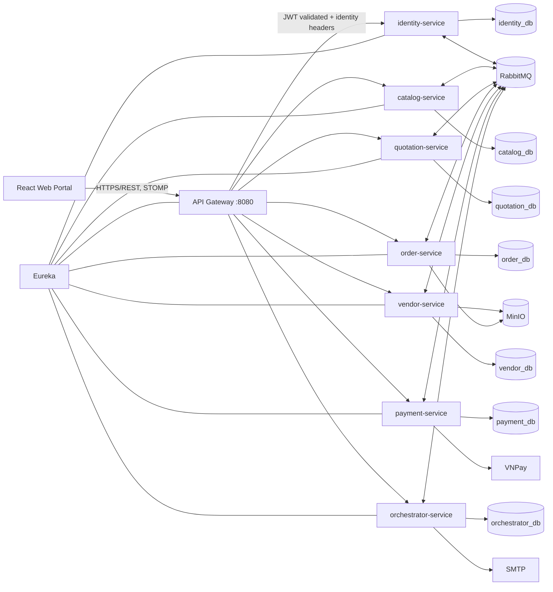
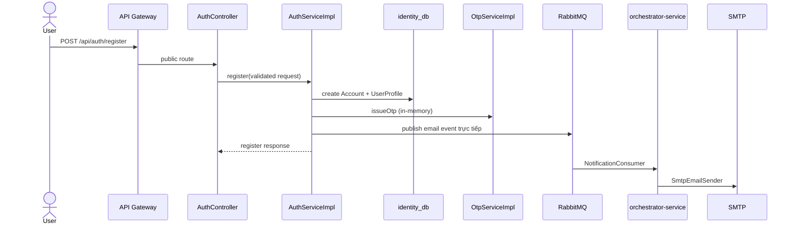
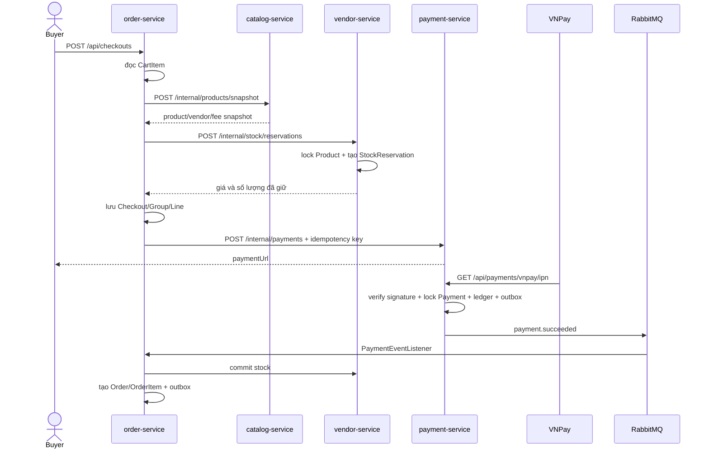
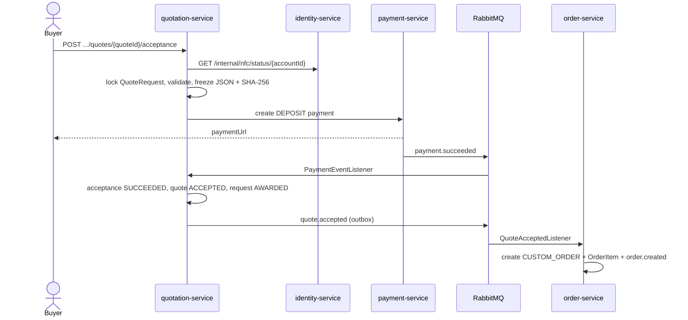
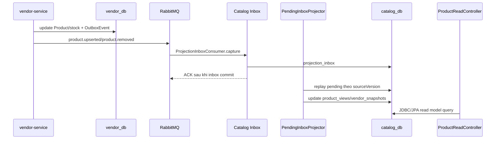

# Architecture Context — Moonkage Platform

> Trạng thái: **Architecture Discovery / AS-IS**  
> Ngày khảo sát: **12/11/2026**  
> Phạm vi thay đổi: chỉ tạo tài liệu này; không thay đổi source code, dependency, database schema, migration hoặc configuration.  
> Nguyên tắc bằng chứng: nhận định trong tài liệu dựa trên source code và cấu hình hiện có. Nội dung không đủ bằng chứng được ghi rõ **Chưa xác minh**.

## 1. Tổng quan hệ thống

### 1.1. Bài toán nghiệp vụ

Moonkage là nền tảng B2B2C cho thị trường bánh trung thu, kết nối người mua với các Shop/xưởng qua hai nhánh giao dịch chính:

- Mua sản phẩm có sẵn: duyệt catalog, giỏ hàng, checkout nhiều Shop, giữ tồn kho, thanh toán VNPay, theo dõi đơn, đánh giá và khiếu nại.
- Đặt sản xuất theo yêu cầu: tạo yêu cầu báo giá, mời Shop, nhận và so sánh báo giá, chấp nhận báo giá, đặt cọc, duyệt maket, theo dõi sản xuất, thanh toán phần còn lại.
- Hỗ trợ người bán: đăng ký Shop, xác minh chủ sở hữu qua NFC/CCCD, tải hồ sơ, duyệt Shop, đóng phí mở bán, quản lý sản phẩm, bậc giá, tồn kho và vùng giao hàng.
- Quản trị dòng tiền: ghi nhận payment, phân bổ tiền theo order, giữ tiền, refund, disbursement và payout.
- Hỗ trợ vận hành: audit log, email, chat realtime, notification inbox, service discovery và observability.

Bằng chứng chính: các API trong `identity-service`, `catalog-service`, `quotation-service`, `order-service`, `vendor-service`, `payment-service`, `orchestrator-service`; schema Flyway của từng service; các route trong `api/api-gateway/src/main/resources/application.yml`.

### 1.2. Công nghệ

| Nhóm | Hiện trạng đã xác minh | Bằng chứng |
|---|---|---|
| Ngôn ngữ/runtime | Java 21 | `api/pom.xml` — `java.version` |
| Framework | Spring Boot 3.5.16; Spring Cloud 2025.0.3 | `api/pom.xml` |
| Build | Maven multi-module, Maven Wrapper | `api/pom.xml`, `api/mvnw`, `api/mvnw.cmd` |
| Web/API | Spring MVC cho business service; Spring Cloud Gateway WebFlux cho gateway; springdoc OpenAPI | POM của các module |
| Persistence | PostgreSQL 17; Spring Data JPA/Hibernate; catalog dùng thêm JDBC cho projection/search | `docker-compose.yml`; package `repository` của từng service |
| Migration | Flyway; `ddl-auto: validate` | `application.yml` và `db/migration` của từng service |
| Security | JWT HS256, token do identity-service phát; gateway xác minh token và truyền `X-Account-Id`, `X-User-Role` | `JwtTokenProvider`, gateway `SecurityConfig` |
| Messaging | RabbitMQ topic exchange; transactional outbox; inbox/`processed_events` ở consumer | `common-outbox`, các `RabbitConfig`, migration |
| File storage | MinIO/S3-compatible qua `common-storage` | `common-storage`, order-service, vendor-service |
| External services | VNPay, SMTP, MinIO; dữ liệu thẻ NFC được mobile client đẩy vào API | `payment.gateway`, orchestrator `SmtpEmailSender`, identity `NfcServiceImpl` |
| Scheduler | Outbox relay, hết hạn payment/checkout/quote/stock, dọn OTP/NFC, catalog projector, refund job | các method `@Scheduled` |
| Cache | Không phát hiện Spring Cache, Redis hoặc Caffeine | khảo sát POM, `application.yml`, annotation cache |
| Observability | Actuator/Prometheus endpoint, Micrometer, OpenTelemetry Collector, Jaeger, PII masking | `common-observability`, `infra/otel`, `docker-compose.yml` |
| Local deployment | Docker Compose; business service không publish port ra host | `docker-compose.yml` |
| CI | `mvnw clean verify`: Spotless, Checkstyle, Error Prone, ArchUnit và tests | `.github/workflows/code-quality.yml`, `api/pom.xml` |

### 1.3. Nhận định kiến trúc sơ bộ

Hệ thống là **microservices architecture** với database-per-service, kết hợp giao tiếp đồng bộ qua OpenFeign và bất đồng bộ qua RabbitMQ. Bên trong mỗi service không dùng một phong cách duy nhất:

- order, payment, quotation chủ yếu là Layered Architecture theo package kỹ thuật;
- identity và vendor thiên về Package by Feature;
- catalog là CQRS read-side/projection kết hợp JPA và JDBC;
- orchestrator thể hiện Ports and Adapters rõ hơn qua `application`, `domain`, `channel`, `infrastructure`;
- các `common-*` là shared libraries được link ở build time, không phải service độc lập.

Vì vậy, mô tả chính xác nhất là **microservices với kiến trúc nội bộ kết hợp**, không phải toàn hệ thống tuân thủ Clean Architecture hay Hexagonal Architecture.

## 2. Cấu trúc repository

```text
.
├── api/                              # Maven reactor backend
│   ├── pom.xml                       # Parent POM và quality gates
│   ├── config/archunit/              # Rule kiến trúc dùng chung
│   ├── api-gateway/                  # Gateway, JWT, route, rate limit
│   ├── discovery-server/             # Eureka Server
│   ├── identity-service/             # Account, auth, address, KYC/NFC
│   ├── catalog-service/              # Catalog read model, search, fee
│   ├── quotation-service/            # Quote request, invitation, quote, acceptance
│   ├── order-service/                # Cart, checkout, order, chat, dispute, review
│   ├── vendor-service/               # Vendor, product, stock, documents, fee
│   ├── payment-service/              # Payment, ledger, refund, payout
│   ├── orchestrator-service/         # Email, audit, notification, realtime
│   ├── common-api/                   # HTTP envelope/error/header constants
│   ├── common-outbox/                # Outbox relay abstraction
│   ├── common-storage/               # MinIO abstraction
│   ├── common-observability/         # Metrics, tracing, PII masking
│   └── common-reference/             # Reference data tỉnh/thành
├── web/                              # React SPA; client của gateway
├── infra/                            # MinIO init, OTel Collector, demo seed
├── docs/                             # Product, architecture, service docs
├── .github/workflows/                # CI quality gates
└── docker-compose.yml                # Local runtime topology
```

### 2.1. Quy mô backend tại thời điểm khảo sát

| Module | Main Java | Test Java | Flyway migration |
|---|---:|---:|---:|
| api-gateway | 8 | 4 | 0 |
| catalog-service | 89 | 10 | 10 |
| common-api | 7 | 5 | 0 |
| common-observability | 7 | 3 | 0 |
| common-outbox | 7 | 3 | 0 |
| common-reference | 1 | 1 | 0 |
| common-storage | 12 | 5 | 0 |
| discovery-server | 1 | 0 | 0 |
| identity-service | 120 | 32 | 5 |
| orchestrator-service | 50 | 7 | 1 |
| order-service | 154 | 11 | 6 |
| payment-service | 89 | 11 | 4 |
| quotation-service | 93 | 8 | 4 |
| vendor-service | 180 | 27 | 8 |

Các số trên được đếm tĩnh từ `src/main/java`, `src/test/java` và `src/main/resources/db/migration`; không đại diện cho độ phủ test.

## 3. Kiến trúc hiện tại (AS-IS Architecture)

### 3.1. Topology triển khai



Mỗi business service sở hữu database riêng. Không phát hiện query hoặc foreign key xuyên database. Dữ liệu cần chia sẻ được lấy đồng bộ qua internal API hoặc sao chép thành snapshot/read model qua event.

### 3.2. Dependency giữa các service

```mermaid
flowchart LR
    OR[order] -->|Feign: product snapshot| CA[catalog]
    OR -->|Feign: stock/vendor| VE[vendor]
    OR -->|Feign: create payment/refund| PA[payment]
    OR -->|Feign: account name| ID[identity]
    QU[quotation] -->|Feign: NFC| ID
    QU -->|Feign: payment/refund| PA
    VE -->|Feign: NFC/ID check| ID
    VE -->|Feign: registration payment| PA
    PA -->|Feign: vendor ownership| VE
    PA -->|Feign: payout lock| OR

    VE -. product/vendor events .-> CA
    PA -. payment events .-> OR
    PA -. payment events .-> QU
    PA -. payment events .-> VE
    QU -. quote.accepted .-> OR
    OR -. order/dispute/review events .-> PA
    OR -. chat events .-> OC[orchestrator]
    ID -. email/NFC events .-> OC
```

Các cạnh đồng bộ tạo hai vòng dependency runtime đáng chú ý: `order-service ↔ payment-service` và `vendor-service ↔ payment-service`. Đây không phải Maven dependency cycle, nhưng làm deployment và availability coupling cao hơn.

### 3.3. Kiến trúc bên trong service

Luồng phổ biến:

```text
Controller → Service/Application component → Repository/JPA/JDBC → PostgreSQL
                         ├→ OpenFeign client → service khác
                         ├→ Outbox table → OutboxRelay → RabbitMQ
                         └→ ObjectStorage/VNPay adapter
```

- Controller chủ yếu nhận request, dùng Bean Validation, lấy `CurrentUserInfo`, gọi service và trả DTO. Không phát hiện controller import trực tiếp repository/entity.
- Business logic tập trung ở service/application component và một phần trong entity/value object.
- Transaction boundary chủ yếu đặt tại service method bằng `@Transactional` hoặc `TransactionTemplate`.
- Mapper/DTO được dùng để tránh expose JPA entity trực tiếp ra public API.
- Catalog là ngoại lệ có chủ đích: projection/search dùng repository JDBC và read model thay vì CRUD JPA thuần.
- Orchestrator dùng `EventHandler` port và handler theo channel; đây là module gần Hexagonal Architecture nhất.

## 4. Phân tích module nghiệp vụ

| Module | Trách nhiệm và entry point | Class chính | Persistence | Phụ thuộc |
|---|---|---|---|---|
| api-gateway | Route public API, validate JWT, CORS, rate limit, chặn `/internal/**`, inject identity header | `SecurityConfig`, `RateLimitFilter`, `LegacyPathRedirectFilter` | Không | Eureka, identity JWT secret |
| discovery-server | Service registry | `DiscoveryServerApplication` | Không | Không |
| identity-service | Account, profile, address, login/refresh, OTP, KYC/NFC | `AuthController`, `AccountController`, `KycController`, `AuthServiceImpl`, `NfcServiceImpl` | `Account`, `UserProfile`, `Address`, `LegalProfile`, `OutboxEvent` | RabbitMQ, orchestrator gián tiếp |
| catalog-service | Public product read model, search/facet, product snapshot cho checkout, phí liên tỉnh | `ProductReadController`, `InterprovinceFeeController`, `ProjectionInboxConsumer`, `CatalogProjectionServiceImpl` | `product_views`, `vendor_snapshots`, `product_reviews`, fee/province, inbox/outbox | RabbitMQ; event từ vendor/order |
| quotation-service | Quote request, invitation, quote/revision, acceptance/deposit | `QuoteRequestController`, `SupplierController`, `QuoteRequestServiceImpl`, `QuoteServiceImpl`, `QuoteAcceptanceServiceImpl` | `QuoteRequest`, `RequestInvitation`, `Quote`, `QuoteAcceptance`, `VendorSnapshot`, inbox/outbox | identity, payment, RabbitMQ |
| order-service | Cart, checkout, order lifecycle, mockup/invoice, progress, dispute, review, chat | 10 controller; `CheckoutServiceImpl`, `OrderServiceImpl`, `DisputeServiceImpl`, `ChatServiceImpl` | 17 entity gồm `CartItem`, `Checkout`, `Order`, `OrderItem`, `Dispute`, `Review`, chat, inbox/outbox | catalog, vendor, payment, identity, RabbitMQ, MinIO |
| vendor-service | Vendor registration/review, documents, delivery settings, order profile, product/write model, stock hold, fee | `VendorController`, `ProductController`, `InternalStockController`, `VendorServiceImpl`, `ProductServiceImpl`, `StockServiceImpl` | `Vendor`, document/review/check, `Product`, price tier, stock reservation, outbox/inbox | identity, payment, RabbitMQ, MinIO |
| payment-service | VNPay, payment idempotency, allocation, ledger, refund, disbursement, payout | `PaymentController`, `LedgerController`, `PaymentServiceImpl`, `RefundServiceImpl`, `ReconciliationServiceImpl` | `Payment`, allocation, ledger/entry, refund, payout, order snapshot, inbox/outbox | VNPay, order, vendor, RabbitMQ |
| orchestrator-service | Consume event và dispatch sang email, audit, in-app, NFC/realtime/chat | `NotificationConsumer`, `DefaultEventDispatcher`, channel handlers, `NotificationController` | `AuditLog`, `Notification`, `NotificationEventLog` | RabbitMQ, SMTP, WebSocket |
| common-api | `ApiResponse`, `PageResponse`, common error handling và header constants | `CommonExceptionHandler`, `GatewayHeader` | Không | Spring Web/Feign |
| common-outbox | Relay outbox có publisher confirm và trace propagation | `OutboxRelay`, `OutboxEventSource`, `OutboxTraceContext` | Adapter do service cung cấp | RabbitMQ, tracing |
| common-storage | Presigned upload/download, validation chữ ký file, strip metadata ảnh | `ObjectStorage`, `ImageMetadataStripper` | MinIO | MinIO SDK |
| common-observability | Metrics tiền/outbox, trace, masking PII | `MoneyMetrics`, `OutboxMetrics`, `PiiMaskingObservationFilter` | Không | Micrometer, OTel |
| common-reference | Danh mục tỉnh/thành dùng chung | `Province` | In-memory immutable map | Không |

### 4.1. Ranh giới trách nhiệm

- Vendor sở hữu write model sản phẩm và tồn kho; Catalog sở hữu read model sản phẩm công khai.
- Quotation sở hữu vòng đời báo giá; Order chỉ tạo custom order sau `quote.accepted`.
- Payment sở hữu payment/ledger/refund/payout; Order sở hữu trạng thái giao hàng và quyền khóa payout.
- Identity sở hữu account và KYC; service khác chỉ nhận DTO tối thiểu qua internal API.
- Orchestrator là consumer cho channel notification/audit, không điều phối transaction nghiệp vụ liên service dù tên module là “orchestrator”.

## 5. Phân tích luồng xử lý nghiệp vụ

### 5.1. Đăng ký account và gửi OTP



- Request validation: `AuthController` với `@Valid`, value object `Email`, `PhoneNumber`, `PasswordHash` tiếp tục kiểm tra domain rule.
- Transaction: `AuthServiceImpl.register()` được đánh dấu `@Transactional`.
- Persistence: `AccountService` và `UserProfileService` ghi identity database.
- External side effect: `EmailNotificationPublisher` gọi `RabbitTemplate.convertAndSend` trực tiếp trong transaction, không qua outbox.
- Exception: `GlobalExceptionHandler` kế thừa `CommonExceptionHandler` và trả `ApiResponse`.

### 5.2. Checkout mua hàng có sẵn và thanh toán



`CheckoutServiceImpl.create()` chủ động tách remote call và local transaction bằng `TransactionTemplate`. Khi tạo payment thất bại, checkout chuyển `FAILED` và cố gắng release stock. `PaymentServiceImpl` xác minh chữ ký VNPay, khóa row payment, bảo vệ duplicate success bằng unique index `(purpose, reference_id)` và ghi event vào outbox. Consumer dùng `processed_events` để idempotent.

### 5.3. Chấp nhận báo giá và tạo custom order



`QuoteAcceptanceServiceImpl` khóa request trước để tránh hai quote cùng thắng, lưu snapshot hợp đồng và hash, sau đó gắn payment. Khi payment đến muộn và acceptance không còn thắng được, service yêu cầu refund. Ràng buộc DB `ux_quote_acceptances_one_succeeded` và `ux_quote_acceptances_one_pending` bổ sung bảo vệ concurrency.

### 5.4. Đồng bộ product write model sang catalog read model



Catalog ACK message sau khi inbox commit, không chờ projection hoàn tất. `sourceVersion`, tombstone và `processed_events` bảo vệ event đến trễ/trùng. Vì vậy catalog là **eventually consistent** với vendor/order.

### 5.5. Payout

`ReconciliationServiceImpl.payout()`:

1. Kiểm tra ledger, refund đang chờ, disbursement đang chờ trong local transaction.
2. Gọi `order-service` qua `OrderClient.lockForPayout()` để Order xác nhận không còn khả năng mở dispute.
3. Mở transaction mới, khóa ledger, tạo `Payout`, ghi ledger entry và outbox event `payout.completed`.

Luồng này tránh giữ transaction payment database trong lúc gọi order-service. Tuy nhiên, nếu bước 2 thành công nhưng bước 3 thất bại, trạng thái “payout lock” ở order-service và payment-service cần cơ chế retry/reconciliation; cơ chế tự động đối soát trường hợp này **Chưa xác minh**.

### 5.6. Validation, transaction, exception và response

- Bean Validation xuất hiện ở controller request và configuration properties; domain validation tiếp tục nằm trong value object/entity/service.
- Public API thường bọc `ApiResponse`; internal API có chỗ trả DTO trực tiếp theo chủ đích.
- `CommonExceptionHandler` chuẩn hóa validation, malformed JSON, method/path, Feign và uncaught exception. Phần lớn service kế thừa handler này; catalog có handler riêng.
- Transaction chủ yếu ở service; repository có pessimistic lock/query chuyên biệt cho concurrency.
- Không phát hiện JPA entity được trả trực tiếp từ controller.

## 6. Kiến trúc dữ liệu

### 6.1. Database ownership

| Database | Aggregate/table chính | Quan hệ nổi bật |
|---|---|---|
| identity_db | `accounts`, `user_profiles`, `addresses`, `legal_profiles`, `outbox_events` | profile/address/legal profile FK tới account |
| catalog_db | `product_views`, `product_reviews`, `vendor_snapshots`, `provinces`, `interprovince_fees`, `projection_inbox`, `processed_events`, tombstone | read model độc lập; fee FK tới province |
| quotation_db | `quote_requests`, invitations, `quotes`, quote items, `quote_acceptances`, `vendor_snapshots`, inbox/outbox | quote/acceptance FK trong cùng DB; unique partial index bảo vệ winner |
| order_db | cart, checkout/group/line, orders/items, mockup/progress, dispute/evidence, reviews, chat, vouchers, inbox/outbox | order aggregate có nhiều child FK; checkout group/line snapshot dữ liệu mua |
| vendor_db | vendors, documents/reviews/checks, delivery area, order profile, products/images/price tiers, stock reservations, fee config, inbox/outbox | product và cấu hình FK tới vendor; reservation FK tới product |
| payment_db | payments/allocation, ledger/entry, refund, disbursement, payout, order snapshot, inbox/outbox | payment allocation FK payment; ledger liên kết order bằng business key |
| orchestrator_db | audit logs, notifications, notification event logs | recipient/target lưu dưới dạng identifier, không FK xuyên service |

### 6.2. ORM và query strategy

- JPA/Hibernate là mặc định; schema được Flyway quản lý và Hibernate chỉ `validate`.
- Catalog dùng JDBC repository cho projection và search phức tạp (`JdbcCatalogProjectionRepository`, `JdbcProductSearchRepository`).
- Các hot path concurrency dùng pessimistic lock hoặc `FOR UPDATE`, ví dụ stock reservation, payment IPN, checkout, quote acceptance, ledger/payout.
- Cross-service reference (`accountId`, `vendorId`, `orderId`, `paymentId`) là string/business identifier, không có foreign key xuyên database.
- Snapshot được dùng để giảm coupling lịch sử: checkout lines, order items, quote acceptance JSON/hash, vendor/product/order snapshots.

### 6.3. Transaction và consistency

- Atomicity nội service: local transaction + DB constraint.
- Event publication: đa số domain event dùng transactional outbox và publisher confirm.
- Consumer idempotency: `processed_events`, projection inbox hoặc notification event log.
- Consistency liên service: eventual consistency; một số use case phối hợp bằng synchronous call + compensation thay vì distributed transaction.
- Cache phân tán: không có.

## 7. Các thành phần dùng chung

### 7.1. Security

- Identity phát access/refresh token HS256; gateway chỉ chấp nhận token có claim `type=ACCESS`.
- Gateway xóa header identity do client gửi rồi tự gắn `X-Account-Id`, `X-User-Role`.
- Public route được whitelist theo method/path; gateway deny `/internal/**`.
- Identity có Spring Security riêng. Các business service còn lại chủ yếu tin header do gateway truyền và kiểm tra authorization trong service/application logic.
- WebSocket cho phép handshake ở gateway; token được kiểm tra ở STOMP CONNECT bởi `StompAuthInterceptor`.
- PII: CCCD và bank account có hash/encryption component; log/trace có PII masking.

### 7.2. Validation và error model

- `common-api` cung cấp `ApiResponse`, `PageResponse`, `CommonErrorCode`, `CommonExceptionHandler`.
- Service vẫn sở hữu `AppException`/`ErrorCode` riêng để giữ vocabulary nghiệp vụ.
- Catalog chưa kế thừa `CommonExceptionHandler`, tạo một biến thể error boundary riêng.

### 7.3. Messaging và outbox

- `common-outbox.OutboxRelay` đọc batch, publish theo thứ tự, chờ broker confirm rồi đánh dấu published.
- Mỗi service vẫn sở hữu entity/table/repository adapter outbox của mình.
- Catalog có relay riêng và pipeline inbox/projector riêng phục vụ CQRS.
- Consumer nghiệp vụ chính dùng inbox/idempotency; orchestrator dùng `notification_event_logs`.

### 7.4. Storage

- `common-storage.ObjectStorage` tạo presigned link và thao tác MinIO.
- Vendor sở hữu product images và hồ sơ Shop; Order sở hữu maket/invoice/evidence/progress photo.
- Bucket/user được phân quyền qua `infra/minio/init.sh`; compose truyền credential theo service thay vì root credential.

### 7.5. Observability và deployment

- Tất cả business service expose health và Prometheus endpoint.
- Trace OTLP được gửi tới Collector rồi Jaeger; trace context được lưu trong outbox và phục hồi khi relay.
- Docker Compose chạy 7 PostgreSQL, RabbitMQ, MinIO, Eureka, gateway, 7 service, OTel Collector và Jaeger.
- Chỉ gateway và các UI/hạ tầng quản trị cần thiết publish port; business service nằm trong Docker network.
- Chưa phát hiện Prometheus server/Grafana/alert rules trong repository.

## 8. Các vấn đề kiến trúc được phát hiện

Không có vấn đề nào được xếp **Critical** chỉ từ bằng chứng tĩnh hiện có. Các mức độ dưới đây phản ánh rủi ro nếu triển khai production hoặc scale ngang.

| ID | Mức độ | Vấn đề | Bằng chứng source code | Ảnh hưởng | Đề xuất |
|---|---|---|---|---|---|
| ARC-01 | High | Internal API không có service authentication; trust boundary phụ thuộc hoàn toàn vào network và gateway header | Gateway `SecurityConfig` chỉ deny `/internal/**` ở gateway; chỉ identity có `SecurityFilterChain`; các service đọc `X-Account-Id`/`X-User-Role`; internal controller như `InternalPaymentController`, `InternalStockController` không xác thực service caller | Một workload bị xâm nhập trong cùng network có thể spoof header/gọi internal API; khó đáp ứng zero-trust | Quyết định chuẩn service identity: mTLS, signed service token/OAuth2 client credentials; xác thực internal endpoint tại từng service |
| ARC-02 | High | OTP, NFC session/lockout và gateway rate limit lưu in-memory theo instance | `OtpServiceImpl.otpEntries`, `NfcServiceImpl.sessions`, `NfcAttemptTracker.lockouts`, `RateLimitFilter.windows` đều là `ConcurrentHashMap`; cấu hình ghi rõ rate limit per-instance | Restart làm mất OTP/session/lockout; nhiều replica cho kết quả không nhất quán và cho phép né rate limit; NFC callback có thể rơi vào replica khác | Chọn distributed ephemeral store và atomic operation; hoặc chính thức giới hạn single replica/sticky routing và ghi rõ SLO |
| ARC-03 | High | External call/side effect nằm trong database transaction ở một số luồng | `QuoteAcceptanceServiceImpl.accept()` là `@Transactional` nhưng gọi identity và payment; `AuthServiceImpl.register()` publish email trực tiếp qua RabbitMQ trong transaction; `OrderServiceImpl.createFromQuote()` gọi vendor lookup trong transaction; nhiều read transaction gọi Feign | Giữ connection/lock lâu, phụ thuộc latency ngoài; rollback local không rollback remote side effect; có thể gửi OTP trước khi account commit | Tách transaction và remote orchestration; dùng state machine/outbox/command idempotency; không publish trực tiếp trước commit |
| ARC-04 | High | Runtime dependency cycle và thiếu resilience policy thống nhất | OpenFeign tạo `order ↔ payment`, `vendor ↔ payment`; chỉ thấy connect/read timeout trong `application.yml`, không phát hiện circuit breaker/bulkhead/resilience4j | Cascading failure, khó deploy độc lập, latency tail tăng; lỗi một service có thể lan sang checkout/payout/vendor flow | Xác định sync call nào bắt buộc; phá vòng bằng snapshot/event hoặc facade rõ ràng; chuẩn hóa timeout budget, retry chỉ cho idempotent call, circuit breaker và metrics |
| ARC-05 | Medium | Contract REST/event bị sao chép ở producer/consumer, chưa có schema governance | 4 bản `CreatePaymentRequest/Response`, 4 bản `PaymentSucceededEvent`, 2 bản `QuoteAcceptedEvent`, 7 `RabbitConfig`; không phát hiện Spring Cloud Contract/Pact/schema registry | DTO/routing key có thể drift nhưng compile/test từng service vẫn pass | Thiết lập consumer-driven contract test hoặc versioned schema; không nhất thiết gom mọi DTO vào shared jar vì sẽ tăng build-time coupling |
| ARC-06 | Medium | Một số service class có quá nhiều trách nhiệm/dependency | `OrderServiceImpl` 446 dòng/13 dependency; `CheckoutServiceImpl` 396 dòng/14 dependency; `ReconciliationServiceImpl` 312 dòng/12 dependency; `VendorServiceImpl` 286 dòng và nhiều collaborator | Khó test độc lập, thay đổi dễ ảnh hưởng use case khác, transaction boundary khó nhìn | Tách application use case/command handler theo hành vi, giữ entity/domain policy riêng; thực hiện sau khi contract và characterization test ổn định |
| ARC-07 | Medium | Outbox relay có giả định single instance và giữ transaction khi chờ broker confirm | Javadoc `OutboxRelay` nêu “Runs in one instance”; `relay()` là `@Transactional` và chờ confirm từng message | Scale nhiều replica phát duplicate nhiều hơn; transaction/connection bị giữ theo latency RabbitMQ; throughput batch hạn chế | Thiết kế claim/lease/`SKIP LOCKED`, tách publish khỏi transaction đọc dài, hoặc dùng CDC; kiểm chứng ordering requirement theo aggregate |
| ARC-08 | Medium | Test giữa các service không cân bằng; thiếu contract/system integration tự động trong backend module | Vendor/identity có nhiều Testcontainers API test; order/payment/quotation chủ yếu unit + repository integration; orchestrator không có DB/Rabbit end-to-end; không phát hiện WireMock/Pact/Cloud Contract | Rủi ro cao nhất nằm ở Feign/event contract và saga nhưng ít được bảo vệ trong test module tương ứng | Thêm contract tests và integration tests cho checkout/payment/quote/event redelivery; thêm orchestrator Rabbit+DB+SMTP fake test |
| ARC-09 | Medium | Observability mới dừng ở trace local và metrics endpoint | `common-observability`, OTel/Jaeger có trong compose; không có Prometheus server, dashboard hay alert rules | Có metric nhưng chưa có bằng chứng được scrape/cảnh báo; sự cố outbox, payment mismatch có thể không được phát hiện chủ động | Chuẩn hóa production telemetry backend, dashboard, alert/SLO; kiểm tra PII masking end-to-end |
| ARC-10 | Medium | Chức năng notification/voucher chưa hoàn thiện so với model hiện có | Chỉ orchestrator định nghĩa/consume `orchestrator.inapp.#`, không phát hiện producer ở service khác; `Voucher` và `VoucherRepository` tồn tại nhưng không có controller/service | Code/schema chết hoặc tính năng luôn rỗng; tăng chi phí hiểu hệ thống | Architect quyết định roadmap: hoàn thiện event producer/use case hoặc loại khỏi runtime scope trong một migration có kiểm soát |
| ARC-11 | Low | Trùng lặp bootstrap/configuration và dead dependency | 8 bản `DotEnvConfig`, 7 bản `OpenApiConfig`; `order.QuotationClient` và `quotation.CatalogClient` là Feign interface rỗng | Maintenance lặp, tạo dependency graph sai lệch, dễ sửa thiếu module | Gom phần bootstrap thực sự ổn định vào starter hoặc bỏ dead client; tránh shared library cho business contract chưa ổn định |
| ARC-12 | Low | Error handling chưa hoàn toàn đồng nhất | Phần lớn `GlobalExceptionHandler` kế thừa `CommonExceptionHandler`, nhưng catalog tự triển khai; internal API trả DTO thẳng trong khi public API dùng wrapper | Client/observability phải xử lý biến thể; mapping lỗi Feign có thể khác nhau | Định nghĩa error contract công khai và internal; thêm contract test, không ép cùng class hierarchy nếu semantics khác |
| ARC-13 | Low | ArchUnit rule dựa nhiều vào tên package nên không bao phủ đều kiến trúc kết hợp | `ArchitectureTest` chỉ match `..controller..`, `..service..`, `..repository..`; identity/vendor package-by-feature và orchestrator ports/adapters | Có thể pass quality gate dù dependency sai trong package không mang tên layer | Viết rule theo annotation/module-specific boundary và dependency direction thực tế |

## 9. Hiện trạng kiểm thử

### 9.1. Inventory tĩnh

Khảo sát phát hiện **127 file test Java** và ít nhất **838 annotation `@Test`**. Đây là số đếm source tĩnh, không phải số test đã chạy hoặc đã pass.

| Module | File test | `@Test` tĩnh | Nhận xét |
|---|---:|---:|---|
| api-gateway | 4 | 33 | Route coverage, security, redirect, rate limit |
| catalog-service | 10 | 86 | Có PostgreSQL/RabbitMQ integration và projection test lớn |
| common-* | 17 | 101 | API envelope, outbox, storage, observability, reference |
| identity-service | 32 | 182 | Unit + API/Repository Testcontainers, security/KYC/OTP |
| orchestrator-service | 7 | 26 | Chủ yếu unit; chưa thấy full infrastructure integration |
| order-service | 11 | 99 | Service unit/money flow; repository integration |
| payment-service | 11 | 112 | Payment/refund/ledger/reconciliation unit; repository integration |
| quotation-service | 8 | 44 | Service unit; repository integration |
| vendor-service | 27 | 155 | Nhiều API/domain/PostgreSQL/RabbitMQ integration |

### 9.2. Loại test đã có

- Unit test với JUnit/Mockito cho service, domain/value object, crypto, signer, exception handler.
- MVC/WebFlux test cho gateway, identity và vendor API.
- Testcontainers PostgreSQL cho identity, catalog, quotation, order repository, payment repository và vendor.
- RabbitMQ container test cho catalog/vendor outbox/projection.
- ArchUnit rule được parent POM thêm vào mọi module.
- Frontend có test riêng trong `web`, nhưng không phân tích sâu trong khảo sát backend này.

### 9.3. Khoảng trống test quan trọng

- Không phát hiện consumer-driven contract test cho OpenFeign hoặc Rabbit event.
- Chưa có bằng chứng integration test xuyên các service cho checkout → VNPay IPN → order creation.
- Chưa có bằng chứng integration test xuyên quotation → payment → order.
- Chưa có orchestrator integration test với RabbitMQ + PostgreSQL + SMTP fake + WebSocket.
- `@Testcontainers(disabledWithoutDocker = true)` cho phép integration test bị skip khi Docker không có; CI runner có Docker hay các test thực sự chạy hay không **Chưa xác minh**.
- Không có test ở discovery-server; rủi ro thấp vì module chỉ bootstrap Eureka nhưng vẫn chưa được kiểm chứng trong khảo sát này.

### 9.4. Kết quả thực thi

**Không chạy test/build trong lần khảo sát này** để tuân thủ phạm vi chỉ đọc source và chỉ tạo file tài liệu. Vì vậy không khẳng định bất kỳ test nào pass. README và báo cáo E2E hiện có chỉ là bằng chứng lịch sử, không phải kết quả được tái xác minh trong phiên khảo sát.

## 10. Định hướng chuẩn hóa kiến trúc

Đây là các phương án TO-BE cần đánh giá, chưa phải quyết định kiến trúc cuối cùng:

1. **Chuẩn hóa trust boundary trước:** định nghĩa public, authenticated user và service-to-service identity; áp dụng nhất quán ở gateway và từng service.
2. **Chuẩn hóa application boundary:** một use case/command handler có transaction boundary rõ; remote call không nằm trong local DB transaction trừ khi có lý do và timeout budget được ghi nhận.
3. **Chuẩn hóa integration contract:** versioned REST/event schema, compatibility rule và consumer-driven contract test; tránh shared business DTO jar nếu làm mất tính độc lập deploy.
4. **Chuẩn hóa consistency pattern:** outbox/inbox cho event; idempotency key cho command; state machine/compensation cho saga; reconciliation job cho trạng thái “remote success/local failure”.
5. **Chuẩn hóa package theo service type:** không cần ép mọi service cùng cây package. Có thể có profile “CRUD/layered”, “domain feature”, “CQRS projection”, “ports-adapters”, nhưng mỗi profile phải có dependency rule tự động.
6. **Chuẩn hóa resilience:** timeout budget, retry condition, circuit breaker, bulkhead, fallback và telemetry theo từng loại integration.
7. **Chuẩn hóa operability:** health semantics, metric scrape, dashboard, alert, trace retention và audit/PII policy cho môi trường production.
8. **Chuẩn hóa scale model:** loại bỏ state in-memory cần chia sẻ hoặc công bố rõ component chỉ chạy single replica.

## 11. Đề xuất thứ tự refactor

| Ưu tiên | Nhóm công việc | Lý do/phụ thuộc | Rủi ro triển khai |
|---:|---|---|---|
| 1 | Characterization + contract tests cho Feign/event và money flows | Tạo safety net trước mọi thay đổi | Thấp |
| 2 | Service authentication và hardening internal API | Giảm rủi ro security lớn nhất; ít phụ thuộc refactor domain | Trung bình |
| 3 | Distributed state cho OTP/NFC/rate limit hoặc quyết định single-replica | Cần trước horizontal scaling/production HA | Trung bình |
| 4 | Tách remote side effect khỏi DB transaction ở auth/quotation/order | Cần idempotency và contract test từ bước 1 | Cao |
| 5 | Phá runtime cycle order/payment và vendor/payment; thêm reconciliation | Liên quan money/order ownership, cần quyết định kiến trúc | Cao |
| 6 | Nâng outbox relay cho multi-instance/throughput | Sau khi xác định ordering và duplicate semantics | Trung bình |
| 7 | Tách các service class lớn theo use case | An toàn hơn sau khi boundary và contract ổn định | Trung bình |
| 8 | Chuẩn hóa starter/config/error/ArchUnit; xóa dead client | Cleanup, không nên đi trước vấn đề runtime | Thấp |
| 9 | Hoàn thiện hoặc đóng scope notification/voucher | Phụ thuộc roadmap sản phẩm | Thấp–Trung bình |
| 10 | Production observability/deployment baseline | Thực hiện song song trước go-live | Trung bình |

Không thực hiện refactor trong lần khảo sát này.

## 12. Những vấn đề cần Senior Solution Architect quyết định

1. Hệ thống production có yêu cầu scale ngang cho gateway và identity hay không? Nếu có, SLA cho OTP/NFC session là gì?
2. Chuẩn service identity sẽ là mTLS, OAuth2 client credentials, signed internal JWT hay service mesh policy?
3. Có chấp nhận vòng sync `order/payment` và `vendor/payment`, hay chuyển payout/ownership sang event/snapshot?
4. Với quote acceptance, consistency mong muốn là synchronous orchestration hay saga/state machine bất đồng bộ?
5. Contract governance chọn consumer-driven contract, schema registry, OpenAPI compatibility gate hay kết hợp?
6. Outbox ordering cần global order, per aggregate order hay chỉ at-least-once? Có yêu cầu nhiều replica mỗi service không?
7. Catalog lag tối đa được chấp nhận là bao nhiêu và cần read-your-write ở use case nào?
8. Notification in-app và voucher nằm trong release scope nào, hay cần chính thức loại khỏi bounded context hiện tại?
9. “orchestrator-service” có tiếp tục chỉ là notification/audit hub hay sẽ trở thành workflow orchestrator? Tên và ownership nên phản ánh quyết định này.
10. Chuẩn kiến trúc nội bộ có cho phép nhiều profile theo đặc thù service hay yêu cầu một template duy nhất?
11. Môi trường đích là Docker Compose, Kubernetes hay managed platform? Quyết định này ảnh hưởng discovery, secret, health, scaling và telemetry.
12. RPO/RTO, retention và reconciliation policy cho payment/ledger/audit là gì?
13. Có yêu cầu tách PII/financial data sang security zone hoặc key-management service chuyên dụng không?

## 13. Phạm vi khảo sát và giới hạn

### 13.1. Đã kiểm tra

- Parent/module POM và dependencies backend.
- Source Java chính của gateway, discovery, 7 business service và 5 common library.
- Controller/service/repository/entity/client/listener/scheduler quan trọng.
- Security flow JWT/header và WebSocket authentication.
- `application.yml`, Dockerfile, `docker-compose.yml`, OTel config và backend CI.
- Flyway migration/table/constraint/index chính.
- Test inventory, annotation và Testcontainers setup.
- Các luồng đăng ký, checkout, payment IPN, quote acceptance, catalog projection và payout.

### 13.2. Chưa kiểm tra sâu

- Toàn bộ 64 màn hình và kiến trúc chi tiết của `web`; chỉ xem như client boundary.
- Mobile app Moonkage Verify không nằm trong repository này.
- Hạ tầng cloud/Kubernetes/IaC vì không có trong repository.
- Cấu hình production thực tế, secret manager, firewall/network policy, TLS termination.
- Database đang chạy, volume data, execution plan và production traffic profile.
- VNPay/SMTP/MinIO thật và account/permission ngoài source.
- Runtime behavior khi broker, DB hoặc downstream service lỗi đồng thời.
- Kết quả build/test hiện tại do không thực thi lệnh tạo build artifact hoặc thay đổi môi trường.

### 13.3. Chưa xác minh

- CI branch protection có bắt buộc workflow pass trước merge hay không.
- Testcontainers integration có thực sự chạy trong CI hay bị skip.
- Prometheus/Grafana/alerting có được triển khai ở repository hoặc nền tảng khác hay không.
- Cơ chế reconciliation tự động khi payout lock thành công nhưng ghi payout thất bại.
- SLO, RPO/RTO, backup/restore, key rotation và secret rotation thực tế.
- Tải dự kiến, số replica production và giới hạn consistency chấp nhận được.

---

Tài liệu này mô tả **AS-IS** dựa trên source tại thời điểm khảo sát. Các đề xuất trong mục 8–12 là đầu vào cho quyết định TO-BE, không phải mô tả chức năng đã tồn tại.
