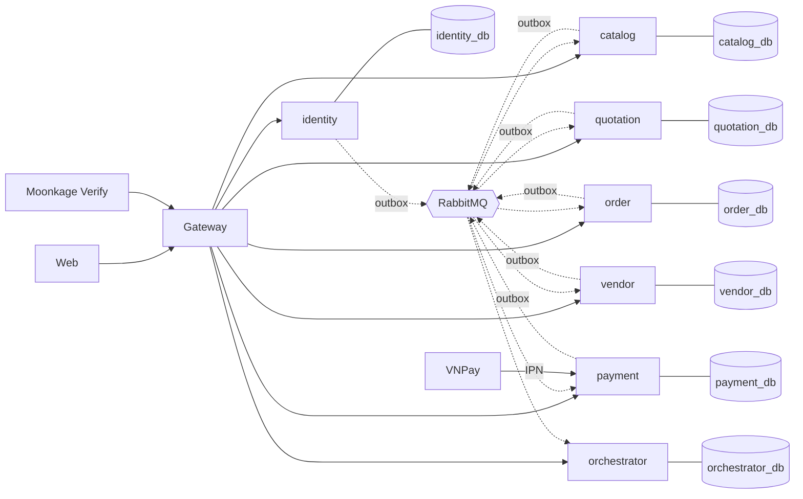

# Moonkage – Phác thảo API và Database

> **Trạng thái:** Đề xuất (2026-10-22). Tách từ tài liệu Claude Doc cùng tên để dễ duyệt theo service; khi hai bên lệch, file trong repo là bản đúng.

## Các file

| File | Nội dung | Migration |
| --- | --- | --- |
| [identity.md](identity.md) | Account, hồ sơ, địa chỉ, NFC, OTP | identity-service |
| [vendor.md](vendor.md) | Người bán, giấy tờ, duyệt, phí đăng ký, sản phẩm (phía ghi) | vendor-service |
| [catalog.md](catalog.md) | Bản đọc sản phẩm, đánh giá, phí liên tỉnh | catalog-service |
| [quotation.md](quotation.md) | Yêu cầu báo giá, báo giá, bản chép chấp nhận | quotation-service |
| [order.md](order.md) | Giỏ, checkout, đơn, maket, khiếu nại | order-service |
| [payment.md](payment.md) | Thanh toán, hoàn tiền, sổ tiền, giải ngân | payment-service |
| [orchestrator.md](orchestrator.md) | Thông báo, nhật ký | — |
| [integration.md](integration.md) | Sự kiện và API nội bộ toàn hệ thống | — |
| [decisions.md](decisions.md) | Quyết định L-01 → L-18 | — |
| [db-review-proposals.md](db-review-proposals.md) | Rà soát database P-01 → P-09, đã chốt và gộp vào V2 | — |

Kế hoạch đưa code về khớp: [api-db-alignment-plan.md](../api-db-alignment-plan.md).

## Phạm vi và quy ước chung

Bản phác thảo gồm toàn bộ bảng và API công khai của 7 service. Nó đi từ schema đang có ở `develop` (Flyway `V1__baseline.sql`) và bổ sung chỗ còn thiếu so với Requirement v1.6 và Software Design v0.6.6. Bảng đánh **Mới** là chưa có trong code; **Sửa** là có nhưng lệch yêu cầu; không đánh dấu là giữ nguyên. Các FR hoãn (FR-13, FR-18, FR-23, FR-37, FR-50) chỉ được nêu tên.

**Database**

| Quy ước | Giá trị | Ghi chú |
| --- | --- | --- |
| Khóa chính | `id varchar(36)`, UUID sinh ở service | Code đang để `varchar(255)`; thu về 36 khi viết migration mới |
| Tham chiếu sang service khác | Chỉ lưu id (`account_id`, `vendor_id`, `order_id`), không có foreign key | Mỗi service một database (D-06) |
| Tham chiếu trong cùng service | Foreign key thật |  |
| Thời điểm | `timestamptz` | identity, orchestrator đã đúng; vendor, catalog, quotation, order, payment đang `timestamp without time zone` → sửa |
| Ngày | `date` | Hạn dùng, ngày giao, ngày sinh |
| Tiền | `bigint` VND, không số lẻ (NFR-09) | Tỷ lệ cọc `numeric(5,2)` |
| Enum | `varchar` + `CHECK`, giá trị `UPPER_SNAKE_CASE` | Như code hiện tại |
| Cột chung | `created_at`, `updated_at`; `version bigint` cho bảng có tranh chấp ghi (tồn kho, sổ tiền, voucher) | Optimistic lock |
| Dữ liệu cá nhân | Số định danh: `*_hash` (HMAC + `*_key_ver`), `*_masked`, `*_enc bytea` (AES-GCM + `pii_key_ver`); số tài khoản ngân hàng: `*_enc` + `*_masked` (P-09) | NFR-03, D-07, D-08, D-17 |
| File | Chỉ lưu `object_key` MinIO, không lưu URL | common-storage cấp presigned URL |
| Mã tỉnh | `province_code varchar(2)`, kiểm theo enum `Province` (`api/common-reference`) | 34 đơn vị theo Quyết định 19/2025/QĐ-TTg; catalog có bảng `provinces` (A-18, P-07) |
| Outbox | Mỗi service phát sự kiện có một bảng `outbox_events`; index `(created_at) WHERE published_at IS NULL` | Như identity hiện có (P-08) |

**API**

Trừ `/api/auth/...`, mọi API quản lý tài nguyên qua **aggregate root**: mỗi root sở hữu các tài nguyên con của nó, giữ bất biến của cả nhóm trong một transaction, và là cửa duy nhất để đọc, ghi chúng.

1. Đường dẫn: `/api/<root>/{rootId}/<con>/{childId}`. Tài nguyên con không có đường dẫn riêng: không có `/api/mockups/{id}`, chỉ có `/api/orders/{orderId}/mockups/{versionNo}`.
2. Chỉ dùng method HTTP: `GET` đọc, `POST` tạo, `PUT` thay toàn bộ, `PATCH` đổi một phần, `DELETE` xóa (chỉ tài nguyên được phép xóa). Không có động từ trong URL.
3. Thao tác nghiệp vụ = đổi trạng thái của tài nguyên (`PATCH {"status": ...}`), hoặc tạo một tài nguyên con có thật trong database (`POST .../reviews`, `POST .../acceptance`). Root kiểm chuyển trạng thái; sai thứ tự trả 409 `INVALID_STATE_TRANSITION`.
4. Một đường dẫn cho mọi vai. Bỏ tiền tố `/api/seller`, `/api/admin`; service kiểm vai (`MEMBER`, `ADMIN`) và quyền chủ người bán, sửa trường không thuộc vai trả 403. Danh sách theo vai lọc bằng tham số: `GET /api/orders?vendorId=` (chủ người bán), không tham số = của mình, `ADMIN` xem được tất cả.
5. `me` là bí danh accountId của người gọi: `/api/accounts/me`, `/api/carts/me`.
6. Root ở service khác chỉ tham chiếu bằng id; phối hợp qua `/internal/...` hoặc sự kiện. Gateway định tuyến theo tên root, mỗi root thuộc đúng một service.
7. Giữ nguyên: `ApiResponse<T>`, JSON `camelCase`, enum `UPPER_SNAKE_CASE`, ngày `yyyy-MM-dd`, phân trang `?page=&size=&sort=`, JWT HS256 (`sub`, `role`).

**Aggregate root**

| Service | Root | Tài nguyên con | Đường dẫn gốc |
| --- | --- | --- | --- |
| identity | Account | `profile`, `addresses`, `nfc-sessions` (→ `card`), `legal-profile` (chỉ đọc) | `/api/accounts` |
| vendor | Vendor | `documents`, `delivery-areas`, `order-profile`, `reviews`, `registration-fee-payments`, `owner-checks` (chỉ đọc), products (→ images, price-tiers) — phía ghi duy nhất của sản phẩm | `/api/vendors` |
| vendor | RegistrationFeeConfig (một bản) | — | `/api/registration-fee-config` |
| vendor | CakeAttribute (danh mục vỏ và nhân, FR-54) | — | `/api/cake-attributes` |
| catalog | Product (chỉ đọc, bản đọc dựng từ vendor) | `reviews (chỉ đọc)` | `/api/products` |
| catalog | InterprovinceFeeTable (một bản) | `provinces/{provinceCode}` | `/api/interprovince-fees` |
| quotation | QuoteRequest | `logos`, `invitations`, `quotes` (→ `acceptance`) | `/api/quote-requests` |
| quotation | Supplier (chỉ đọc, từ bản sao vendor) | — | `/api/suppliers` |
| order | Cart (mỗi người một giỏ) | `items` | `/api/carts` |
| order | Checkout | — (kết quả tạo ra Order) | `/api/checkouts` |
| order | Order | `items`, `mockups`, `progress-updates`, `invoice`, `dispute` (→ `evidences`), `reviews`, `payments` | `/api/orders` |
| payment | Payment | — | `/api/payments` |
| payment | Ledger (theo đơn) | `entries`, `disbursements`, `refunds`, `payout` | `/api/ledgers` |
| orchestrator | Notification | — | `/api/notifications` |
| orchestrator | AuditLog (chỉ đọc) | — | `/api/audit-logs` |

Trong bảng API của từng file service, cột **Ai** ghi: K = khách, M = member, S = chủ người bán, A = quản trị, App = Moonkage Verify.

## Tổng quan

Bảy service, mỗi service một PostgreSQL riêng (cổng 5441–5447), không service nào đọc database của service khác. Dữ liệu chéo đi bằng id, bằng REST nội bộ khi cần câu trả lời ngay, và bằng bản sao cập nhật từ sự kiện.

Bản sao `vendor_snapshots` (catalog, quotation, order) cho phép kiểm BR-20, BR-21, BR-22, BR-31 mà không gọi vendor mỗi request; `order_snapshots` cho payment xét điều kiện chuyển tiền. File nằm ở MinIO, mỗi service tự cấp presigned URL qua common-storage.
