# Sơ đồ Activity

Mermaid không có kiểu sơ đồ activity riêng, nên các sơ đồ dùng `flowchart` theo quy ước UML:

- Hình tròn đặc là điểm bắt đầu, hình tròn viền đôi là điểm kết thúc.
- Hình thoi là rẽ nhánh. Điều kiện ghi trên mũi tên.
- Mỗi khung là một làn (swimlane): ai làm bước đó. "Hệ thống" là các microservice phía sau gateway.

| # | Luồng | FR chính | Service tham gia |
|---|---|---|---|
| 1 | Mua ngay (F1) | FR-05 → FR-11 | catalog, order, vendor, payment |
| 2 | Đặt hàng qua báo giá (F2, F3) | FR-15 → FR-22 | quotation, order, payment, identity |
| 3 | Trở thành người bán (F4) | FR-26, FR-27, FR-45 | vendor, payment |
| 4 | Khiếu nại và hoàn tiền (F5) | FR-12, FR-49 | order, payment |

Chi tiết các lời gọi giữa service xem sơ đồ sequence ở [software-design.md](../software-design.md) mục 7.

## 1. Mua ngay (F1)

```mermaid
flowchart TD
    START((" ")):::start

    subgraph BUYER["Người mua"]
        B1["Chọn khu vực giao hàng"]
        B2["Tìm, lọc sản phẩm"]
        B3["Thêm vào giỏ"]
        B4["Đăng nhập"]
        B5["Mở giỏ, chọn địa chỉ,<br/>xin hoá đơn nếu cần"]
        B6["Bấm Thanh toán"]
        B7["Nhận hàng"]
        B8{"Hàng đúng<br/>như đặt?"}
        B9["Bấm Đã nhận hàng"]
        B10["Đánh giá sản phẩm"]
        B11["Mở khiếu nại<br/>(xem luồng 4)"]
    end

    subgraph SYS["Hệ thống"]
        S0{"Đã đăng nhập?"}
        S1{"Giao được tới tỉnh,<br/>không phải hàng của mình?"}
        S2{"Giữ được<br/>tồn kho?"}
        S3["Tạo Checkout,<br/>tạo link VNPay"]
        S4["Chốt tồn kho,<br/>tạo mỗi Shop một đơn PAID,<br/>ghi tiền vào sổ giữ tiền"]
        S5["Nhả tồn kho,<br/>Checkout FAILED hoặc EXPIRED"]
        S6["Báo lỗi trên giỏ hàng"]
    end

    subgraph GW["VNPay"]
        V1{"Thanh toán<br/>thành công?"}
    end

    subgraph SHOP["Chủ Shop"]
        H1["Xác nhận đơn"]
        H2["Giao cho vận chuyển<br/>(liên tỉnh: nhập mã vận đơn)"]
        H3["Báo đã giao"]
    end

    END((" ")):::stop
    FAIL((" ")):::stop

    START --> B1 --> B2 --> B3 --> S0
    S0 -- Chưa --> B4 --> B3
    S0 -- Rồi --> B5 --> B6 --> S1
    S1 -- Không --> S6 --> B5
    S1 -- Được --> S2
    S2 -- Không đủ hàng --> S6
    S2 -- Được --> S3 --> V1
    V1 -- Không / quá hạn --> S5 --> FAIL
    V1 -- Có --> S4 --> H1 --> H2 --> H3 --> B7 --> B8
    B8 -- Có --> B9 --> B10 --> END
    B8 -- Không --> B11

    classDef start fill:#222,stroke:#222
    classDef stop fill:#222,stroke:#222,stroke-width:4px
```

Nếu tiền tới khi hàng vừa bán hết (`commitStock` thất bại), hệ thống tự hoàn tiền và Checkout chuyển `REFUND_REQUESTED`.

## 2. Đặt hàng qua báo giá (F2, F3)

```mermaid
flowchart TD
    START((" ")):::start

    subgraph BUYER["Người mua"]
        B0{"Đã xác minh<br/>NFC?"}
        B0a["Xác minh bằng<br/>app Moonkage Verify"]
        B1{"Gửi một Shop<br/>hay nhiều xưởng?"}
        B2a["Gửi yêu cầu trực tiếp<br/>(DIRECT)"]
        B2b["Tạo yêu cầu mở<br/>(OPEN)"]
        B3["So sánh các báo giá"]
        B4["Chấp nhận một báo giá,<br/>điền thông tin hoá đơn"]
        B5["Trả cọc qua VNPay"]
        B6{"Duyệt maket?"}
        B7["Trả phần còn lại<br/>qua VNPay"]
    end

    subgraph SYS["Hệ thống"]
        S1["Gửi lời mời tới Shop<br/>nhận đặt hàng phù hợp"]
        S2{"Báo giá còn<br/>nhận được?"}
        S3["Quote ACCEPTED, báo giá khác CLOSED,<br/>yêu cầu AWARDED,<br/>tạo đơn DEPOSITED"]
        S4["Hoàn cọc<br/>(QUOTE_EXPIRED)"]
        S5["Đơn COMPLETED"]
    end

    subgraph SHOP["Chủ Shop"]
        H1{"Nhận làm?"}
        H2["Từ chối kèm lý do"]
        H3["Soạn và gửi báo giá"]
        H4{"Có in logo,<br/>tuỳ chỉnh?"}
        H5["Tải maket lên"]
        H6["Sản xuất,<br/>cập nhật tiến độ kèm ảnh"]
        H7["Báo xong hàng"]
        H8["Giao hàng,<br/>báo đã giao"]
    end

    END((" ")):::stop
    STOP1((" ")):::stop

    START --> B0
    B0 -- Chưa --> B0a --> B0
    B0 -- Rồi --> B1
    B1 -- Một Shop --> B2a --> S1
    B1 -- Nhiều xưởng --> B2b --> S1
    S1 --> H1
    H1 -- Không --> H2
    H1 -- Có --> H3 --> B3 --> B4 --> B5 --> S2
    S2 -- Không --> S4 --> STOP1
    S2 -- Có --> S3 --> H4
    H4 -- Có --> H5 --> B6
    B6 -- Yêu cầu sửa --> H5
    B6 -- Duyệt --> H6
    H4 -- Không --> H6
    H6 --> H7 --> H8 --> B7 --> S5 --> END

    classDef start fill:#222,stroke:#222
    classDef stop fill:#222,stroke:#222,stroke-width:4px
```

Trong lúc sản xuất, Chủ Shop có thể xin giải ngân một phần tiền cọc để mua nguyên liệu (FR-41). Quản trị duyệt hay từ chối yêu cầu này (FR-47). Bước đó chạy song song, không chặn luồng chính nên không vẽ ở đây.

## 3. Trở thành người bán (F4)

```mermaid
flowchart TD
    START((" ")):::start

    subgraph MEM["Thành viên"]
        M1["Khai hồ sơ: tên, mã số thuế,<br/>người đại diện, tài khoản ngân hàng,<br/>cách bán (Shop / nhận đặt hàng)"]
        M2["Tải giấy tờ lên"]
        M3["Nộp hồ sơ"]
        M4["Sửa hồ sơ theo lý do"]
        M5["Đóng phí mở bán<br/>qua VNPay"]
        M6["Khai vùng giao, phí giao,<br/>hồ sơ nhận đặt hàng"]
        M7["Đăng sản phẩm"]
    end

    subgraph SYS["Hệ thống"]
        S1["Cấp URL tải lên MinIO<br/>(presigned)"]
        S2["Mã hoá số tài khoản<br/>(AES-256-GCM),<br/>hồ sơ PENDING"]
        S3["Ghi nhận phí đã đóng,<br/>Shop được bán (canOperate)"]
    end

    subgraph ADM["Quản trị"]
        A1["Đối chiếu giấy tờ<br/>với cơ quan đăng ký"]
        A2{"Quyết định"}
    end

    END((" ")):::stop
    STOP1((" ")):::stop

    START --> M1 --> S1 --> M2 --> M3 --> S2 --> A1 --> A2
    A2 -- Cần bổ sung --> M4
    A2 -- Từ chối --> M4
    M4 --> M3
    A2 -- Duyệt --> M5 --> S3 --> M6 --> M7 --> END
    M4 -. Bỏ cuộc .-> STOP1

    classDef start fill:#222,stroke:#222
    classDef stop fill:#222,stroke:#222,stroke-width:4px
```

## 4. Khiếu nại và hoàn tiền (F5)

```mermaid
flowchart TD
    START((" ")):::start

    subgraph BUYER["Người mua"]
        B1["Mở khiếu nại:<br/>lý do, mô tả, ảnh bằng chứng"]
    end

    subgraph SYS["Hệ thống"]
        S0{"Đã giao, còn hạn khiếu nại,<br/>chưa khoá giải ngân,<br/>chưa có khiếu nại mở?"}
        S1["Báo không mở được khiếu nại"]
        S2["Khiếu nại OPEN,<br/>chặn Đã nhận hàng<br/>và chặn chuyển tiền cho Shop"]
        S3["Khiếu nại RESOLVED,<br/>phát dispute.resolved"]
        S4["Tạo lệnh hoàn tiền,<br/>gọi VNPay"]
        S5{"VNPay hoàn<br/>thành công?"}
        S6["Refund SUCCEEDED,<br/>ghi sổ tiền"]
        S7["Refund MANUAL_REQUIRED"]
        S8["Phần tiền còn lại<br/>chờ chuyển cho Shop"]
    end

    subgraph SHOP["Chủ Shop"]
        H1["Gửi bằng chứng phản hồi"]
    end

    subgraph ADM["Quản trị"]
        A1["Xem bằng chứng hai bên"]
        A2{"Phán quyết"}
        A3["Hoàn tay ngoài hệ thống,<br/>đánh dấu đã hoàn"]
        A4["Chuyển tiền cho Shop<br/>(FR-48)"]
    end

    END((" ")):::stop
    STOP1((" ")):::stop

    START --> B1 --> S0
    S0 -- Không --> S1 --> STOP1
    S0 -- Có --> S2 --> H1 --> A1 --> A2
    A2 -- Hoàn toàn bộ --> S3
    A2 -- Hoàn một phần --> S3
    A2 -- Bác khiếu nại --> S3
    S3 -- Có hoàn tiền --> S4 --> S5
    S5 -- Có --> S6 --> S8
    S5 -- "Không / quá thời gian" --> S7 --> A3 --> S6
    S3 -- Bác --> S8
    S8 --> A4 --> END

    classDef start fill:#222,stroke:#222
    classDef stop fill:#222,stroke:#222,stroke-width:4px
```

