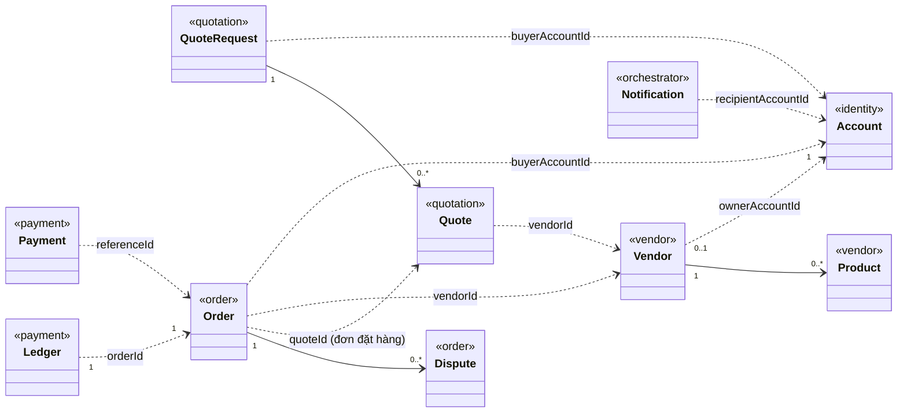
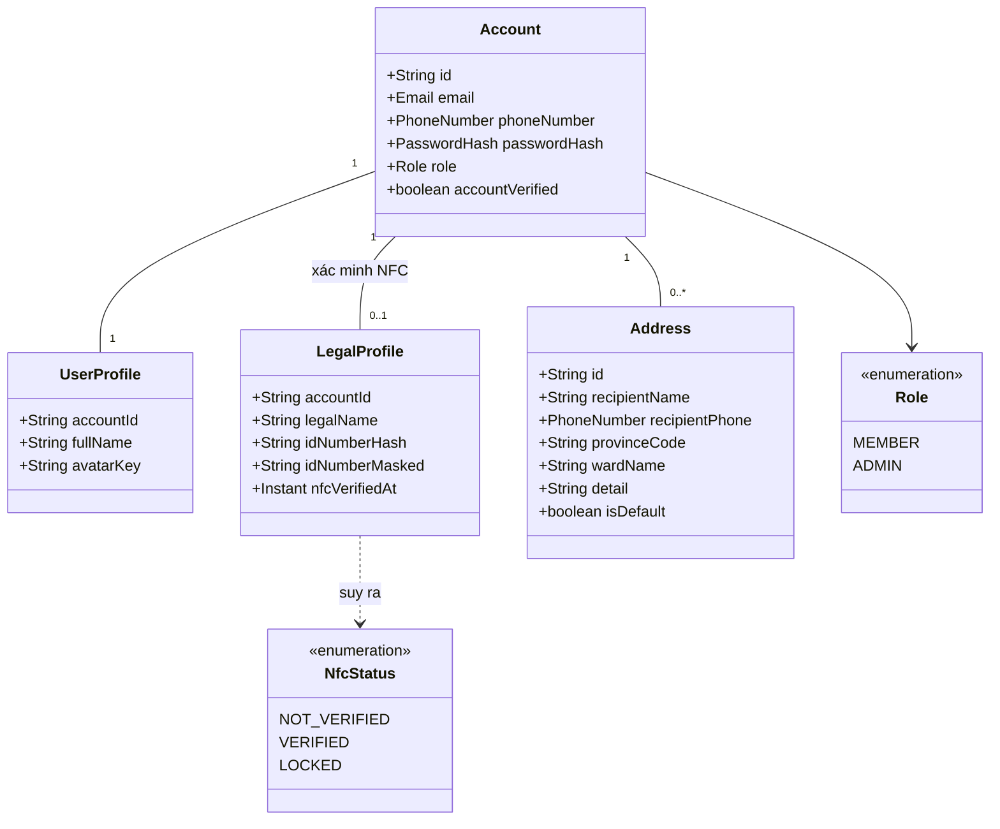
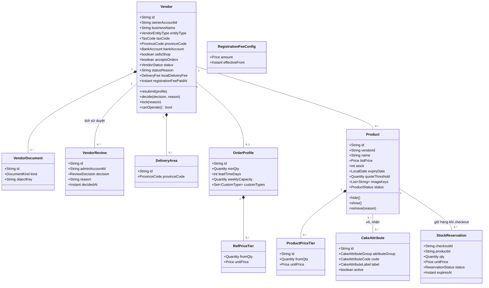
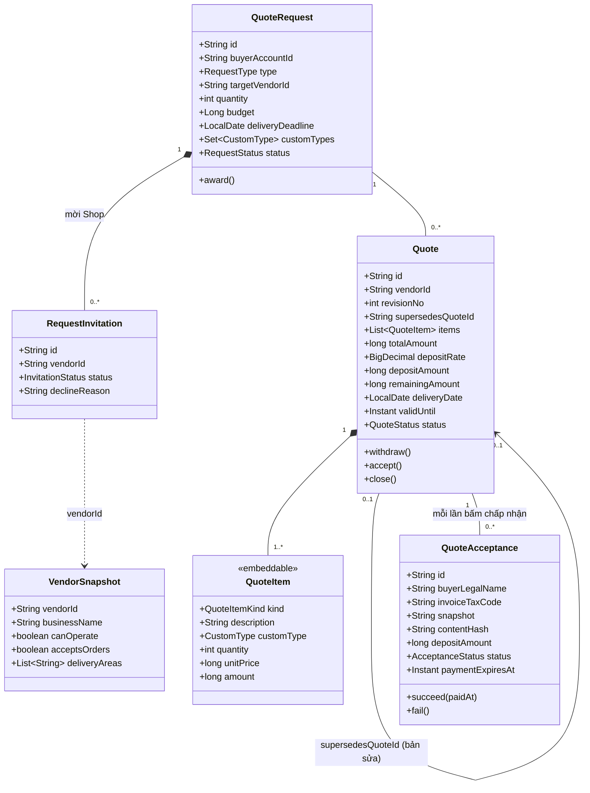
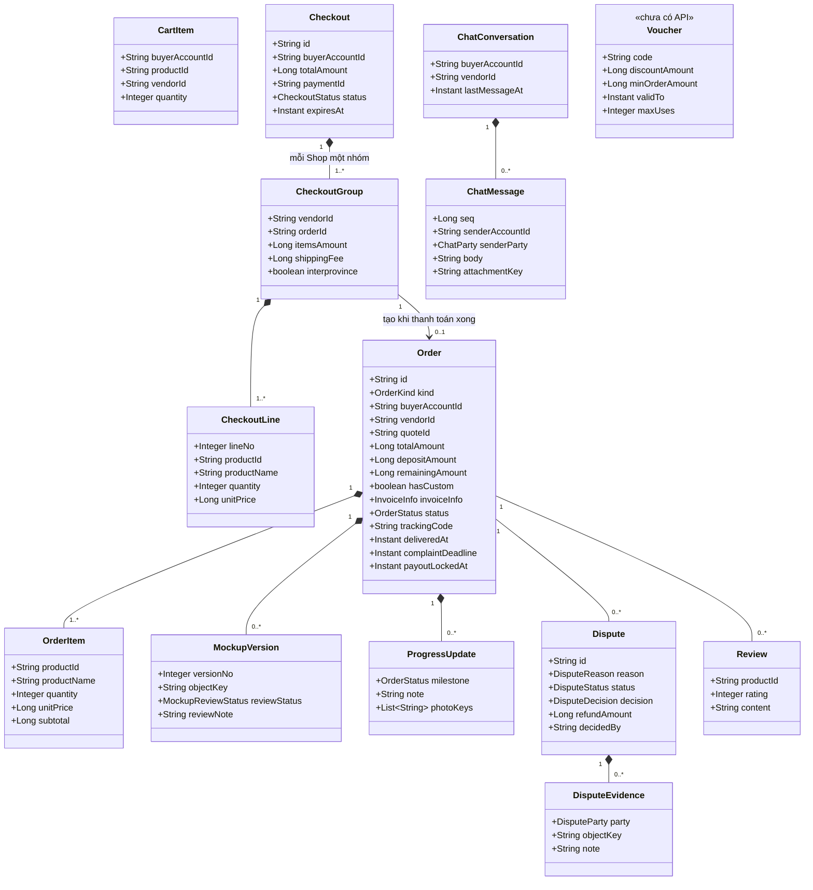
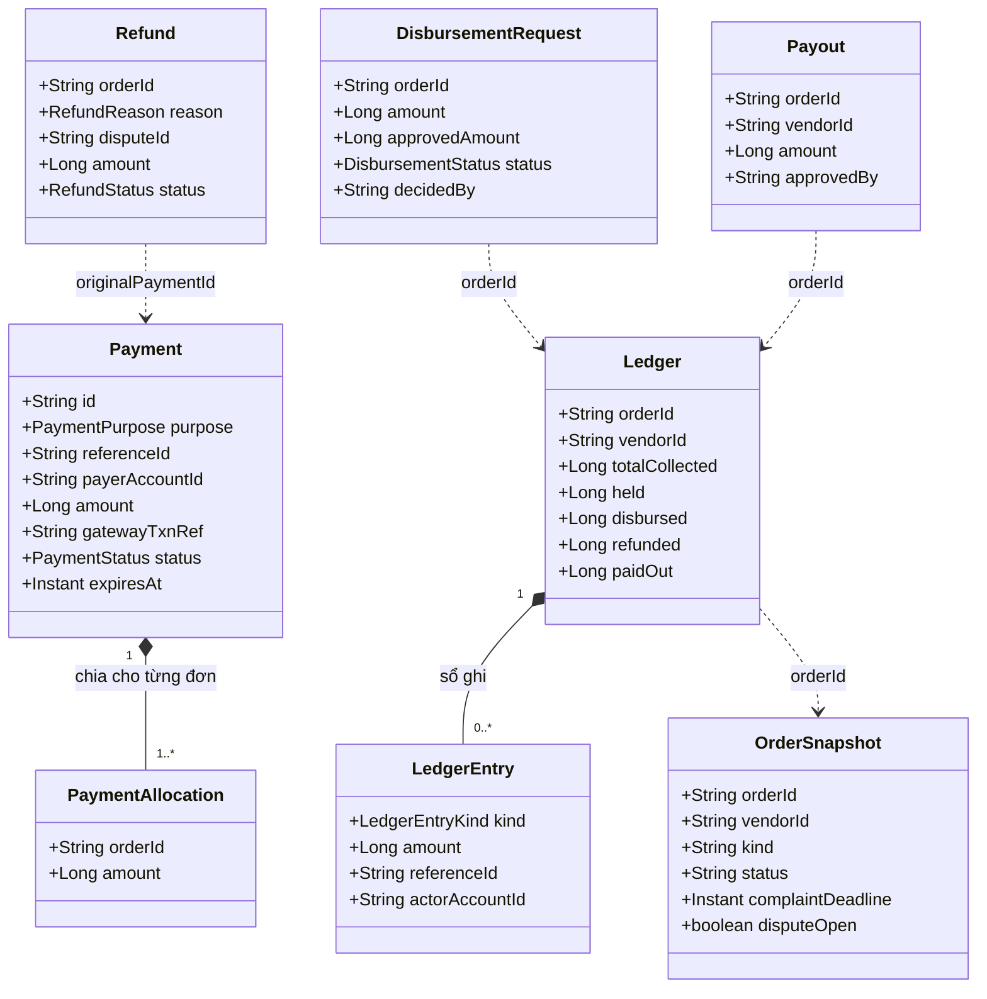
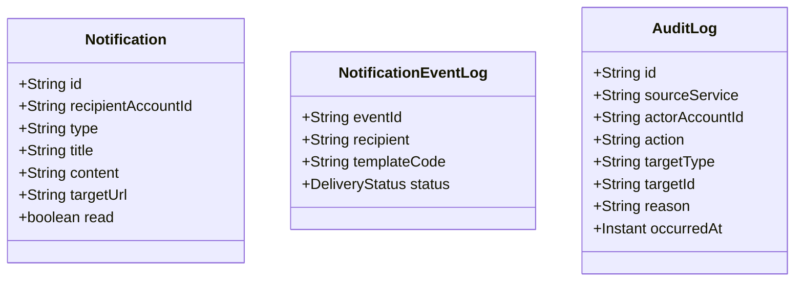

# Sơ đồ Class (mô hình miền)

Mỗi microservice có database riêng (D-1). Vì vậy sơ đồ chia theo service:

- **Trong một service:** quan hệ là liên kết JPA thật (`@ManyToOne`, `@OneToMany`), vẽ nét liền kèm bội số.
- **Giữa hai service:** chỉ tham chiếu bằng ID, không có khoá ngoại. Vẽ nét đứt `..>` kèm tên trường giữ ID.

Mỗi class chỉ ghi các thuộc tính có nghĩa nghiệp vụ. Bỏ `createdAt`, `updatedAt`, `version` và các bảng kỹ thuật (`OutboxEvent`, `ProcessedEvent`). Nguồn: entity JPA trong `api/<service>/src/main/java`.

## 1. Toàn cảnh: các thực thể chính và tham chiếu giữa service

## 2. identity-service

`Email`, `PhoneNumber`, `PasswordHash` là value object, nhúng vào bảng `accounts`. `NfcStatus` không lưu thành cột: có `nfcVerifiedAt` thì là `VERIFIED`, đang bị khoá do sai nhiều lần thì là `LOCKED`, còn lại là `NOT_VERIFIED` (`LegalProfileServiceImpl`). Số CCCD chỉ lưu dạng băm và dạng đã che.

## 3. vendor-service

`VendorStatus`: `PENDING`, `NEEDS_INFO`, `APPROVED`, `REJECTED`, `LOCKED`. `ProductStatus`: `ON_SALE`, `HIDDEN`, `REMOVED`. `ReservationStatus`: `HELD`, `COMMITTED`, `RELEASED`. Vòng đời xem [state-machines.md](state-machines.md).

## 4. quotation-service

`RequestType`: `DIRECT` (gửi một Shop, FR-15) hoặc `OPEN` (gửi nhiều xưởng, FR-16). `QuoteAcceptance` chụp lại toàn bộ điều khoản (`snapshot`, `contentHash`) tại lúc chấp nhận. Đó là bản thoả thuận mà `Order.agreementHash` trỏ tới.

## 5. order-service

`OrderKind`: `BUY_NOW` (mua ngay, tạo từ `Checkout`) hoặc `CUSTOM_ORDER` (đặt hàng, tạo từ sự kiện `quote.accepted`, `Order.id` = `QuoteAcceptance.id`). `Voucher` mới có bảng, chưa có service hay controller.

## 6. payment-service

`PaymentPurpose`: `CHECKOUT` (mua ngay), `DEPOSIT` (cọc), `REMAINDER` (phần còn lại), `REGISTRATION_FEE` (phí mở bán). `OrderSnapshot` là bản sao trạng thái đơn mà payment-service tự giữ (nhận qua sự kiện) để quyết định có được giải ngân không, không gọi sang order-service. Một lần mua ngay nhiều Shop là **một** `Payment` chia thành nhiều `PaymentAllocation`, mỗi đơn một phần. Mỗi đơn có đúng một `Ledger`: `held` là tiền nền tảng đang giữ, `disbursed`, `paidOut`, `refunded` là tiền đã ra.

## 7. orchestrator-service

orchestrator-service không có quan hệ JPA giữa các bảng. Dữ liệu tới từ RabbitMQ (`NotificationConsumer`): thông báo trong ứng dụng, email và audit log.
