# Sơ đồ State Machine

Mỗi sơ đồ là vòng đời của một thực thể có trạng thái. Tên trạng thái là giá trị enum trong code, kèm nghĩa tiếng Việt. Nhãn trên mũi tên ghi **ai hoặc cái gì** làm đổi trạng thái và điều kiện chặn (guard) trong ngoặc vuông.

| # | Thực thể | Enum | Nơi đổi trạng thái |
|---|---|---|---|
| 1 | Đơn mua ngay | `OrderStatus` | `CheckoutServiceImpl`, `OrderServiceImpl.nextStatus()` |
| 2 | Đơn đặt hàng | `OrderStatus` | `OrderServiceImpl`, `OrderDocumentServiceImpl` |
| 3 | Phiên thanh toán giỏ hàng | `CheckoutStatus` | `CheckoutServiceImpl` |
| 4 | Yêu cầu báo giá và lời mời | `RequestStatus`, `InvitationStatus` | `QuoteRequest`, `RequestInvitation` |
| 5 | Báo giá | `QuoteStatus` | `Quote`, `QuoteExpiryJob` |
| 6 | Lần chấp nhận báo giá | `AcceptanceStatus` | `QuoteAcceptance`, `QuoteAcceptanceServiceImpl` |
| 7 | Hồ sơ Shop | `VendorStatus` | `Vendor` |
| 8 | Sản phẩm | `ProductStatus` | `Product` |
| 9 | Khiếu nại | `DisputeStatus` | `DisputeServiceImpl` |
| 10 | Thanh toán và hoàn tiền | `PaymentStatus`, `RefundStatus` | `PaymentServiceImpl`, `RefundJob` |
| 11 | Xác minh NFC | `NfcStatus` | `LegalProfileServiceImpl`, `NfcAttemptTracker` |

## 1. Đơn mua ngay (`OrderKind.BUY_NOW`)

Đơn chỉ được tạo **sau khi** tiền đã vào (`payment.succeeded`), nên trạng thái đầu là `PAID`. Chủ Shop chỉ được chuyển đơn sang **đúng một** bước kế tiếp (`nextStatus()`).

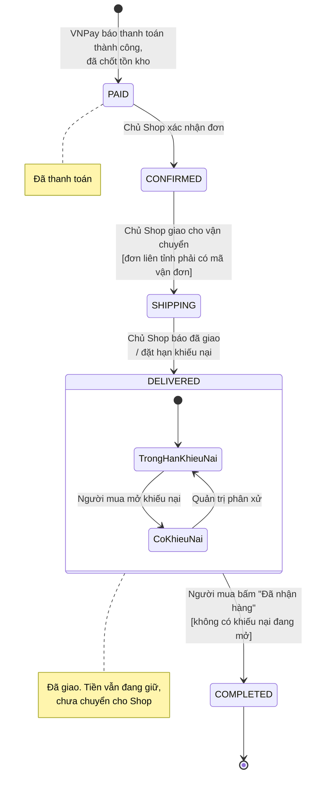

## 2. Đơn đặt hàng (`OrderKind.CUSTOM_ORDER`)

Đơn được tạo khi tiền cọc đã vào (sự kiện `quote.accepted`). Có in logo hay túi riêng (`hasCustom`) thì phải qua bước duyệt maket (BR-15).

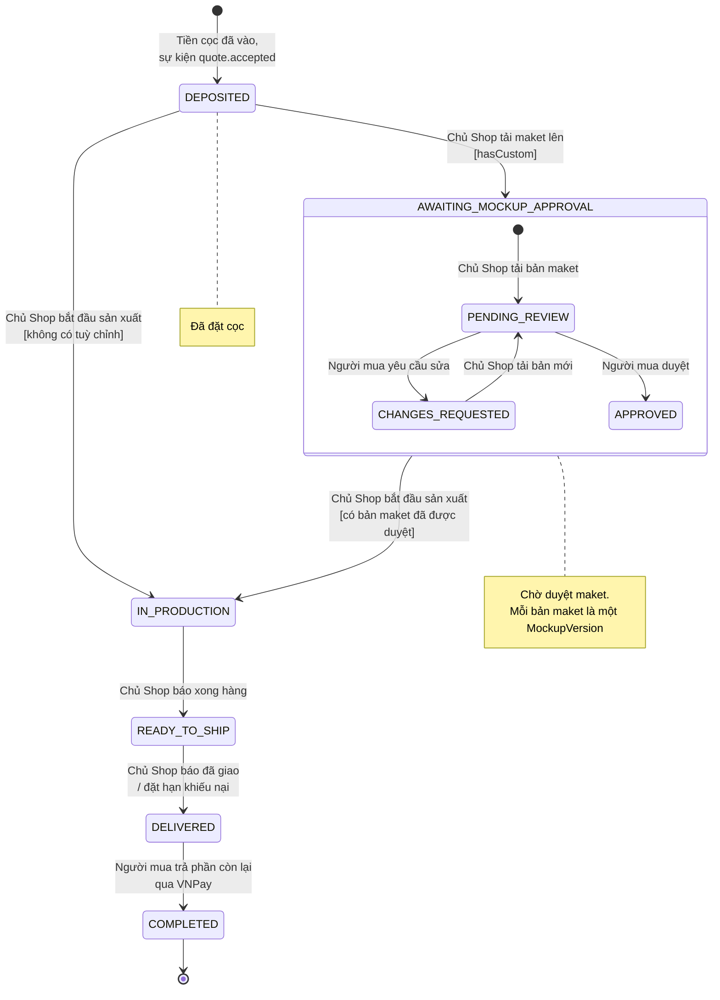

Mỗi lần chuyển bước, order-service ghi một `ProgressUpdate` (ghi chú và ảnh) để người mua theo dõi tiến độ (FR-21).

## 3. Phiên thanh toán giỏ hàng (`CheckoutStatus`)

Một lần bấm "Thanh toán" là một `Checkout`. Phiên này giữ tồn kho ở vendor-service trong lúc chờ VNPay.

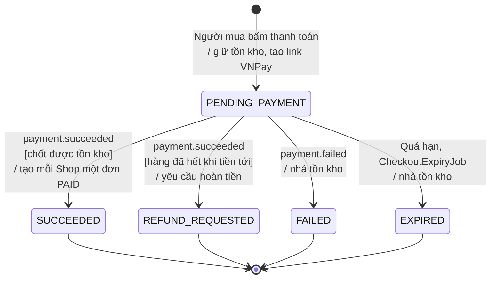

Tồn kho đi kèm (`ReservationStatus` ở vendor-service): `HELD` → `COMMITTED` khi thanh toán xong, hoặc `HELD` → `RELEASED` khi thất bại hay quá hạn.

## 4. Yêu cầu báo giá và lời mời

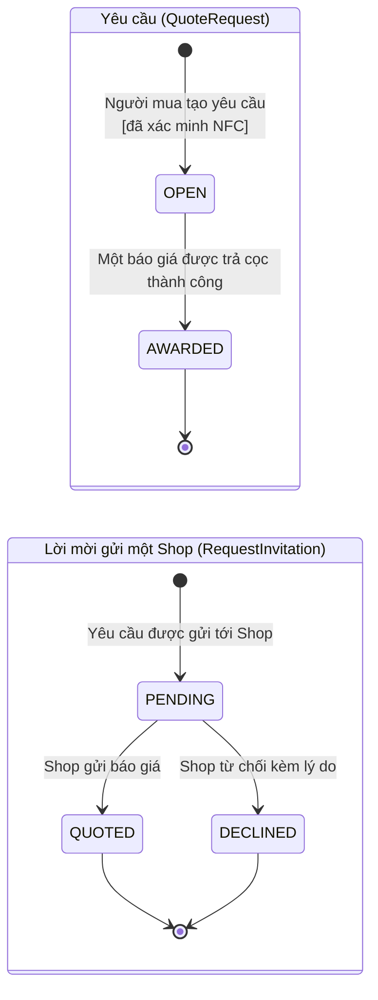

Enum `RequestStatus` còn `CLOSED` và `EXPIRED`, nhưng hiện chưa có code nào chuyển yêu cầu sang hai trạng thái này.

## 5. Báo giá (`QuoteStatus`)

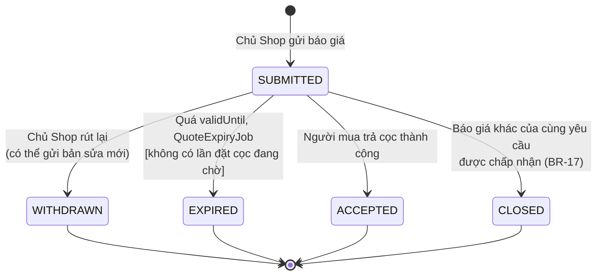

Enum có `REJECTED`, nhưng hiện chưa có code nào chuyển báo giá sang trạng thái này.

## 6. Lần chấp nhận báo giá (`AcceptanceStatus`)

Mỗi lần người mua bấm "Chấp nhận và đặt cọc" tạo một `QuoteAcceptance`. Bản ghi này chụp lại điều khoản, rồi chờ tiền cọc.

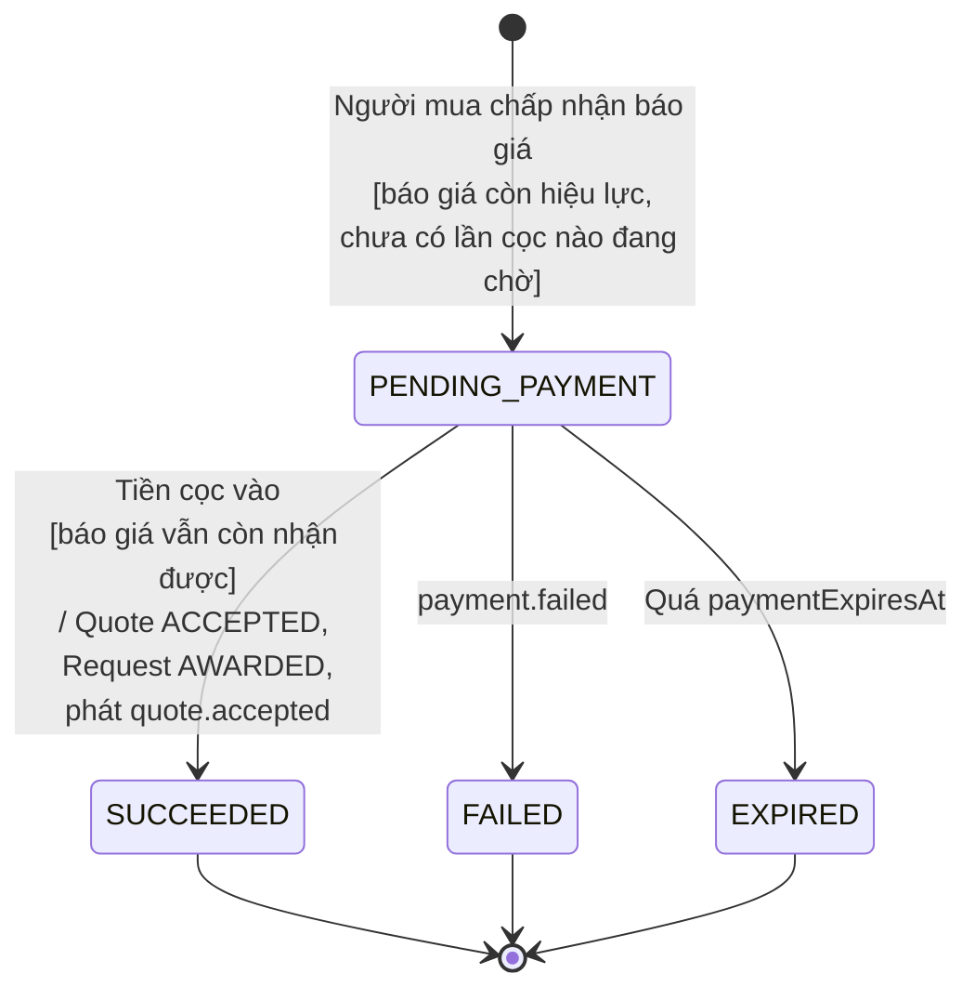

Nếu tiền cọc tới khi báo giá không còn nhận được nữa (đã hết hạn, hoặc báo giá khác đã thắng), cọc được hoàn lại với lý do `QUOTE_EXPIRED`.

## 7. Hồ sơ Shop (`VendorStatus`)

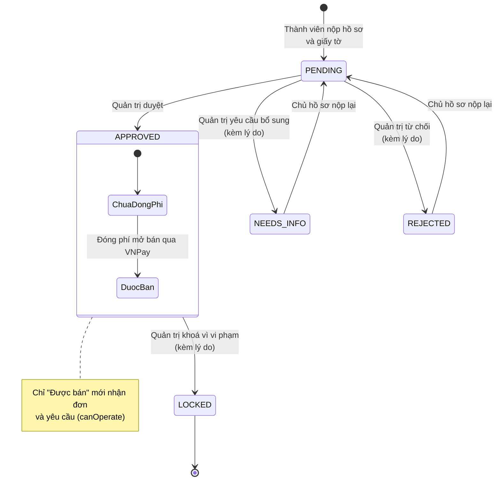

Chưa có chức năng mở khoá Shop (`VendorStatus` ghi rõ "Unlocking is not a requirement").

## 8. Sản phẩm (`ProductStatus`)

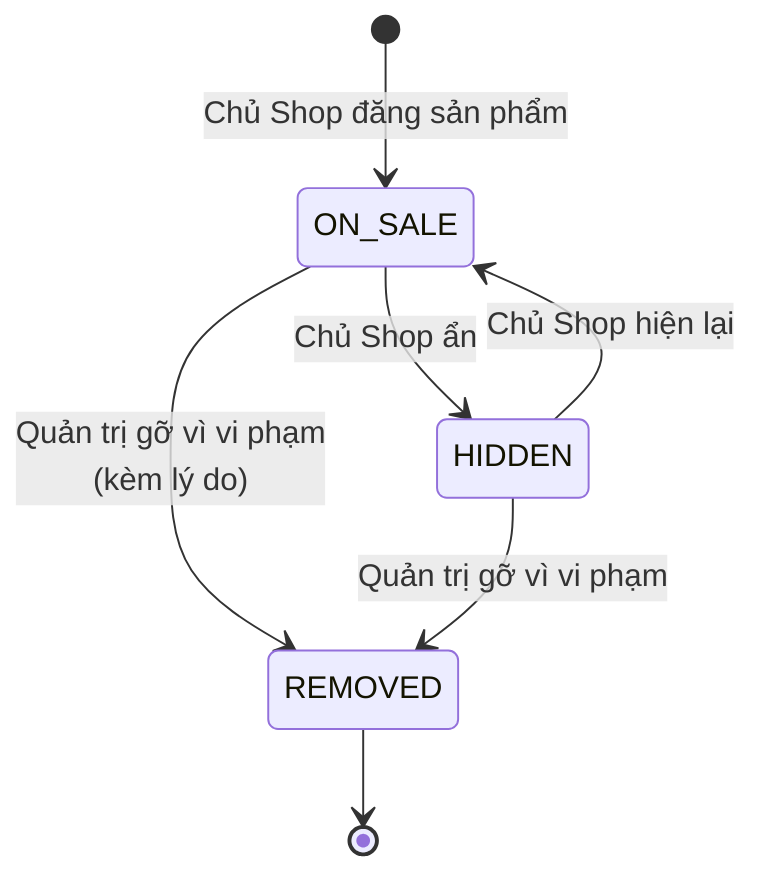

Sản phẩm không bao giờ bị xoá, chỉ ẩn hoặc bị gỡ (requirements mục 4.2). Mua ngay chỉ được khi `ON_SALE` và còn đủ tồn kho (`Product.canSupply`).

## 9. Khiếu nại (`DisputeStatus`)

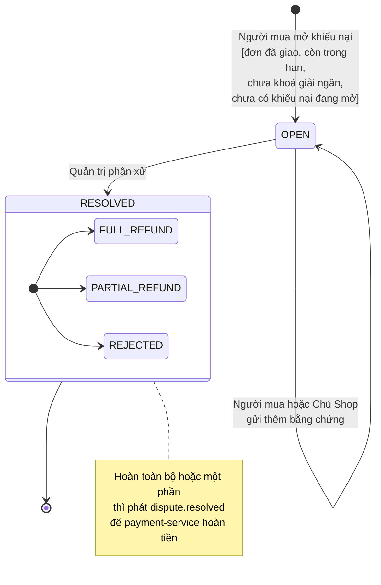

## 10. Thanh toán và hoàn tiền

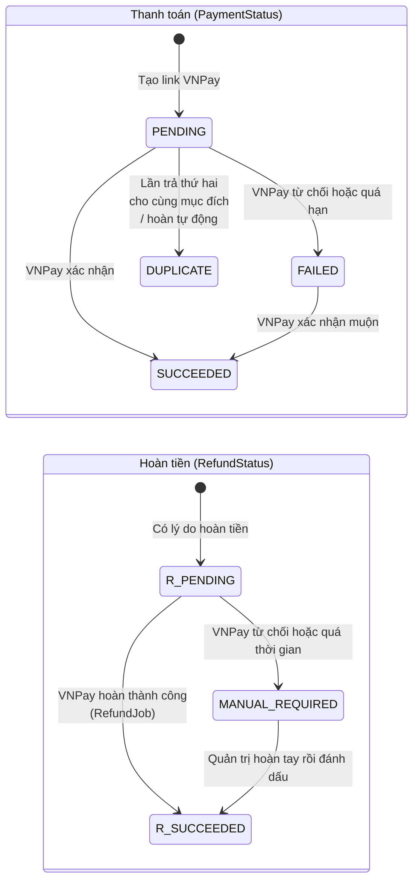

`R_PENDING` và `R_SUCCEEDED` là tên trong sơ đồ để khỏi trùng với trạng thái của `Payment`. Trong code là `RefundStatus.PENDING` và `RefundStatus.SUCCEEDED`.

## 11. Xác minh NFC (`NfcStatus`)

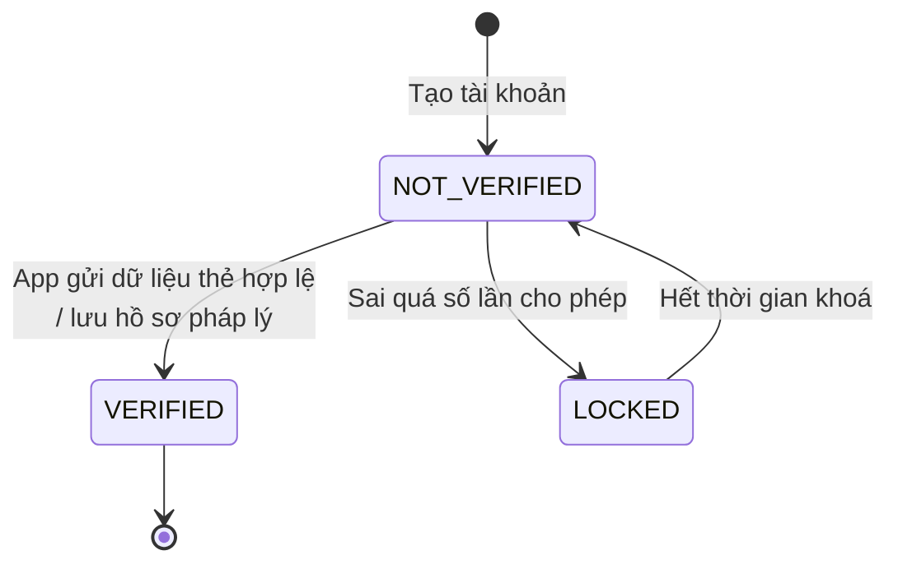

`NfcStatus` không lưu thành cột mà được suy ra: có `LegalProfile.nfcVerifiedAt` thì là `VERIFIED`, đang trong thời gian khoá (`NfcLockout`) thì là `LOCKED`.
