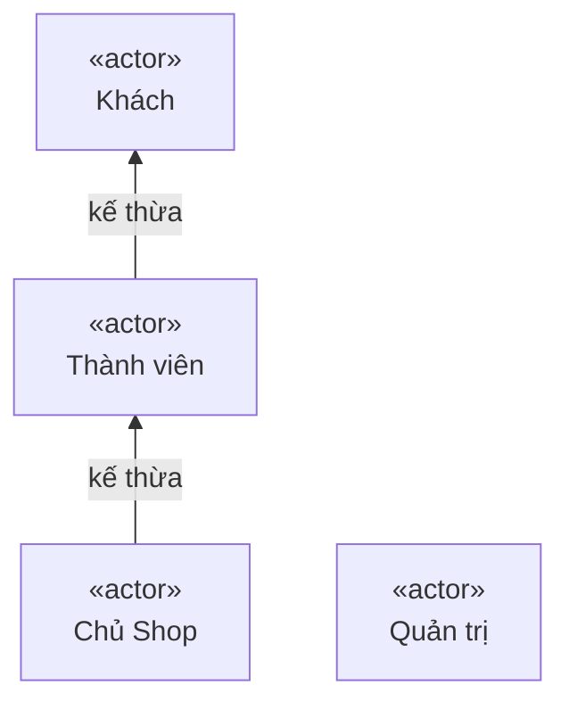
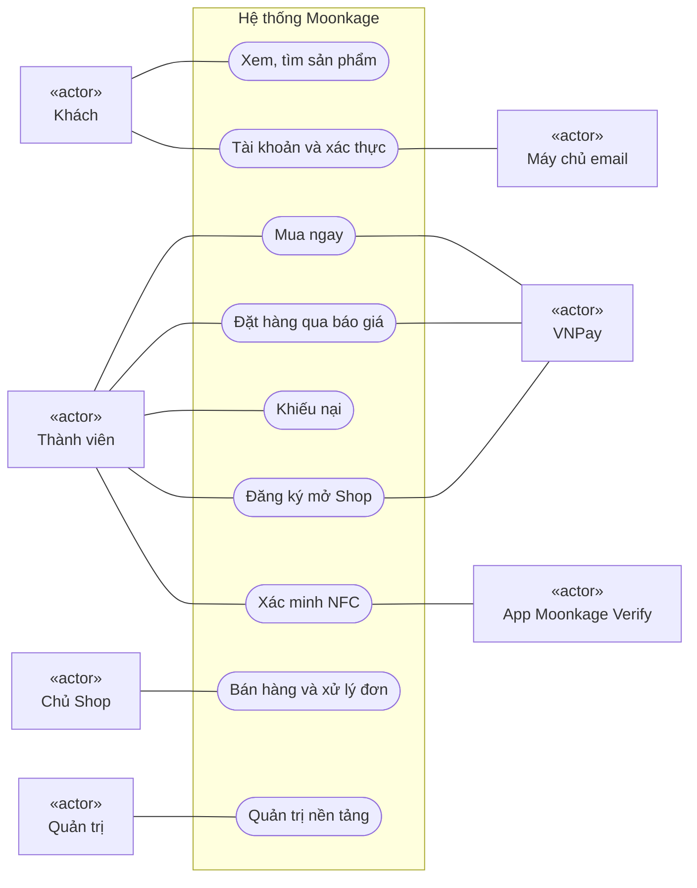
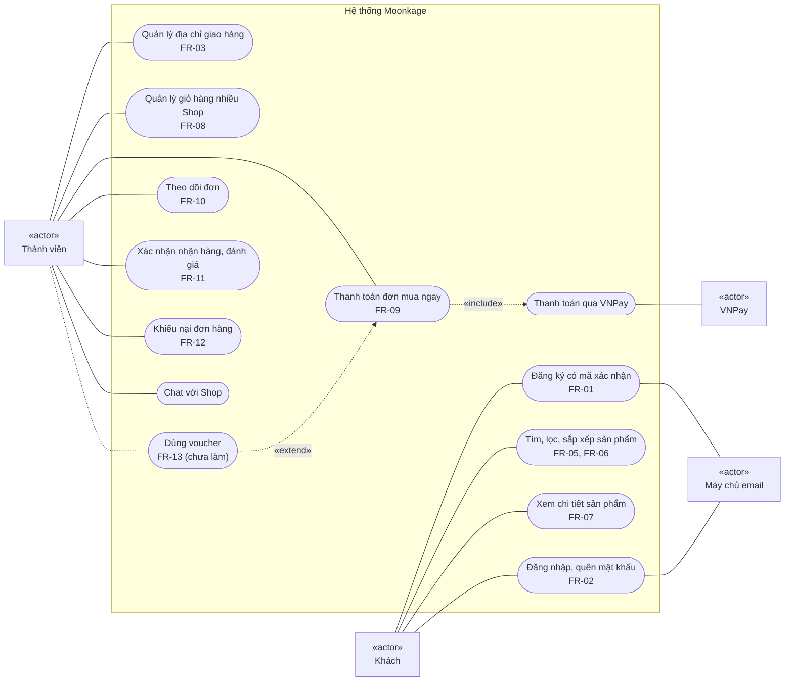
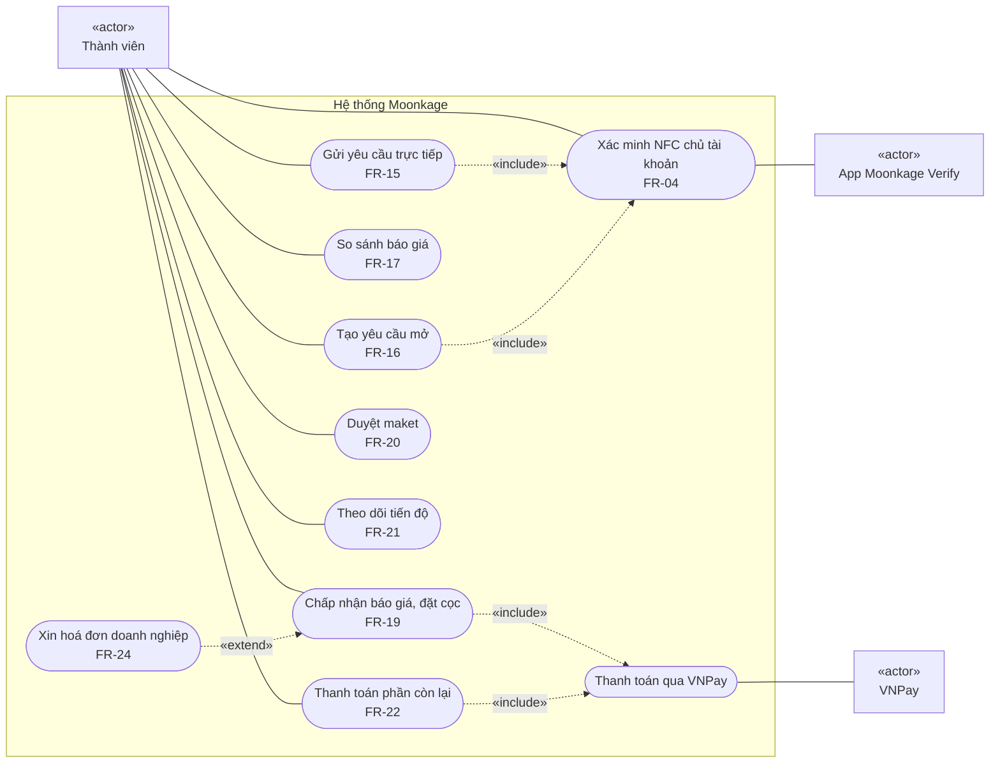
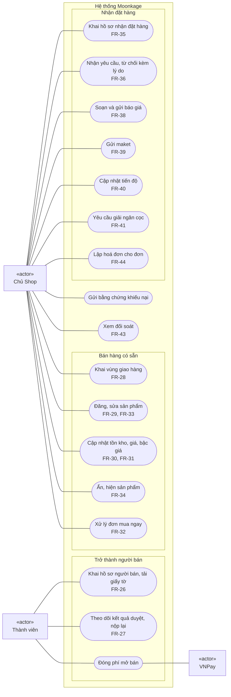
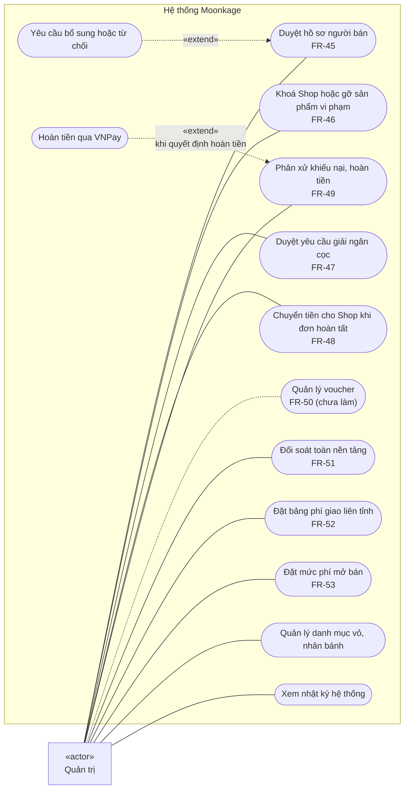

# Sơ đồ Use Case

Mermaid không có kiểu sơ đồ use case riêng, nên sơ đồ dùng `flowchart` theo quy ước UML:

- Hình chữ nhật có «actor» là tác nhân. Hình bo tròn là use case.
- Khung lớn là ranh giới hệ thống Moonkage.
- Mũi tên «include» là bước luôn xảy ra, «extend» là bước tuỳ chọn.
- Nét đứt là phần chưa làm.

Nguồn: [requirements.md](../../product/requirements.md) mục 3 (vai trò) và mục 5 (FR), đối chiếu với controller của từng service.

## 1. Tác nhân

| Tác nhân | Là ai | Ghi chú |
|---|---|---|
| Khách | Người chưa đăng nhập | Chỉ xem và tìm sản phẩm |
| Thành viên (người mua) | Mọi tài khoản vai `MEMBER` | Kế thừa mọi use case của Khách |
| Chủ Shop | Thành viên sở hữu một Shop đã duyệt | **Không phải một vai riêng** (D-19). Quyền suy ra từ `Vendor.ownerAccountId`. Kế thừa mọi use case của Thành viên |
| Quản trị | Tài khoản vai `ADMIN` | Đội vận hành Moonkage |
| App Moonkage Verify | Hệ thống ngoài (app Android) | Đọc thẻ NFC, gửi dữ liệu thẻ đã mã hoá |
| VNPay | Hệ thống ngoài | Cổng thanh toán (sandbox) |
| Máy chủ email | Hệ thống ngoài | Gmail SMTP: mã xác nhận và đặt lại mật khẩu |

## 2. Tổng quan

## 3. Khách và Thành viên: tài khoản và mua ngay

Thành viên kế thừa mọi use case của Khách (mục 1), nên không nối lại các đường của Khách.

## 4. Thành viên: đặt hàng qua báo giá

Gửi yêu cầu báo giá đòi tài khoản đã xác minh NFC (BR-23, kiểm ở `QuoteRequestController`). Mua ngay thì không cần.

## 5. Chủ Shop

Một Thành viên chỉ trở thành Chủ Shop khi hồ sơ được duyệt **và** đã đóng phí mở bán (`Vendor.canOperate()`, BR-20, BR-31).

## 6. Quản trị

