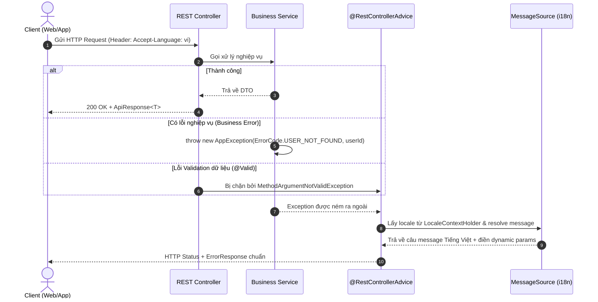

# TASK: Triển khai Hệ thống Quản lý Message & Error Response Chuẩn Enterprise (Identity Service)

> **Lưu trữ.** Tài liệu lịch sử, không cập nhật nữa và có thể đã khác code hiện tại. Hiện trạng: [docs/services/identity/README.md](../services/identity/README.md).

> **Module**: `identity-service`  
> **Ngôn ngữ trọng tâm**: **Tiếng Việt (`vi`)**  
> **Mục tiêu**: Chuẩn hóa toàn bộ message nghiệp vụ và phản hồi lỗi qua `MessageSource` (i18n), sử dụng `ErrorCode` enum và `AppException` có dynamic params (`{0}`, `{1}`...), loại bỏ triệt để hardcode text UI trong Service.

---

## 1. Luồng hoạt động tổng thể (Workflow)



---

## 2. Chuẩn Contract Payload (DTO)

### 2.1. Phản hồi Thành công

```json
{
  "success": true,
  "code": "SUCCESS",
  "message": "Thao tác thành công",
  "data": { ... },
  "timestamp": "2026-10-18T14:30:00Z"
}
```

### 2.2. Phản hồi Thất bại / Lỗi

```json
{
  "success": false,
  "code": "AUTH_ACCOUNT_LOCKED",
  "message": "Tài khoản của bạn đã bị khóa. Vui lòng liên hệ quản trị viên.",
  "errors": [
    {
      "field": "email",
      "message": "Email không đúng định dạng"
    }
  ],
  "timestamp": "2026-10-18T14:30:00Z"
}
```

---

## 3. Các thành phần Code cần triển khai

### Bước 1: Cấu hình `LocaleResolver` & `MessageSource`

File: `src/main/java/com/moonkage/identity/config/LocaleConfig.java`

```java
package com.moonkage.identity.config;

import java.nio.charset.StandardCharsets;
import java.util.List;
import java.util.Locale;
import org.springframework.context.MessageSource;
import org.springframework.context.annotation.Bean;
import org.springframework.context.annotation.Configuration;
import org.springframework.context.support.ResourceBundleMessageSource;
import org.springframework.web.servlet.LocaleResolver;
import org.springframework.web.servlet.i18n.AcceptHeaderLocaleResolver;

@Configuration
public class LocaleConfig {

    private static final Locale LOCALE_VI = Locale.forLanguageTag("vi");

    @Bean
    public LocaleResolver localeResolver() {
        AcceptHeaderLocaleResolver resolver = new AcceptHeaderLocaleResolver();
        resolver.setSupportedLocales(List.of(LOCALE_VI, Locale.ENGLISH));
        resolver.setDefaultLocale(LOCALE_VI); // Dự án trọng tâm Tiếng Việt
        return resolver;
    }

    @Bean
    public MessageSource messageSource() {
        ResourceBundleMessageSource messageSource = new ResourceBundleMessageSource();
        messageSource.setBasename("messages");
        messageSource.setDefaultEncoding(StandardCharsets.UTF_8.name());
        messageSource.setUseCodeAsDefaultMessage(true);
        return messageSource;
    }
}
```

---

### Bước 2: File tài nguyên ngôn ngữ Tiếng Việt

File: `src/main/resources/messages.properties` (Default bundle chứa toàn bộ thông điệp tiếng Việt):

```properties
# ─── COMMON ───
error.common.internal=Đã xảy ra lỗi hệ thống. Vui lòng thử lại sau.
error.common.invalid_input=Dữ liệu đầu vào không hợp lệ.
error.common.access_denied=Bạn không có quyền thực hiện hành động này.
error.common.malformed_json=Định dạng dữ liệu gửi lên không đúng.

# ─── AUTH ───
error.auth.invalid_credentials=Email/số điện thoại hoặc mật khẩu không chính xác.
error.auth.account_not_activated=Tài khoản chưa được kích hoạt. Vui lòng kiểm tra email và xác thực OTP.
error.auth.account_locked=Tài khoản của bạn đã bị khóa. Vui lòng thử lại sau {0} phút.
error.auth.account_disabled_or_locked=Tài khoản đã bị khóa hoặc ngừng hoạt động.
error.auth.otp_invalid_or_expired=Mã OTP không đúng hoặc đã hết hạn.
error.auth.refresh_token_invalid=Refresh token không hợp lệ hoặc đã hết hạn. Vui lòng đăng nhập lại.
error.auth.email_already_exists=Email {0} đã được sử dụng.
error.auth.phone_already_exists=Số điện thoại {0} đã được sử dụng.
error.auth.role_not_initialized=Vai trò {0} chưa được khởi tạo trong hệ thống.
error.auth.missing_bearer_token=Yêu cầu thiếu Authorization Bearer token.
error.auth.token_expired=Token xác thực đã hết hạn.
error.auth.token_invalid=Token xác thực không hợp lệ.
error.auth.email_delivery_failed=Không thể gửi email xác thực đến {0}. Vui lòng thử lại.

# ─── USER & ADDRESS ───
error.user.account_not_found=Không tìm thấy tài khoản người dùng {0}.
error.user.profile_not_found=Không tìm thấy hồ sơ người dùng.
error.address.not_found=Không tìm thấy địa chỉ có mã {0}.
```

---

### Bước 3: Định nghĩa `ErrorCode` Enum cho Identity Service

#### 3.1. Quy ước đặt tên lỗi (Error Naming Conventions)

Để đảm bảo tính nhất quán trên toàn hệ thống và giữa Backend - Frontend, việc đặt tên lỗi tuân thủ các quy tắc chuẩn hóa sau:

##### 1. Cấu trúc tổng thể của một Error Definition

Mỗi lỗi trong hệ thống được định nghĩa qua 3 thành phần liên kết chặt chẽ:

* **`CONSTANT_NAME` (Enum identifier)**: Tên định danh hằng số trong mã nguồn Java.
* **`code` (Public Error Code)**: Mã lỗi duy nhất gửi về cho Client (Web/Mobile) nhận diện và tra cứu từ điển đa ngôn ngữ (i18n).
* **`messageKey`**: Khóa thông điệp ánh xạ trực tiếp vào file cấu hình `messages_vi.properties`.

---

##### 2. Chi tiết quy cách đặt tên từng thành phần

| Thành phần | Định dạng | Cấu trúc chuẩn | Ví dụ |
| :--- | :--- | :--- | :--- |
| **Enum Identifier** | `UPPER_SNAKE_CASE` | `[TIỀN_TỐ_NGỮ_CẢNH]_[ĐỐI_TƯỢNG]_[TRẠNG_THÁI/HÀNH_ĐỘNG]` | `INVALID_CREDENTIALS`, `ACCOUNT_NOT_ACTIVATED`, `USER_NOT_FOUND` |
| **Public `code`** | `UPPER_SNAKE_CASE` | `[MODULE]_[MÃ_SỐ_3_CHỮ_SỐ]` hoặc `COMMON_[HTTP_CODE]` | `AUTH_001`, `USER_002`, `ADDRESS_001`, `COMMON_400` |
| **`messageKey`** | `lower.snake.case` | `error.[module].[đối_tượng]_[hành_động/trạng_thái]` | `error.auth.invalid_credentials`, `error.user.not_found` |

---

##### 3. Quy tắc ngữ nghĩa (Semantic Naming Rules)

Tên lỗi cần phản ánh chính xác bản chất nghiệp vụ bằng các hậu tố/tiền tố chuẩn sau:

* **Hậu tố trạng thái & kết quả**:
  * `_NOT_FOUND`: Dữ liệu/tài nguyên truy vấn không tồn tại trong DB (tương ứng HTTP `404 NOT_FOUND`).  
    *Ví dụ*: `USER_NOT_FOUND`, `ADDRESS_NOT_FOUND`.
  * `_ALREADY_EXISTS` / `_DUPLICATED`: Dữ liệu bị xung đột do vi phạm ràng buộc duy nhất (tương ứng HTTP `409 CONFLICT`).  
    *Ví dụ*: `EMAIL_ALREADY_EXISTS`, `PHONE_ALREADY_EXISTS`.
  * `_EXPIRED`: Dữ liệu/phiên làm việc/token đã hết hạn sử dụng (tương ứng HTTP `400 BAD_REQUEST` hoặc `401 UNAUTHORIZED`).  
    *Ví dụ*: `TOKEN_EXPIRED`, `OTP_EXPIRED`.
  * `_LOCKED` / `_DISABLED`: Tài nguyên hoặc tài khoản bị vô hiệu hóa/khóa có chủ đích (tương ứng HTTP `403 FORBIDDEN`).  
    *Ví dụ*: `ACCOUNT_LOCKED`, `ACCOUNT_DISABLED`.
  * `_FAILED`: Một tác vụ hoặc side-effect xử lý thất bại (gửi mail, tích hợp bên thứ ba) (tương ứng HTTP `500` hoặc `503`).  
    *Ví dụ*: `EMAIL_DELIVERY_FAILED`.

* **Tiền tố đánh giá tính hợp lệ**:
  * `INVALID_...`: Dữ liệu đầu vào sai định dạng, không khớp mật khẩu, hoặc thông tin bảo mật không hợp lệ (tương ứng HTTP `400` hoặc `401`).  
    *Ví dụ*: `INVALID_CREDENTIALS`, `INVALID_INPUT`, `INVALID_OTP`.
  * `MISSING_...`: Dữ liệu hoặc header bắt buộc bị thiếu trong request (tương ứng HTTP `400` hoặc `401`).  
    *Ví dụ*: `MISSING_BEARER_TOKEN`.

---

##### 4. Quy ước phân bổ tiền tố và dải mã lỗi (`code`)

Để dễ dàng định tuyến và tra cứu log phân tán (distributed tracing):

* **`COMMON_xxx`**: Dành cho lỗi hạ tầng hệ thống, HTTP protocol, validate chung (dùng kèm mã HTTP):
  * `COMMON_400`: Lỗi cú pháp request, JSON malformed, validate tham số.
  * `COMMON_401`: Chưa xác thực hoặc phiên đăng nhập không hợp lệ.
  * `COMMON_403`: Không có quyền truy cập tài nguyên (Access Denied).
  * `COMMON_500`: Lỗi hệ thống nội bộ chưa được phân loại.
* **`AUTH_xxx`** (`AUTH_001` -> `AUTH_099`): Phân hệ Xác thực, Đăng nhập, Quản lý Token, Mã OTP, Kích hoạt tài khoản.
* **`USER_xxx`** (`USER_001` -> `USER_099`): Phân hệ Quản lý Tài khoản (Account), Thông tin cá nhân (Profile).
* **`ADDRESS_xxx`** (`ADDRESS_001` -> `ADDRESS_099`): Phân hệ Quản lý Sổ địa chỉ giao hàng.

> [!IMPORTANT]
> **Tính bất biến của Error Code**: Giá trị của `code` trả về cho Client là **bất biến (immutable)**. Một khi đã bàn giao cho Frontend/Mobile App, không được phép thay đổi mã `code`, chỉ thay đổi câu từ hiển thị trong file ngôn ngữ `messages_vi.properties`.

---

##### 5. Anti-Patterns cần tránh khi đặt tên lỗi

* ❌ **Không đặt tên chung chung, mơ hồ**: Tránh `ERROR_1`, `SOMETHING_WENT_WRONG`, `FAILED`, `UNKNOWN_ERROR`.
* ❌ **Không nhét văn phong nói/tiếng Việt vào mã lỗi**: Tránh `USER_KHONG_TON_TAI`, `CANNOT_FIND_USER_BY_ID_ERROR`.
* ❌ **Không dùng lẫn lộn quy ước viết hoa/thường**: Tránh `userNotFound`, `user-not-found` trong Enum name và mã Code.
* ❌ **Không gắn cứng thông điệp UI vào tên lỗi**: Tránh `PLEASE_ENTER_PASSWORD` (tên lỗi phải là danh từ/trạng thái như `MISSING_PASSWORD` hoặc `INVALID_PASSWORD`).

---

#### 3.2. Mã nguồn triển khai `ErrorCode.java`

File: `src/main/java/com/moonkage/identity/exception/ErrorCode.java`

```java
package com.moonkage.identity.exception;

import lombok.Getter;
import lombok.RequiredArgsConstructor;
import org.springframework.http.HttpStatus;

@Getter
@RequiredArgsConstructor
public enum ErrorCode {

    // Common
    INTERNAL_SERVER_ERROR("COMMON_500", HttpStatus.INTERNAL_SERVER_ERROR, "error.common.internal"),
    INVALID_INPUT("COMMON_400", HttpStatus.BAD_REQUEST, "error.common.invalid_input"),
    ACCESS_DENIED("COMMON_403", HttpStatus.FORBIDDEN, "error.common.access_denied"),
    MALFORMED_JSON("COMMON_400", HttpStatus.BAD_REQUEST, "error.common.malformed_json"),

    // Auth
    INVALID_CREDENTIALS("AUTH_001", HttpStatus.UNAUTHORIZED, "error.auth.invalid_credentials"),
    ACCOUNT_NOT_ACTIVATED("AUTH_002", HttpStatus.FORBIDDEN, "error.auth.account_not_activated"),
    ACCOUNT_LOCKED("AUTH_003", HttpStatus.FORBIDDEN, "error.auth.account_locked"),
    ACCOUNT_DISABLED_OR_LOCKED("AUTH_004", HttpStatus.FORBIDDEN, "error.auth.account_disabled_or_locked"),
    OTP_INVALID_OR_EXPIRED("AUTH_005", HttpStatus.BAD_REQUEST, "error.auth.otp_invalid_or_expired"),
    REFRESH_TOKEN_INVALID("AUTH_006", HttpStatus.UNAUTHORIZED, "error.auth.refresh_token_invalid"),
    EMAIL_ALREADY_EXISTS("AUTH_007", HttpStatus.CONFLICT, "error.auth.email_already_exists"),
    PHONE_ALREADY_EXISTS("AUTH_008", HttpStatus.CONFLICT, "error.auth.phone_already_exists"),
    ROLE_NOT_INITIALIZED("AUTH_009", HttpStatus.INTERNAL_SERVER_ERROR, "error.auth.role_not_initialized"),
    MISSING_BEARER_TOKEN("AUTH_010", HttpStatus.UNAUTHORIZED, "error.auth.missing_bearer_token"),
    TOKEN_EXPIRED("AUTH_011", HttpStatus.UNAUTHORIZED, "error.auth.token_expired"),
    TOKEN_INVALID("AUTH_012", HttpStatus.UNAUTHORIZED, "error.auth.token_invalid"),
    EMAIL_DELIVERY_FAILED("AUTH_013", HttpStatus.SERVICE_UNAVAILABLE, "error.auth.email_delivery_failed"),

    // User & Address
    ACCOUNT_NOT_FOUND("USER_001", HttpStatus.NOT_FOUND, "error.user.account_not_found"),
    USER_PROFILE_NOT_FOUND("USER_002", HttpStatus.NOT_FOUND, "error.user.profile_not_found"),
    ADDRESS_NOT_FOUND("ADDRESS_001", HttpStatus.NOT_FOUND, "error.address.not_found");

    private final String code;
    private final HttpStatus httpStatus;
    private final String messageKey;
}
```

---

### Bước 4: Tạo Custom Exception `AppException`

File: `src/main/java/com/moonkage/identity/exception/AppException.java`

```java
package com.moonkage.identity.exception;

import lombok.Getter;

@Getter
public class AppException extends RuntimeException {

    private final ErrorCode errorCode;
    private final Object[] args;

    public AppException(ErrorCode errorCode, Object... args) {
        super(errorCode.getMessageKey());
        this.errorCode = errorCode;
        this.args = args;
    }
}
```

---

### Bước 5: Tạo DTO Phản hồi chuẩn `ErrorResponse`

File: `src/main/java/com/moonkage/identity/dto/response/ErrorResponse.java`

```java
package com.moonkage.identity.dto.response;

import com.fasterxml.jackson.annotation.JsonInclude;
import java.time.Instant;
import java.util.List;
import lombok.Builder;
import lombok.Getter;

@Getter
@Builder
@JsonInclude(JsonInclude.Include.NON_NULL)
public class ErrorResponse {

    @Builder.Default
    private final boolean success = false;

    private final String code;
    private final String message;
    private final List<ValidationError> errors;
    private final Instant timestamp;

    @Getter
    @Builder
    public static class ValidationError {
        private final String field;
        private final String message;
    }
}
```

---

### Bước 6: Bộ xử lý lỗi tập trung `GlobalExceptionHandler`

File: `src/main/java/com/moonkage/identity/exception/GlobalExceptionHandler.java`

```java
package com.moonkage.identity.exception;

import com.moonkage.identity.dto.response.ErrorResponse;
import io.jsonwebtoken.ExpiredJwtException;
import io.jsonwebtoken.JwtException;
import java.time.Instant;
import java.util.List;
import lombok.RequiredArgsConstructor;
import lombok.extern.slf4j.Slf4j;
import org.springframework.context.MessageSource;
import org.springframework.context.i18n.LocaleContextHolder;
import org.springframework.http.ResponseEntity;
import org.springframework.http.converter.HttpMessageNotReadableException;
import org.springframework.security.access.AccessDeniedException;
import org.springframework.security.authentication.AccountStatusException;
import org.springframework.security.authentication.BadCredentialsException;
import org.springframework.security.core.AuthenticationException;
import org.springframework.web.bind.MethodArgumentNotValidException;
import org.springframework.web.bind.annotation.ExceptionHandler;
import org.springframework.web.bind.annotation.RestControllerAdvice;

@Slf4j
@RestControllerAdvice
@RequiredArgsConstructor
public class GlobalExceptionHandler {

    private final MessageSource messageSource;

    // 1. Bắt lỗi nghiệp vụ AppException
    @ExceptionHandler(AppException.class)
    public ResponseEntity<ErrorResponse> handleAppException(AppException ex) {
        ErrorCode ec = ex.getErrorCode();
        String localizedMessage = messageSource.getMessage(
                ec.getMessageKey(),
                ex.getArgs(),
                LocaleContextHolder.getLocale());

        log.warn("Business Exception: code={}, message={}", ec.getCode(), localizedMessage);

        ErrorResponse response = ErrorResponse.builder()
                .code(ec.getCode())
                .message(localizedMessage)
                .timestamp(Instant.now())
                .build();

        return ResponseEntity.status(ec.getHttpStatus()).body(response);
    }

    // 2. Bắt lỗi Validation DTO (@Valid)
    @ExceptionHandler(MethodArgumentNotValidException.class)
    public ResponseEntity<ErrorResponse> handleValidationException(MethodArgumentNotValidException ex) {
        List<ErrorResponse.ValidationError> validationErrors = ex.getBindingResult().getFieldErrors().stream()
                .map(fe -> ErrorResponse.ValidationError.builder()
                        .field(fe.getField())
                        .message(fe.getDefaultMessage())
                        .build())
                .toList();

        String localizedMessage = messageSource.getMessage(
                ErrorCode.INVALID_INPUT.getMessageKey(),
                null,
                LocaleContextHolder.getLocale());

        ErrorResponse response = ErrorResponse.builder()
                .code(ErrorCode.INVALID_INPUT.getCode())
                .message(localizedMessage)
                .errors(validationErrors)
                .timestamp(Instant.now())
                .build();

        return ResponseEntity.status(ErrorCode.INVALID_INPUT.getHttpStatus()).body(response);
    }

    // 3. Bắt lỗi JSON body không hợp lệ
    @ExceptionHandler(HttpMessageNotReadableException.class)
    public ResponseEntity<ErrorResponse> handleHttpMessageNotReadable(HttpMessageNotReadableException ex) {
        return buildErrorResponse(ErrorCode.MALFORMED_JSON);
    }

    // 4. Bắt lỗi xác thực Spring Security
    @ExceptionHandler(BadCredentialsException.class)
    public ResponseEntity<ErrorResponse> handleBadCredentials(BadCredentialsException ex) {
        return buildErrorResponse(ErrorCode.INVALID_CREDENTIALS);
    }

    @ExceptionHandler(ExpiredJwtException.class)
    public ResponseEntity<ErrorResponse> handleExpiredJwt(ExpiredJwtException ex) {
        return buildErrorResponse(ErrorCode.TOKEN_EXPIRED);
    }

    @ExceptionHandler({JwtException.class, AuthenticationException.class})
    public ResponseEntity<ErrorResponse> handleAuthException(Exception ex) {
        return buildErrorResponse(ErrorCode.TOKEN_INVALID);
    }

    @ExceptionHandler(AccountStatusException.class)
    public ResponseEntity<ErrorResponse> handleAccountStatus(AccountStatusException ex) {
        return buildErrorResponse(ErrorCode.ACCOUNT_DISABLED_OR_LOCKED);
    }

    @ExceptionHandler(AccessDeniedException.class)
    public ResponseEntity<ErrorResponse> handleAccessDenied(AccessDeniedException ex) {
        return buildErrorResponse(ErrorCode.ACCESS_DENIED);
    }

    // 5. Bắt các lỗi không xác định (Internal Server Error)
    @ExceptionHandler(Exception.class)
    public ResponseEntity<ErrorResponse> handleUncaughtException(Exception ex) {
        log.error("Unhandled Exception: ", ex);
        return buildErrorResponse(ErrorCode.INTERNAL_SERVER_ERROR);
    }

    private ResponseEntity<ErrorResponse> buildErrorResponse(ErrorCode errorCode) {
        String localizedMessage = messageSource.getMessage(
                errorCode.getMessageKey(),
                null,
                LocaleContextHolder.getLocale());

        ErrorResponse response = ErrorResponse.builder()
                .code(errorCode.getCode())
                .message(localizedMessage)
                .timestamp(Instant.now())
                .build();

        return ResponseEntity.status(errorCode.getHttpStatus()).body(response);
    }
}
```

---

## 4. Cách sử dụng trong Service Layer

```java
// Ví dụ trong AddressServiceImpl:
@Override
@Transactional(readOnly = true)
public AddressResponse getAddress(String accountId, String addressId) {
    return addressRepository.findByIdAndAccountId(addressId, accountId)
            .map(addressMapper::toResponse)
            .orElseThrow(() -> new AppException(ErrorCode.ADDRESS_NOT_FOUND, addressId));
}

// Ví dụ trong AuthServiceImpl:
if (emailService.verifyOtp(email, request.getOtp())) {
    ...
} else {
    throw new AppException(ErrorCode.OTP_INVALID_OR_EXPIRED);
}
```

---

## 5. Checklist nghiệm thu (Verification Checklist)

* [x] Header mặc định nhận thông báo Tiếng Việt từ `messages_vi.properties`.
* [x] Tham số động `{0}`, `{1}` truyền vào `AppException` được format chính xác vào câu thông báo.
* [x] Gửi request body vi phạm `@NotBlank`, `@Size` trả về HTTP 400 cùng mảng `errors: [{field, message}]`.
* [x] Xóa bỏ hoàn toàn class `ErrorMessageConstant` và các custom exception phân mảnh cũ.
* [x] Chạy `mvn spotless:apply`, `mvn checkstyle:check` và toàn bộ unit test/ArchUnit test đạt 100% pass.
