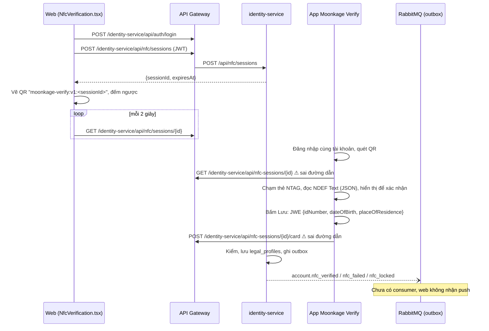

# Khảo sát hiện trạng luồng xác minh NFC (FR-04)

> **Lưu trữ.** Tài liệu lịch sử, không cập nhật nữa và có thể đã khác code hiện tại. Hiện trạng: [docs/services/identity/classes/NfcServiceImpl.md](../services/identity/classes/NfcServiceImpl.md).

Ngày khảo sát: 2026-10-19. Dựa trên code hiện có, không dựa trên tài liệu kế hoạch.

| Phía | Vị trí | Commit tham chiếu |
| --- | --- | --- |
| API | `platform/api/identity-service` (package `nfc`, `NfcController`, `IntNfcController`, `IntAccountController`) | `64ec9bc` (develop) + thay đổi chưa commit |
| Web | `platform/web/src/components/NfcVerification.tsx` | `af3235e` |
| Mobile | repo riêng `moonkage/mobile` (Flutter, app Moonkage Verify) | `2c78835` |

Đối chiếu với `docs/architecture/software-design.md` (mục 4.2, 5.1, sơ đồ tuần tự FR-04).

---

## 1. Tóm tắt

- **API: gần đủ theo thiết kế.** Có phiên QR, nhận thẻ, giải mã JWE, kiểm 9 trường, đếm lần sai và tạm khóa, lưu `legal_profiles` có mã hóa/băm, outbox event, API nội bộ. Test đơn vị khá dày.
- **Mobile: luồng hoàn chỉnh nhưng gọi sai đường dẫn API.** App gọi `/api/nfc-sessions/...`, còn backend là `/api/nfc/sessions/...`. App chỉ chạy được với mock server của chính nó, **chưa chạy được với backend thật**.
- **Web: mới là trang thử nghiệm.** Một component tự đăng nhập, tạo QR, poll trạng thái. Chưa gắn vào portal, chưa có WebSocket.
- **Chưa có đầu nhận:** event `account.nfc_*` được ghi outbox nhưng không service nào nghe; không có push WebSocket về web; vendor/quotation chưa gọi API nội bộ NFC.

---

## 2. Luồng hiện tại

---

## 3. API (identity-service)

### 3.1 Endpoint

| Endpoint | Ai gọi | Trả về | Ghi chú |
| --- | --- | --- | --- |
| `POST /api/nfc/sessions` | Web | 201 `{sessionId, expiresAt}` | 409 `NFC_001` đã xác minh, 429 `NFC_002` đang khóa. Phiên mới thay phiên PENDING cũ của cùng tài khoản |
| `GET /api/nfc/sessions/{id}` | Web (poll), App (trước khi chạm) | 200 `{sessionId, status: PENDING\|VERIFIED, expiresAt}` | 410 `NFC_003` hết hạn/không có, 403 `NFC_004` không phải chủ |
| `POST /api/nfc/sessions/{id}/card` | App | Luôn 200 `{status: VERIFIED\|REJECTED, reasonCode, attemptsLeft, lockedUntil}` | Cố ý không `@Valid`: thẻ sai dạng là lần thử bị đếm (`BAD_FORMAT`), không phải 400 |
| `GET /api/nfc/status` | Chưa ai gọi | `{nfcStatus, legalName, idNumberMasked, nfcVerifiedAt}` | Trạng thái của chính tài khoản, chỉ dữ liệu đã che |
| `GET /internal/nfc/status/{accountId}` | Chưa ai gọi | như trên | Cho BR-23, AC-45.1 |
| `POST /internal/accounts/check` | Chưa ai gọi | `{idHash, idHashKeyVer, idMasked, matchesAccount, owner*}` | Cho BR-27 (vendor băm số CCCD khai báo). Đang chuyển từ `IntIdNumberController` sang `IntAccountController` (thay đổi chưa commit) |

### 3.2 Xử lý khi nhận thẻ (`NfcServiceImpl.submitCard`)

Thứ tự kiểm khớp Software Design 4.2:

1. Phiên tồn tại, còn hạn → `SESSION_EXPIRED`
2. Phiên thuộc tài khoản trong JWT → `SESSION_NOT_OWNED`
3. Phiên chưa dùng, không đang xử lý song song → `SESSION_USED`
4. Tài khoản không bị khóa (khóa dòng `accounts` bằng `findByIdForUpdate`) → `LOCKED`
5. Giải mã JWE (chỉ nhận RSA-OAEP-256 + A256GCM) và kiểm 9 trường → `BAD_FORMAT`
6. CCCD còn hạn (giờ Việt Nam) → `CARD_EXPIRED`
7. Số CCCD chưa gắn tài khoản khác (HMAC + unique key) → `ID_ALREADY_LINKED`

Lỗi ở bước 5–7 được đếm. Đủ `nfc.max-attempts` (5) thì khóa `nfc.lockout-duration` (15 phút). Khóa hết hạn thì bộ đếm về 0.

Thành công: ghi `legal_profiles` (tên, giới tính, quốc tịch, hash + mask + bản mã hóa số CCCD, bản mã hóa ngày sinh, `nfc_verified_at`), reset bộ đếm, ghi outbox. Nơi sinh, nơi thường trú, ngày cấp, ngày hết hạn bị bỏ (AC-04.11).

### 3.3 Lưu trữ và bảo mật

| Thành phần | Cách làm |
| --- | --- |
| Phiên QR | `ConcurrentHashMap` trong bộ nhớ, TTL 5 phút, dọn mỗi 60 giây. Session id 192 bit base64url |
| Khóa lần thử | Cột `accounts.nfc_failed_attempts`, `accounts.nfc_locked_until` |
| Kết quả | Bảng `legal_profiles`, khóa chính = `account_id`, unique `(id_number_hash, id_hash_key_ver)` |
| Mã hóa đường truyền | JWE, private key `NFC_TRANSPORT_PRIVATE_KEY_V1` |
| Mã hóa lưu trữ | AES-256-GCM, `PII_ENC_KEY_V1` |
| Băm số CCCD | HMAC-SHA256 với pepper `ID_HASH_PEPPER_V1` |
| Event | Outbox → `account.nfc_verified`, `account.nfc_failed`, `account.nfc_locked` (có `sessionId`, chỉ số đã che) |

Thiếu một trong ba khóa thì request NFC lỗi 500 (`IllegalStateException`), không lỗi lúc khởi động.

### 3.4 Test

- Đơn vị: `NfcServiceImplTest` (24), `LegalProfileServiceImplTest` (7), `NfcCardValidatorTest` (5), `PiiCipherTest` (5), `IdNumberHasherTest` (4), `NfcTransportDecryptorTest` (4).
- Tích hợp: `IdentityApiIntegrationTest` mới có ca phiên thuộc đúng tài khoản; chưa có ca gửi thẻ end-to-end qua HTTP.

### 3.5 Tồn tại

| # | Vấn đề | Ảnh hưởng |
| --- | --- | --- |
| A1 | Không có consumer cho `account.nfc_*`; notification-service chỉ bind `notification.email.#`, `notification.inapp.#` | Web không nhận push (AC-04.5), phải poll |
| A2 | Phiên nằm trong bộ nhớ một instance | Chạy nhiều instance identity thì web và app có thể rơi vào hai instance khác nhau → `SESSION_EXPIRED`. Restart mất phiên (chấp nhận theo thiết kế) |
| A3 | Gateway chưa giới hạn tần suất `POST .../card` theo tài khoản và IP (Software Design mục bảo mật) | Chỉ còn khóa 5 lần/15 phút bảo vệ |
| A4 | Chưa thấy cấu hình lọc log body của `.../card` và `/internal/accounts/check` | Rủi ro lộ số CCCD đầy đủ nếu bật log request body |
| A5 | Thiết kế ghi body là `gender`, code (cả API lẫn app) dùng `sex` | Lệch tài liệu, code hai đầu khớp nhau |
| A6 | Thay đổi chưa commit: `IntIdNumberController` đang ở trạng thái thêm vào index nhưng đã xóa ở working tree | Cần `git add -A` hoặc bỏ khỏi index trước khi commit |
| A7 | `appVersion` trong body nhận về nhưng không dùng | Không ảnh hưởng |

---

## 4. Web

### 4.1 Hiện có

- `App.tsx` chỉ render `NfcVerification`. Component tự làm hết: nhập URL gateway, đăng nhập, tạo phiên, vẽ QR, đếm ngược, poll.
- QR: `moonkage-verify:v1:<sessionId>` (thư viện `qrcode`), khớp định dạng app đọc.
- Poll `GET /api/nfc/sessions/{id}` mỗi 2 giây. Dừng khi `VERIFIED` hoặc 410. Hết giờ đếm ngược thì hiện "Phiên đã hết hạn".
- Lỗi 409/429 khi tạo phiên hiện câu `message` của server.

### 4.2 Tồn tại

| # | Vấn đề |
| --- | --- |
| W1 | Chỉ là trang thử nghiệm (commit `feat: quick nfc qr test`), chưa có layout, routing, quản lý token chung. `react-router-dom`, `axios` đã cài nhưng chưa dùng |
| W2 | Hardcode trong state: URL `http://localhost:8080`, tài khoản `demo@moonkage.vn` / `123456`, đường dẫn API, chu kỳ poll 2000 ms. Trái nguyên tắc không hardcode, cần đưa vào `../../.env` (Vite) và hằng số |
| W3 | Không dùng WebSocket `/ws` như thiết kế, chỉ poll (phụ thuộc A1) |
| W4 | Không biết lần gửi thẻ bị từ chối hay bị khóa: GET phiên chỉ có PENDING/VERIFIED, web chờ đến hết hạn |
| W5 | Không gọi `GET /api/nfc/status`: không hiển thị tài khoản đã xác minh (tên, CCCD đã che), không chặn nút tạo phiên từ trước |
| W6 | Token chỉ ở state, reload là mất. Không xử lý 401 |
| W7 | Không có test (`ddee65c` chỉ sửa cảnh báo oxlint) |

---

## 5. Mobile (Moonkage Verify)

### 5.1 Hiện có

- Flutter, chỉ Android (minSdk 26). Riverpod + go_router + dio. Màn hình: login → home → scan QR → tap card → confirm → result.
- Đăng nhập `POST /identity-service/api/auth/login`, đọc `token`, lưu Keystore (remember me), interceptor gắn Bearer, 401 thì đăng xuất.
- QR: nhận `moonkage-verify[:vN]:<id>` và vài dạng URL; id `[A-Za-z0-9_-]{16,128}` (khớp id 32 ký tự của backend).
- NFC: `nfc_manager`, chỉ đọc NDEF Text record là JSON có `id_number` (thẻ NTAG215 tự ghi, không phải chip CCCD thật). Có "Ambient Shield" chặn pop-up hệ thống Android (intent-filter priority 999 + ReaderMode).
- Kiểm sớm ở app: 12 chữ số, tên in hoa không dấu, ngày hợp lệ, thứ tự sinh < cấp < hết hạn. Thẻ sai loại/sai dạng không gửi lên server.
- Xác nhận tại máy (D-20), bấm Lưu mới mã hóa JWE (`jose`, RSA-OAEP-256 + A256GCM) và gửi một lần. Hủy thì xóa RAM, không gọi API.
- Body gửi: `fullName, sex (MALE/FEMALE), nationality, placeOfBirth, dateOfIssue, dateOfExpiry (yyyy-MM-dd), encryptedFields, appVersion` — **khớp** `SubmitCardRequest` của backend. Bảng `ReasonCode` khớp `NfcReasonCode`.
- `tool/mock_server.dart` giả lập backend; `tool/make_card.dart` tạo nội dung thẻ. README ghi 86 test.

### 5.2 Đối chiếu hợp đồng với backend

| Mục | App | Backend | Kết quả |
| --- | --- | --- | --- |
| Đường dẫn phiên | `/identity-service/api/nfc-sessions/{id}` | `/api/nfc/sessions/{id}` | ❌ Lệch |
| Đường dẫn gửi thẻ | `/identity-service/api/nfc-sessions/{id}/card` | `/api/nfc/sessions/{id}/card` | ❌ Lệch |
| Body gửi thẻ | 8 trường như trên | `SubmitCardRequest` | ✅ |
| Thuật toán JWE | RSA-OAEP-256 + A256GCM | chỉ nhận đúng cặp này | ✅ |
| Kết quả | `VERIFIED` / `REJECTED` + `reasonCode` | như nhau | ✅ |
| Lỗi GET phiên | 404/410 → hết hạn, 403 → không phải chủ | 410, 403 | ✅ |
| Khóa công khai | `NFC_TRANSPORT_PUBLIC_KEY` trong `env/*.json`, thiếu thì dùng khóa demo | `NFC_TRANSPORT_PRIVATE_KEY_V1` | ⚠ Phải là một cặp |

### 5.3 Tồn tại

| # | Vấn đề | Ảnh hưởng |
| --- | --- | --- |
| M1 | Lệch đường dẫn `nfc-sessions` ↔ `nfc/sessions` (`lib/core/network/api_endpoints.dart`). Mock server cũng dùng đường dẫn cũ nên test vẫn xanh | Với backend thật, GET phiên không khớp handler nào; `GlobalExceptionHandler` có nhánh bắt `Exception` chung nên nhiều khả năng trả 500 (nếu 404 thì app hiểu là "phiên hết hạn"). Dù mã nào, app dừng ngay sau khi quét QR. **Chặn toàn bộ luồng** |
| M2 | `env/dev.json`, `env/mock.json` không có `NFC_TRANSPORT_PUBLIC_KEY` → app dùng khóa demo trong `demo_nfc_key.dart` | Nếu backend không cấu hình đúng private key của khóa demo, mọi lần gửi bị `BAD_FORMAT` và **bị đếm**, 5 lần là khóa 15 phút |
| M3 | Private key demo nằm trong source app (`demoPrivateKeyJwk`, dùng cho mock server) | Chấp nhận cho demo; không được dùng cặp này ở môi trường thật. Nên tách private key khỏi `lib/` sang `tool/` |
| M4 | Code còn lại của thiết kế 2 bước: `PendingConfirmation`, `pendingStatus`; chú thích đầu `mock_server.dart` còn mô tả `/confirm`, `DELETE /card` | Dọn dẹp |
| M5 | `checkSession` chưa xử lý phiên đã `VERIFIED` | App vẫn cho chạm thẻ, đến khi gửi mới nhận `SESSION_USED` |
| M6 | App cho ngày sinh trùng ngày cấp, backend yêu cầu ngày cấp sau ngày sinh | Ca biên, server trả `BAD_FORMAT` |
| M7 | App không kiểm hạn CCCD trước khi gửi | Thẻ hết hạn vẫn gửi và bị đếm `CARD_EXPIRED` (đúng thiết kế, nhưng có thể báo sớm ở màn xác nhận) |
| M8 | Tài liệu tham chiếu `docs/NFC_CARD_GUIDE.md` không tồn tại trong repo mobile | Thiếu đặc tả định dạng thẻ |

---

## 6. Việc cần làm để chạy được end-to-end

Theo thứ tự ưu tiên:

1. **M1** — sửa `ApiEndpoints` của app sang `/identity-service/api/nfc/sessions/...`, sửa mock server và test theo. Đây là điểm chặn duy nhất của luồng chính.
2. **M2** — sinh một cặp RSA theo `../../.env.example`, đặt private key vào `.env` của platform và public key PEM vào `env/dev.json` của app. Ghi rõ trong README của cả hai repo.
3. **A6** — dọn trạng thái git của `IntIdNumberController` trước khi commit.
4. **A1 + W3** — consumer `account.nfc_*` ở notification-service, đẩy qua STOMP `/ws` theo `accountId` + `sessionId`; web subscribe, giữ poll làm dự phòng. Đẩy luôn `nfc_failed`/`nfc_locked` để giải quyết W4.
5. **W1, W2, W5, W6** — đưa NFC vào portal thật: cấu hình qua `../../.env`, dùng token chung, gọi `GET /api/nfc/status` để hiển thị trạng thái.
6. **A3, A4** — rate limit `.../card` ở gateway, lọc log body nhạy cảm.
7. **M3–M8, A5** — dọn code cũ, cập nhật Software Design (`gender` → `sex`), bổ sung tài liệu định dạng thẻ.
8. Test tích hợp gửi thẻ end-to-end (backend thật, JWE thật) để bắt các lệch hợp đồng như M1 sớm hơn.

Ngoài FR-04: BR-23 (vendor/quotation gọi `/internal/nfc/status`) và BR-27 (vendor gọi `/internal/accounts/check`) đã có API phía identity, chờ các service kia tích hợp.
