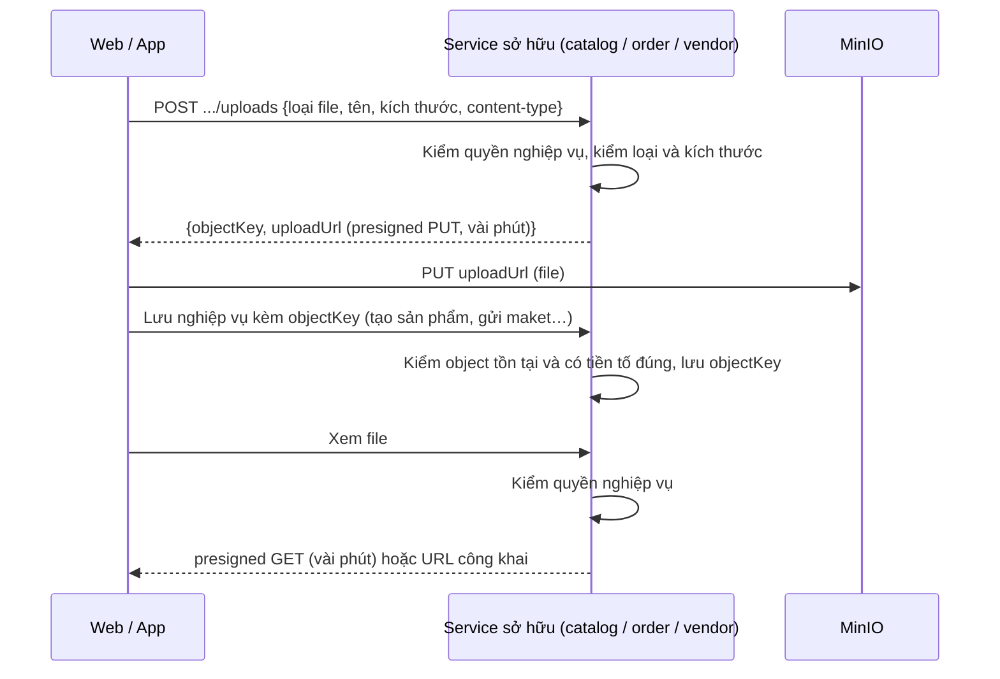

# Lưu trữ file: gộp file-service hay bỏ hẳn

Ngày lập: 2026-10-19. Trạng thái: **chờ quyết định**.

Câu hỏi: có nên gộp `file-service` vào `orchestrator-service` không?

## 1. Hiện trạng

**file-service** (`api/file-service`): 9 file Java, không có database.

| Endpoint | Việc làm |
| --- | --- |
| `POST /api/files?folder=…` (multipart) | Nhận file qua backend, ghi vào MinIO tên `<folder>/<accountId người upload>/<uuid>.<ext>`, trả URL |
| `DELETE /api/files?url=…` | Xóa nếu `accountId` trong đường dẫn là người gọi |
| `GET /api/files/presigned?url=…` | Cấp link tạm cho file riêng tư nếu người gọi là người upload hoặc ADMIN |

- Một bucket chung (`MINIO_BUCKET_NAME`, mặc định `ecommerce`), chia thư mục theo `FileFolder`: `products` (đọc công khai), `vendor-documents`, `mockups`, `progress`, `disputes` (riêng tư).
- **Kiểm quyền dựa trên người upload**, không dựa trên nghiệp vụ.

**Nơi đang giữ đường dẫn file:**

| Service | Trường | Ai cần xem |
| --- | --- | --- |
| catalog | `Product.imageUrls` | Mọi người (công khai) |
| order | `MockupVersion.fileUrl` | Người mua và người bán của đơn |
| order | `DisputeEvidence.fileUrl` | Hai bên của khiếu nại, quản trị |
| order | `Order.invoiceFileUrl` | Người mua, người bán |
| vendor | chưa có (giấy tờ người bán) | Chủ Shop, quản trị (Software Design: bucket riêng `vendor-docs`) |

- Không service backend nào gọi file-service; chỉ client gọi qua gateway. Web hiện chưa có màn upload; mobile không dùng.

**Thiết kế đã chốt** (Software Design, nguyên tắc chia service số 5): *"Không có file-service. Service sở hữu file tự cấp presigned URL MinIO."* Code hiện tại đang lệch thiết kế.

**Vấn đề của cách hiện tại:**
- Người bán upload maket thì người mua không mở được link riêng tư (chỉ người upload hoặc ADMIN). Tương tự với bằng chứng khiếu nại của bên kia.
- File đi qua backend (multipart): tốn băng thông và bộ nhớ của service.
- Ghi chú 261017 mục 13: file cũ nằm theo `userId` cũ nên chủ không xóa được; quyền gắn vào đường dẫn nên đổi định danh là hỏng.

## 2. Các phương án

### A. Gộp file-service vào orchestrator-service

Chuyển 3 endpoint và cấu hình MinIO sang orchestrator, bỏ container file-service.

- Được: bớt một container và một lần deploy.
- Mất:
  - Kiểm quyền vẫn theo người upload; muốn đúng nghiệp vụ thì orchestrator phải gọi ngược order/vendor để hỏi "ai được xem file này", tức là thành điểm phụ thuộc trung tâm.
  - Trộn hai kiểu tải: orchestrator xử lý sự kiện nhẹ, bất đồng bộ (email, audit, push WebSocket NFC); upload multipart thì nặng và đồng bộ. Vài upload lớn có thể làm chậm push và ghi audit.
  - Vẫn lệch Software Design nguyên tắc 5.

### B. Bỏ file-service, service sở hữu tự quản file (khuyến nghị)

Một **module dùng chung** (thư viện, không phải service) bọc MinIO; mỗi service sở hữu dữ liệu tự cấp presigned URL sau khi kiểm quyền theo nghiệp vụ. File đi thẳng giữa trình duyệt/app và MinIO.

- Được: đúng thiết kế; kiểm quyền đúng (order biết ai là hai bên của đơn); file không qua backend; bớt một container giống A.
- Mất: sửa nhiều service hơn; client đổi cách upload (2 bước); dọn dữ liệu MinIO dev.

### C. Giữ nguyên

- Được: không tốn công bây giờ.
- Mất: lỗi quyền xem maket/khiếu nại ở trên sẽ lộ ra khi làm FR maket, tiến độ, khiếu nại; càng để lâu càng nhiều chỗ gọi `/api/files`.

### So sánh

| Tiêu chí | A. Gộp | B. Bỏ (khuyến nghị) | C. Giữ |
| --- | --- | --- | --- |
| Số container | −1 | −1 | 0 |
| Đúng Software Design | Không | Có | Không |
| Quyền xem theo nghiệp vụ | Không (hoặc gọi ngược) | Có | Không |
| File đi qua backend | Có | Không | Có |
| Ảnh hưởng push/audit | Có | Không | Không |
| Công sức | Thấp | Trung bình | Không |

## 3. Kế hoạch cho phương án B

### Luồng mới

- Database lưu **objectKey**, không lưu URL đầy đủ, để đổi host MinIO/S3 không phải sửa dữ liệu.
- Tên object không chứa dữ liệu cá nhân hay accountId: `<service>/<loại>/<uuid>.<ext>` (Software Design mục bảo mật: tên object là UUID).
- Quyền không còn nằm trong đường dẫn; service sở hữu quyết định dựa trên bản ghi nghiệp vụ.

### Các bước

| # | Việc | Phạm vi |
| --- | --- | --- |
| B1 | Module `api/common-storage`: cấu hình MinIO (`minio.*` hiện ở file-service), `presignedPut(key, contentType, maxBytes)`, `presignedGet(key)`, `publicUrl(key)`, `exists(key)`, `delete(key)`, sinh key `<prefix>/<uuid>.<ext>`, danh sách content-type và kích thước cho phép (cấu hình, không hardcode) | Thư viện, có test |
| B2 | Bucket: giữ bucket chung với tiền tố theo service, hoặc tách bucket (`catalog-public`, `order-private`, `vendor-docs` như Software Design). Policy đọc công khai chỉ cho ảnh sản phẩm | Cần chốt (mục 4) |
| B3 | catalog: endpoint xin URL upload ảnh sản phẩm (chủ Shop của sản phẩm); `Product.imageUrls` → danh sách objectKey, trả URL công khai khi đọc | catalog |
| B4 | order: xin URL upload và xem cho maket, bằng chứng khiếu nại, hóa đơn; quyền = người mua hoặc người bán của đơn (khiếu nại thêm quản trị) | order |
| B5 | vendor: giấy tờ người bán khi làm FR đăng ký Shop; quyền = chủ Shop và quản trị; bucket `vendor-docs` | vendor (khi tới FR đó) |
| B6 | Web (và mobile nếu có) đổi sang upload 2 bước; hằng số endpoint mới | web |
| B7 | Gỡ file-service: module trong `api/pom.xml`, Dockerfile, docker-compose, route và Swagger gateway, `.env.example` (biến MinIO chuyển sang các service dùng) | Hạ tầng |
| B8 | Dữ liệu: bucket dev hiện tại chỉ có dữ liệu thử → xóa hoặc tạo mới; không viết migration (ghi chú 261017 mục 13) | Môi trường |
| B9 | Software Design: ghi luồng upload 2 bước, cách đặt tên object, danh sách bucket | Tài liệu |

Thứ tự đề xuất: B1 → B2 → B3 (catalog đang có dữ liệu ảnh thật sự dùng) → B6 cho ảnh sản phẩm → B7, B8 → B4, B5 khi làm tới các FR tương ứng (maket, khiếu nại, đăng ký Shop). B7 có thể làm ngay sau B3 vì không backend nào gọi file-service.

Ước lượng thô: B1–B3 khoảng 1,5–2 ngày; B6–B8 khoảng 1 ngày; B4, B5 tính vào các FR của order/vendor.

### Rủi ro

- **Upload bỏ dở:** client lấy URL, PUT xong nhưng không lưu nghiệp vụ → object mồ côi. Xử lý: lifecycle rule xóa object trong tiền tố `tmp/` sau 1 ngày, service chuyển sang tiền tố chính khi lưu; hoặc dọn định kỳ.
- **Giới hạn kích thước/loại file:** presigned PUT không tự chặn kích thước. Dùng presigned POST policy (có `content-length-range`) hoặc kiểm `statObject` khi lưu và xóa nếu vượt.
- **CORS của MinIO:** trình duyệt PUT thẳng lên MinIO cần cấu hình CORS cho origin web.
- **Host trong presigned URL:** URL phải ký theo host client truy cập được (hiện file-service đã có `publicMinioClient` cho việc này; giữ cách đó trong B1).

## 4. Cần chốt

1. Chọn phương án: A, B hay C. Đề xuất: **B**.
2. Nếu B: một bucket chia tiền tố, hay tách bucket theo mức bảo mật (Software Design nhắc riêng `vendor-docs`)? Đề xuất: tách 2 bucket `public` (ảnh sản phẩm) và `private` (còn lại), thêm `vendor-docs` khi làm B5.
3. Nếu B: làm ngay (B1–B3, B6–B8) hay đợi tới FR maket/khiếu nại? Đề xuất: làm B1–B3 và gỡ file-service ngay, vì càng có thêm màn upload dùng `/api/files` thì càng phải sửa nhiều.
