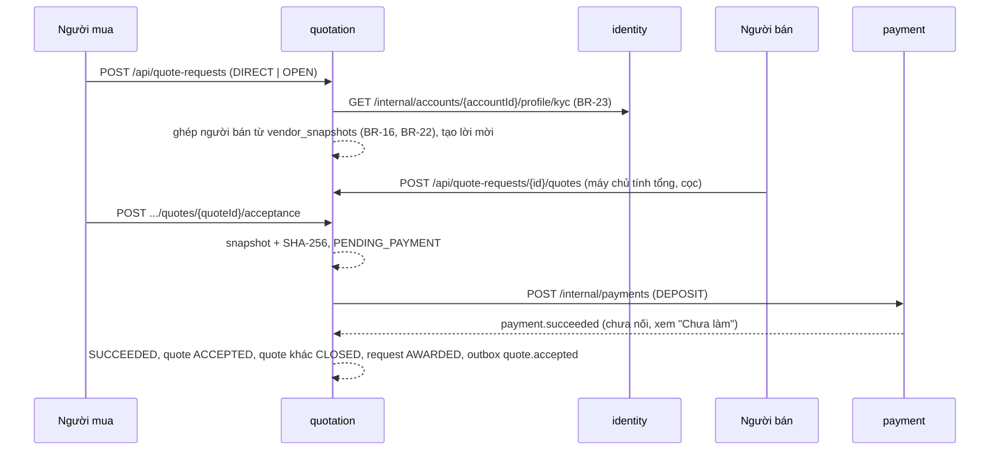

# quotation-service

> Yêu cầu báo giá, lời mời, báo giá và bản chép ràng buộc khi chấp nhận (FR-14 → FR-17, FR-19, FR-36, FR-38). Thiết kế: [api-db/quotation.md](../../architecture/api-db/quotation.md). Database: `quotation_db` (cổng 5443), migration ở `api/quotation-service/src/main/resources/db/migration`.

## Luồng chính

## API

Mọi API trả `ApiResponse<T>` (`status, code, message, data, timestamp`) như identity. Người gọi lấy từ header `X-Account-Id`, `X-User-Role` do gateway gắn. Một đường dẫn cho mọi vai (L-17): service tự xác định người gọi là người mua, chủ người bán được mời, hay quản trị.

| Method, đường dẫn | Ai | Việc |
| --- | --- | --- |
| `POST /api/quote-requests` | M (đã NFC) | Tạo yêu cầu `DIRECT` hoặc `OPEN` |
| `GET /api/quote-requests` | M, A | Yêu cầu của mình (A: tất cả), kèm số người bán được mời, số báo giá |
| `GET /api/quote-requests?vendorId=` | S | Yêu cầu gửi tới Shop mình |
| `GET /api/quote-requests/{requestId}` | M, S, A | Chi tiết; S kèm `suggestedUnitPrice` theo bậc giá tham khảo (AC-38.2) |
| `GET /api/quote-requests/{requestId}/invitations` | M, S, A | Lời mời (S chỉ thấy của mình) |
| `PATCH /api/quote-requests/{requestId}/invitations/{vendorId}` | S | `{status: DECLINED, declineReason}` |
| `GET /api/quote-requests/{requestId}/quotes` | M, S, A | Bảng so sánh: bản mới nhất của mỗi người bán; `acceptable` tắt nút chấp nhận khi hết hạn |
| `POST /api/quote-requests/{requestId}/quotes` | S | Gửi báo giá; `supersedesQuoteId` để gửi bản mới thay bản cũ |
| `GET /api/quote-requests/{requestId}/quotes/{quoteId}?includeRevisions=` | M, S, A | Chi tiết, kèm các bản trước |
| `PATCH /api/quote-requests/{requestId}/quotes/{quoteId}` | S | `{status: WITHDRAWN}` |
| `POST /api/quote-requests/{requestId}/quotes/{quoteId}/acceptance` | M | Chấp nhận, kèm `invoiceInfo` tùy chọn → `{acceptanceId, paymentUrl, paymentExpiresAt}` |
| `GET /api/quote-requests/{requestId}/quotes/{quoteId}/acceptance` | M, S, A | Bản chép ràng buộc (`snapshot`, `contentHash`) và trạng thái cọc |
| `GET /api/suppliers?provinceCode=&customType=&minQty=&q=` | K, M | Đơn vị nhận đặt hàng; `ordersOnly` cho nhãn "Chỉ nhận đặt hàng" |
| `GET /api/suppliers/{vendorId}` | K, M | Hồ sơ nhận đặt hàng, `isOwn` (BR-22) |

Khác với bảng thiết kế: báo giá gửi `validDays` (1–14, Q-19) thay cho `validUntil`, để máy chủ tự tính mốc và không lệch đồng hồ với client.

## Luật kiểm ở máy chủ

| Luật | Ở đâu |
| --- | --- |
| BR-23 đã xác minh NFC | Tạo yêu cầu, chấp nhận báo giá (gọi identity) |
| BR-22 không tự giao dịch | Yêu cầu trực tiếp, ghép yêu cầu mở, gửi báo giá, chấp nhận (lớp chặn cuối, AC-19.4) |
| BR-16 số lượng tối thiểu, custom, vùng giao | Yêu cầu trực tiếp (tối thiểu, custom); yêu cầu mở (cả ba) |
| BR-20, BR-31 người bán bị khóa hoặc chưa đóng phí | `vendor_snapshots.can_operate` |
| BR-05 báo giá không sửa | Chỉ `WITHDRAWN`; đổi giá là bản mới `revision_no + 1`; một báo giá SUBMITTED mỗi người bán mỗi yêu cầu (index) |
| BR-17 một báo giá thắng | Mọi thay đổi khóa dòng `quote_requests` (`SELECT … FOR UPDATE`); cọc thành công đóng các báo giá còn lại |
| L-10 bản chép ràng buộc | `snapshot` JSON chuẩn hóa (khóa sắp xếp) + SHA-256; trigger DB cấm sửa |

Class nặng: [QuoteRequestServiceImpl](classes/QuoteRequestServiceImpl.md), [QuoteServiceImpl](classes/QuoteServiceImpl.md), [QuoteAcceptanceServiceImpl](classes/QuoteAcceptanceServiceImpl.md).

## Dữ liệu người bán

quotation không gọi vendor-service: mọi thông tin người bán đọc từ `vendor_snapshots`, bản sao cập nhật từ sự kiện `vendor.updated`. Migration `V2026_10_26_0900` thêm `tax_code` vì bản chép ràng buộc phải ghi mã số thuế người bán. Trong lúc vendor-service chưa phát sự kiện, seed dev chép tay hai người bán mẫu (Trăng Vàng nhận đặt hàng từ 50 hộp, giao TP.HCM; Bánh Quê chờ duyệt).

## Chưa làm

- Consumer RabbitMQ: `vendor.updated`, `vendor.locked` → `vendor_snapshots`; `payment.succeeded`, `payment.failed` (`DEPOSIT`) → `QuoteAcceptanceService.recordDepositPaid / recordDepositFailed` (đã có, chỉ chưa nối).
- Outbox relay: sự kiện đã ghi vào `outbox_events` trong cùng transaction nhưng chưa có tác vụ đẩy lên `moonkage.events`.
- `POST /internal/payments`, `POST /internal/refunds` chưa có ở payment-service: chấp nhận báo giá trả 503 cho tới khi có.
- Tải logo (`POST /api/quote-requests/uploads`, bảng `request_logos`), xuất file (FR-18), đặt lại (FR-23), lịch công suất (FR-37).
- Gateway còn bắt đăng nhập cho `/api/suppliers`; thiết kế cho khách xem (K).
